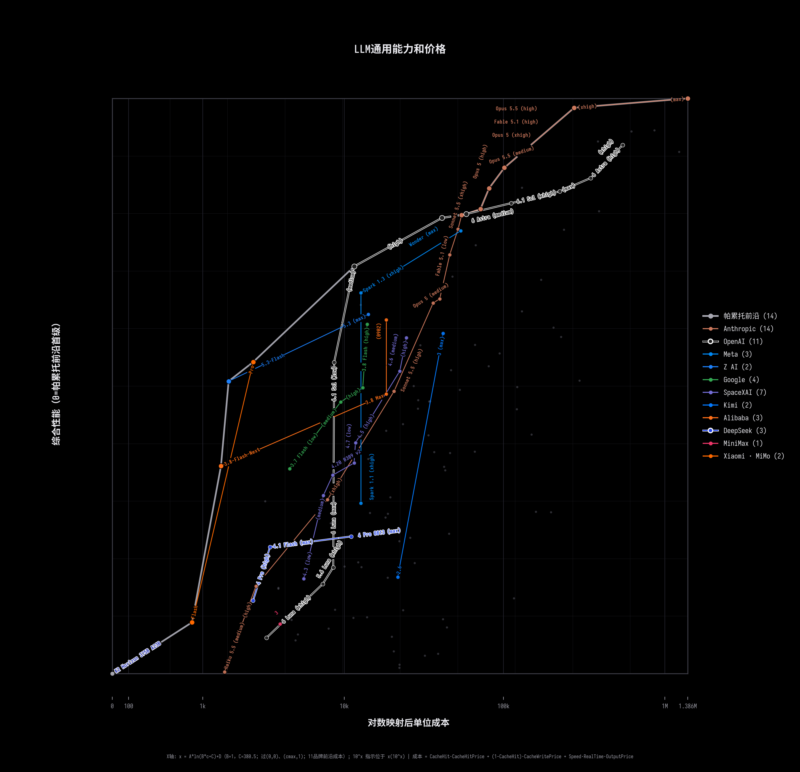

# LLM Leaderboard Pareto Analysis



## 全部模型（综合能力从高到低，最优 = 1，最差 = 0）

共收录 **Status: All**（含已弃用）的全部模型；按重新归一化后的综合能力排序。「帕累托」列：✅ = 总体帕累托前沿模型，❌ = 被支配，— = 无成本数据无法判定。图表纵轴以总体帕累托前沿第一级（y0 = 0.5887，即前沿左端点 K2 Horizon 375B A23B）为 0：综合能力 ≥ 该级且有成本数据的 67 个模型入图，192 个能力低于第一级、5 个缺少成本数据的模型不出现在图中，成本高于品牌前沿最大值的模型同样不入图（本表不受影响，仍完整列出全部模型）。

| # | 品牌 | 模型 | 综合能力 | 单请求成本 | 横轴位置 | 帕累托 |
|---|------|------|---------|-----------|-----------|------|
| 1 |  Anthropic | Claude Opus 5.5 (max with fallback) | 1.0000 | 1,076,798.85 | 1.0000 | ✅ |
| 2 |  Anthropic | Claude Opus 5.5 (xhigh with fallback) | 0.9886 | 206,590.69 | 0.7851 | ✅ |
| 3 |  Anthropic | Claude Fable 5.1 (max with fallback) | 0.9778 | 690,982.23 | 0.9422 | ❌ |
| 4 |  Anthropic | Claude Sonnet 5.5 (max with fallback) | 0.9767 | 529,336.23 | 0.9075 | ❌ |
| 5 |  Meta | Muse Wonder Full (max) | 0.9690 | — | — | — |
| 6 |  Anthropic | Claude Fable 5.1 (xhigh with fallback) | 0.9659 | 274,038.88 | 0.8219 | ❌ |
| 7 |  OpenAI | GPT-6 Astra (xhigh) | 0.9632 | 434,410.99 | 0.8818 | ❌ |
| 8 |  OpenAI | GPT-6 Astra (max) | 0.9615 | 922,415.35 | 0.9798 | ❌ |
| 9 |  Google | Gemini 4 Argon (high) | 0.9501 | 47,215.21 | 0.5939 | ✅ |
| 10 |  Anthropic | Claude Opus 5.5 (high with fallback) | 0.9465 | 66,611.14 | 0.6383 | ❌ |
| 11 |  OpenAI | GPT-6 Astra (high) | 0.9394 | 186,646.31 | 0.7719 | ❌ |
| 12 |  OpenAI | GPT-6.1 Sol (max) | 0.9335 | 140,008.20 | 0.7346 | ❌ |
| 13 |  Anthropic | Claude Fable 5.1 (high with fallback) | 0.9326 | 82,789.71 | 0.6664 | ❌ |
| 14 |  OpenAI | GPT-6.1 Sol (xhigh) | 0.9216 | 76,195.26 | 0.6557 | ❌ |
| 15 |  OpenAI | GPT-6 Astra (medium) | 0.9136 | 55,102.29 | 0.6138 | ❌ |
| 16 |  Anthropic | Claude Opus 5.5 (medium with fallback) | 0.9131 | 47,934.48 | 0.5958 | ❌ |
| 17 |  OpenAI | GPT-6.1 Sol (high) | 0.9113 | 26,551.15 | 0.5199 | ✅ |
| 18 |  Meta | Muse Wonder (max) | 0.9021 | 54,187.38 | 0.6116 | ❌ |
| 19 |  Anthropic | Claude Fable 5.1 (medium with fallback) | 0.8920 | 43,469.36 | 0.5832 | ❌ |
| 20 |  Anthropic | Claude Sonnet 5.5 (xhigh with fallback) | 0.8851 | 42,068.55 | 0.5790 | ❌ |
| 21 |  OpenAI | GPT-6.1 Sol (medium) | 0.8771 | 9,188.54 | 0.3861 | ✅ |
| 22 |  OpenAI | GPT-6 Astra (low) | 0.8688 | 47,718.43 | 0.5952 | ❌ |
| 23 |  Meta | Muse Spark 1.3 (xhigh) | 0.8592 | 12,758.19 | 0.4270 | ❌ |
| 24 |  Anthropic | Claude Fable 5.1 (low with fallback) | 0.8540 | 40,286.73 | 0.5734 | ❌ |
| 25 |  Meta | Muse Spark 1.3 (max) | 0.8536 | 12,758.19 | 0.4270 | ❌ |
| 26 |  Alibaba | Qwen3.8 Max (0902) | 0.8496 | 18,507.35 | 0.4739 | ❌ |
| 27 |  OpenAI | GPT-5.6 Terra (max) | 0.8429 | 222,896.23 | 0.7950 | ❌ |
| 28 |  Kimi | Kimi K3 (max) | 0.8394 | 42,054.19 | 0.5789 | ❌ |
| 29 |  Google | Gemini 3.8 Flash (high) | 0.8394 | 15,956.29 | 0.4551 | ❌ |
| 30 |  Z AI | GLM-5.3 (max) | 0.8361 | 14,256.22 | 0.4409 | ❌ |
| 31 |  StepFun | Step 5 Preview | 0.8170 | 8,268.06 | 0.3731 | ✅ |
| 32 |  OpenAI | GPT-6.1 Sol (low) | 0.8091 | 8,588.37 | 0.3778 | ❌ |
| 33 |  SpaceXAI | Grok 4.7 (xhigh) | 0.8075 | 32,525.73 | 0.5459 | ❌ |
| 34 |  SpaceXAI | Grok 4.7 (high) | 0.8063 | 22,210.92 | 0.4971 | ❌ |
| 35 |  Xiaomi | MiMo-V2.6-Pro | 0.7981 | 2,459.33 | 0.2316 | ✅ |
| 36 |  Google | Gemini 3.8 Flash (medium) | 0.7935 | — | — | — |
| 37 |  Anthropic | Claude Sonnet 5.5 (high with fallback) | 0.7887 | 18,370.54 | 0.4730 | ❌ |
| 38 |  Anthropic | Claude Opus 5.5 (low with fallback) | 0.7817 | 22,478.80 | 0.4986 | ❌ |
| 39 |  OpenAI | GPT-5.3 Codex (xhigh) | 0.7803 | 90,894.72 | 0.6785 | ❌ |
| 40 |  DeepSeek | DeepSeek V4.1 Flash 1017 (max) | 0.7757 | 3,229.23 | 0.2617 | ❌ |
| 41 |  Z AI | GLM-5.3-Flash | 0.7729 | 1,619.08 | 0.1881 | ✅ |
| 42 |  Anthropic | Claude Haiku 5.5 (max) | 0.7707 | 30,423.31 | 0.5373 | ❌ |
| 43 |  Alibaba | Qwen3.8 2.4T A95B | 0.7621 | 18,507.35 | 0.4739 | ❌ |
| 44 |  Meta | Muse Spark Open (xhigh) | 0.7574 | 12,758.19 | 0.4270 | ❌ |
| 45 |  OpenAI | GPT-5.6 Terra (xhigh) | 0.7486 | 29,123.49 | 0.5317 | ❌ |
| 46 |  Google | Gemini 3.1 Pro Preview | 0.7431 | 40,743.16 | 0.5749 | ❌ |
| 47 |  SpaceXAI | Grok 4.7 (low) | 0.7381 | 12,077.43 | 0.4201 | ❌ |
| 48 |  Alibaba | Qwen3.8-Flash-Next | 0.7366 | 1,412.13 | 0.1747 | ✅ |
| 49 |  MiniMax | MiniMax-M3.1-Flash | 0.7286 | 1,727.71 | 0.1946 | ❌ |
| 50 |  Anthropic | Claude Haiku 5.5 (xhigh) | 0.7126 | 5,954.97 | 0.3332 | ❌ |
| 51 |  InclusionAI | Ling 3.1 Flash | 0.7111 | 2,988.15 | 0.2530 | ❌ |
| 52 |  Sapiens AI | Agnes 2.5 Pro Beta | 0.7074 | 901.81 | 0.1343 | ✅ |
| 53 |  OpenAI | GPT-5.6 Terra (high) | 0.7017 | 12,636.66 | 0.4258 | ❌ |
| 54 |  Anthropic | Claude Sonnet 5.5 (medium with fallback) | 0.6956 | 8,755.46 | 0.3802 | ❌ |
| 55 |  Google | Gemini 3.8 Flash (low) | 0.6936 | — | — | — |
| 56 |  DeepSeek | DeepSeek V4 Pro 0813 (max) | 0.6864 | 11,074.50 | 0.4093 | ❌ |
| 57 |  OpenAI | GPT-6 Luna (max) | 0.6770 | 6,368.34 | 0.3413 | ❌ |
| 58 |  Motif Technologies | Motif 3 | 0.6621 | — | — | — |
| 59 |  Alibaba | Qwen3.8 27B (xhigh) | 0.6606 | 8,730.25 | 0.3798 | ❌ |
| 60 |  Anthropic | Claude Haiku 5.5 (high) | 0.6511 | 2,258.59 | 0.2224 | ❌ |
| 61 |  DeepSeek | DeepSeek V4 Flash Vision (max) | 0.6501 | 3,685.22 | 0.2768 | ❌ |
| 62 |  Mistral | Mistral Large 4 Preview | 0.6501 | 12,552.27 | 0.4250 | ❌ |
| 63 |  Kimi | Kimi K3 (low) | 0.6279 | 42,054.19 | 0.5789 | ❌ |
| 64 |  OpenAI | GPT-5.6 Terra (medium) | 0.6276 | 11,270.55 | 0.4115 | ❌ |
| 65 |  China Mobile | JT-4.1 Flash 236B A21B | 0.6276 | — | — | — |
| 66 |  Xiaomi | MiMo-V2.6-Flash | 0.6259 | 806.98 | 0.1251 | ✅ |
| 67 |  MiniMax | MiniMax-M3 | 0.6252 | 3,781.32 | 0.2797 | ❌ |
| 68 |  Anthropic | Claude Sonnet 5.5 (low with fallback) | 0.6213 | 8,570.11 | 0.3775 | ❌ |
| 69 |  Alibaba | Qwen3.7 Plus | 0.6210 | 4,984.20 | 0.3120 | ❌ |
| 70 |  OpenAI | GPT-6 Luna (xhigh) | 0.6148 | 1,866.95 | 0.2025 | ❌ |
| 71 |  Anthropic | Claude Haiku 5.5 (medium) | 0.5908 | 1,143.35 | 0.1550 | ❌ |
| 72 |  Institute of Foundation Models | K2 Horizon 375B A23B | 0.5887 | 0.00 | 0.0000 | ✅ |
| 73 |  Z AI | GLM-5.3 (low) | 0.5882 | 14,256.22 | 0.4409 | ❌ |
| 74 |  Kimi | Kimi K2.7 Code | 0.5876 | 13,253.48 | 0.4318 | ❌ |
| 75 |  Nex AGI | Nex-N2-Pro | 0.5834 | — | — | — |
| 76 |  OpenAI | GPT-6 Luna (high) | 0.5815 | 1,087.56 | 0.1505 | ❌ |
| 77 |  OpenAI | o3 | 0.5725 | 17,868.84 | 0.4695 | ❌ |
| 78 |  OpenAI | GPT-5.6 Terra (low) | 0.5677 | 11,193.09 | 0.4106 | ❌ |
| 79 |  InclusionAI | Ling-3.0-flash-VL | 0.5622 | — | — | — |
| 80 |  Apodex | Apodex 1.1 | 0.5605 | — | — | — |
| 81 |  Thinking Machines | Inkling (xhigh) | 0.5493 | 12,302.77 | 0.4224 | ❌ |
| 82 |  Reflection | Beam 1.0 | 0.5474 | 6,736.74 | 0.3481 | ❌ |
| 83 |  Upstage | Solar Open2 250B | 0.5455 | — | — | — |
| 84 |  OpenAI | GPT-6 Luna (medium) | 0.5435 | — | — | — |
| 85 |  Thinking Machines | Inkling Small | 0.5424 | 3,738.15 | 0.2784 | ❌ |
| 86 |  Multiverse Computing | Quasar 438B (max) | 0.5408 | 4,845.38 | 0.3086 | ❌ |
| 87 |  China Mobile | JT-4.1 Flash 236B A21B (non-reasoning) | 0.5372 | — | — | — |
| 88 |  Upstage | Solar Pro 4 | 0.5361 | 3,738.15 | 0.2784 | ❌ |
| 89 |  Alibaba | Qwen3.8 27B (medium) | 0.5287 | 8,730.25 | 0.3798 | ❌ |
| 90 |  Alibaba | Qwen3.5 Omni Plus | 0.5286 | 3,620.09 | 0.2747 | ❌ |
| 91 |  Anthropic | Claude Haiku 5.5 (low) | 0.5275 | 1,024.80 | 0.1452 | ❌ |
| 92 |  NVIDIA | Nemotron 3 Ultra | 0.5273 | 9,345.78 | 0.3882 | ❌ |
| 93 |  Alibaba | Qwen3.5 397B A17B | 0.5220 | 13,614.98 | 0.4352 | ❌ |
| 94 |  KwaiKAT | KAT-Coder-Pro V2 | 0.5142 | — | — | — |
| 95 |  Alibaba | Qwen3.8 27B (low) | 0.5125 | 8,730.25 | 0.3798 | ❌ |
| 96 |  Tencent | Hy3 | 0.5080 | 1,786.21 | 0.1980 | ❌ |
| 97 |  Google | Gemini 3.5 Flash-Lite | 0.5062 | 9,323.68 | 0.3879 | ❌ |
| 98 |  Institute of Foundation Models | K2 Horizon MoVA 36B A4B | 0.4973 | — | — | — |
| 99 |  NVIDIA | Nemotron 3.5 Super VL | 0.4943 | 2,038.23 | 0.2116 | ❌ |
| 100 |  Alibaba | Qwen3.6 35B A3B | 0.4872 | 13,479.61 | 0.4339 | ❌ |
| 101 |  Alibaba | Qwen3.5 397B A17B (non-reasoning) | 0.4860 | 2,602.59 | 0.2378 | ❌ |
| 102 |  AI9Stars | G9v3-39A5B | 0.4843 | — | — | — |
| 103 |  Alibaba | Qwen3.5 122B A10B | 0.4787 | 8,230.25 | 0.3726 | ❌ |
| 104 |  InclusionAI | Ling-3.0-flash-Fin | 0.4690 | 734.54 | 0.1177 | ❌ |
| 105 |  China Mobile | JT-35B-Flash | 0.4681 | — | — | — |
| 106 |  SK Telecom | A.X-K2 | 0.4638 | — | — | — |
| 107 |  LG AI Research | K-EXAONE 2.0 | 0.4574 | — | — | — |
| 108 |  Google | Gemma 4 31B | 0.4556 | 0.00 | 0.0000 | ❌ |
| 109 |  Alibaba | Qwen3.8 27B (non-reasoning) | 0.4535 | 3,283.48 | 0.2636 | ❌ |
| 110 |  ByteDance Seed | Doubao Seed Code | 0.4504 | — | — | — |
| 111 |  Upstage | Solar Mini 4 | 0.4473 | 1,151.81 | 0.1556 | ❌ |
| 112 |  OpenAI | GPT-6 Luna (low) | 0.4443 | 521.56 | 0.0930 | ❌ |
| 113 |  Meta | Muse Glimmer (high) | 0.4374 | 3,549.66 | 0.2725 | ❌ |
| 114 |  OpenAI | GPT-5.5 Instant (June 2026) | 0.4279 | 82,590.32 | 0.6661 | ❌ |
| 115 |  Mistral | Mistral Medium 3.5 | 0.4268 | 21,027.10 | 0.4901 | ❌ |
| 116 |  InclusionAI | Ring-2.6-1T | 0.4248 | 6,422.69 | 0.3423 | ❌ |
| 117 |  Amazon | Nova 2.0 Pro Preview (medium) | 0.4202 | 28,659.94 | 0.5297 | ❌ |
| 118 |  Cohere | Command A+ | 0.4129 | 0.00 | 0.0000 | ❌ |
| 119 |  Alibaba | Qwen3.5 122B A10B (non-reasoning) | 0.4121 | 2,891.64 | 0.2494 | ❌ |
| 120 |  OpenAI | GPT-5.6 Terra (non-reasoning) | 0.4108 | 10,346.36 | 0.4008 | ❌ |
| 121 |  Institute of Foundation Models | K2 Horizon 7B | 0.4093 | — | — | — |
| 122 |  Amazon | Nova 2.0 Lite (medium) | 0.4034 | 6,422.69 | 0.3423 | ❌ |
| 123 |  Baidu | ERNIE 5.0 Thinking Preview | 0.3952 | — | — | — |
| 124 |  LongCat | LongCat 2.0 | 0.3943 | 7,948.09 | 0.3683 | ❌ |
| 125 |  Google | Gemma 4 26B A4B | 0.3930 | 1,453.78 | 0.1775 | ❌ |
| 126 |  Amazon | Nova 2.0 Pro Preview (low) | 0.3926 | 25,719.53 | 0.5158 | ❌ |
| 127 |  NVIDIA | Nemotron 3.5 Bolt 74B-A9B | 0.3865 | — | — | — |
| 128 |  Amazon | Nova 2.0 Omni (low) | 0.3864 | — | — | — |
| 129 |  Amazon | Nova 2.0 Omni (medium) | 0.3781 | — | — | — |
| 130 |  Alibaba | Qwen3.6 35B A3B (non-reasoning) | 0.3752 | 2,034.51 | 0.2114 | ❌ |
| 131 |  LG AI Research | EXAONE 4.5 33B | 0.3716 | — | — | — |
| 132 |  Alibaba | Qwen3.5 4B | 0.3709 | 392.27 | 0.0754 | ❌ |
| 133 |  Google | Gemma 4 12B | 0.3660 | 807.56 | 0.1252 | ❌ |
| 134 |  Amazon | Nova 2.0 Lite (high) | 0.3650 | 6,422.69 | 0.3423 | ❌ |
| 135 |  Alibaba | Qwen3.5 9B | 0.3622 | 577.71 | 0.1000 | ❌ |
| 136 |  Google | Gemma 4 31B (non-reasoning) | 0.3498 | 1,649.55 | 0.1899 | ❌ |
| 137 |  Amazon | Nova 2.0 Lite (low) | 0.3455 | 6,422.69 | 0.3423 | ❌ |
| 138 |  Alibaba | Qwen3.5 9B (non-reasoning) | 0.3350 | 241.86 | 0.0514 | ❌ |
| 139 |  Alibaba | Qwen3.5 Omni Flash | 0.3330 | 819.30 | 0.1264 | ❌ |
| 140 |  Deep Cogito | Cogito v2.1 | 0.3317 | — | — | — |
| 141 |  OpenAI | GPT-6 Luna (non-reasoning) | 0.3313 | 467.29 | 0.0859 | ❌ |
| 142 |  ServiceNow | Apriel-v1.6-15B-Thinker | 0.3274 | — | — | — |
| 143 |  Google | Gemma 4 26B A4B (non-reasoning) | 0.3265 | 976.71 | 0.1410 | ❌ |
| 144 |  NVIDIA | Nemotron Cascade 2 30B A3B | 0.3219 | — | — | — |
| 145 |  DeepSeek | DeepSeek V4 Pro 0813 (non-reasoning) | 0.3178 | 3,821.23 | 0.2809 | ❌ |
| 146 |  Institute of Foundation Models | K2 Horizon 3.7B | 0.3104 | — | — | — |
| 147 |  Arcee AI | Trinity Large Thinking | 0.3102 | 2,709.37 | 0.2422 | ❌ |
| 148 |  Mistral | Magistral Medium 1.2 | 0.3085 | — | — | — |
| 149 |  OpenBMB | MiniCPM5-2B | 0.3035 | — | — | — |
| 150 |  IBM | Granite 4.2 30B | 0.3029 | 2,094.08 | 0.2144 | ❌ |
| 151 |  InclusionAI | Ling 3.0 Tiny | 0.2986 | 0.00 | 0.0000 | ❌ |
| 152 |  NVIDIA | Nemotron 3.5 Lightning | 0.2985 | 911.51 | 0.1352 | ❌ |
| 153 |  OpenAI | gpt-oss-120b (high) | 0.2975 | 2,454.77 | 0.2314 | ❌ |
| 154 |  AI9Stars | G9v3-3B | 0.2890 | — | — | — |
| 155 |  Google | Gemma 4 12B (non-reasoning) | 0.2819 | 288.00 | 0.0592 | ❌ |
| 156 |  Cohere | North Mini Code | 0.2806 | 0.00 | 0.0000 | ❌ |
| 157 |  Mistral | Mistral Small 4 | 0.2795 | 1,727.71 | 0.1946 | ❌ |
| 158 |  Institute of Foundation Models | K2 Think V2 | 0.2772 | — | — | — |
| 159 |  OpenBMB | MiniCPM5-1B | 0.2767 | — | — | — |
| 160 |  OpenBMB | MiniCPM5-1B (non-reasoning) | 0.2764 | — | — | — |
| 161 |  Upstage | Solar Open 100B | 0.2728 | — | — | — |
| 162 |  Multiverse Computing | HyperNova 60B 2605 (high) | 0.2675 | — | — | — |
| 163 |  China Mobile | JT-MINI | 0.2654 | — | — | — |
| 164 |  Alibaba | Qwen3.5 4B (non-reasoning) | 0.2624 | 93.65 | 0.0224 | ❌ |
| 165 |  Naver | HyperCLOVA X SEED Think (32B) | 0.2623 | — | — | — |
| 166 |  Alibaba | Qwen3 Next 80B A3B | 0.2608 | 3,086.34 | 0.2566 | ❌ |
| 167 |  Institute of Foundation Models | K2-V2 (high) | 0.2602 | — | — | — |
| 168 |  Amazon | Nova 2.0 Pro Preview (non-reasoning) | 0.2591 | 6,930.33 | 0.3515 | ❌ |
| 169 |  Alibaba | Qwen3 Coder Next | 0.2567 | 3,452.50 | 0.2693 | ❌ |
| 170 |  Korea Telecom | Mi:dm K 2.5 Pro | 0.2565 | — | — | — |
| 171 |  IBM | Granite 4.2 8B | 0.2504 | 800.90 | 0.1245 | ❌ |
| 172 |  Prime Intellect | INTELLECT-3 | 0.2500 | — | — | — |
| 173 |  Google | DiffusionGemma 26B A4B | 0.2493 | — | — | — |
| 174 |  LongCat | LongCat Flash Lite | 0.2474 | — | — | — |
| 175 |  OpenAI | gpt-oss-20b (low) | 0.2463 | 665.29 | 0.1102 | ❌ |
| 176 |  Meta | Llama 3.1 405B | 0.2450 | — | — | — |
| 177 |  Amazon | Nova Premier | 0.2441 | — | — | — |
| 178 |  Google | Gemma 4 E4B (non-reasoning) | 0.2430 | 64.67 | 0.0158 | ❌ |
| 179 |  Trillion Labs | Tri-21B-Think | 0.2425 | — | — | — |
| 180 |  NVIDIA | Nemotron 3 Nano | 0.2404 | 1,000.00 | 0.1431 | ❌ |
| 181 |  Inception | Mercury 2.5 | 0.2358 | 2,562.82 | 0.2361 | ❌ |
| 182 |  Amazon | Nova 2.0 Lite (non-reasoning) | 0.2355 | 1,920.41 | 0.2054 | ❌ |
| 183 |  Alibaba | Qwen3 Next 80B A3B | 0.2351 | 1,900.79 | 0.2043 | ❌ |
| 184 |  Nous Research | Hermes 4 405B | 0.2332 | 8,075.63 | 0.3702 | ❌ |
| 185 |  NVIDIA | Nemotron 3 Nano Omni 30B A3B | 0.2330 | 3,365.13 | 0.2664 | ❌ |
| 186 |  Institute of Foundation Models | K2-V2 (medium) | 0.2304 | — | — | — |
| 187 |  Google | Gemma 4 E4B | 0.2290 | 261.51 | 0.0548 | ❌ |
| 188 |  Motif Technologies | Motif-2-12.7B | 0.2289 | — | — | — |
| 189 |  StepFun | Step3 VL 10B | 0.2239 | — | — | — |
| 190 |  OpenAI | gpt-oss-20b (high) | 0.2212 | 570.60 | 0.0991 | ❌ |
| 191 |  Baidu | ERNIE 4.5 300B A47B | 0.2187 | — | — | — |
| 192 |  Meta | Llama 4 Maverick | 0.2180 | 2,723.01 | 0.2427 | ❌ |
| 193 |  OpenAI | gpt-oss-120b (low) | 0.2160 | 2,475.00 | 0.2323 | ❌ |
| 194 |  Amazon | Nova 2.0 Omni (non-reasoning) | 0.2145 | — | — | — |
| 195 |  Mistral | Mistral Small 4 (non-reasoning) | 0.2141 | 611.54 | 0.1040 | ❌ |
| 196 |  Nous Research | Hermes 4 405B (non-reasoning) | 0.2129 | 2,363.99 | 0.2273 | ❌ |
| 197 |  Liquid AI | LFM2.5-8B-A1B | 0.2090 | — | — | — |
| 198 |  Alibaba | Qwen3 Omni 30B A3B | 0.2058 | 2,568.91 | 0.2363 | ❌ |
| 199 |  IBM | Granite 4.2 3B | 0.2001 | 387.95 | 0.0748 | ❌ |
| 200 |  NVIDIA | NVIDIA Nemotron Nano 12B v2 VL | 0.1998 | — | — | — |
| 201 |  TII UAE | Falcon-H1R-7B | 0.1975 | — | — | — |
| 202 |  NVIDIA | Llama Nemotron Ultra | 0.1964 | — | — | — |
| 203 |  Google | Gemma 4 E2B | 0.1870 | — | — | — |
| 204 |  Allen Institute for AI | Olmo 3.1 32B Think | 0.1862 | — | — | — |
| 205 |  Sarvam | Sarvam 105B (high) | 0.1853 | 694.21 | 0.1134 | ❌ |
| 206 |  LG AI Research | EXAONE 4.0 32B | 0.1846 | — | — | — |
| 207 |  Institute of Foundation Models | K2-V2 (low) | 0.1828 | — | — | — |
| 208 |  NVIDIA | NVIDIA Nemotron Nano 9B V2 | 0.1819 | 423.03 | 0.0798 | ❌ |
| 209 |  Liquid AI | LFM2.5-2.6B | 0.1814 | — | — | — |
| 210 |  InclusionAI | Ring-flash-2.0 | 0.1802 | — | — | — |
| 211 |  Nous Research | Hermes 4 70B | 0.1760 | — | — | — |
| 212 |  Nanbeige | Nanbeige4.1-3B | 0.1690 | — | — | — |
| 213 |  Mistral | Magistral Small 1.2 | 0.1675 | 4,037.81 | 0.2873 | ❌ |
| 214 |  Alibaba | Qwen3.5 2B | 0.1673 | — | — | — |
| 215 |  Cohere | Command A | 0.1613 | 7,477.65 | 0.3608 | ❌ |
| 216 |  NVIDIA | NVIDIA Nemotron Nano 9B V2 (non-reasoning) | 0.1495 | 162.43 | 0.0366 | ❌ |
| 217 |  Google | Gemma 4 E2B (non-reasoning) | 0.1474 | — | — | — |
| 218 |  Meta | Llama 4 Scout | 0.1461 | 503.98 | 0.0908 | ❌ |
| 219 |  Allen Institute for AI | Olmo 3.1 32B Instruct | 0.1419 | — | — | — |
| 220 |  Alibaba | Qwen3 Omni 30B A3B | 0.1404 | 800.33 | 0.1245 | ❌ |
| 221 |  Mistral | Ministral 3 14B | 0.1396 | 417.88 | 0.0791 | ❌ |
| 222 |  Kimi | Kimi Linear 48B A3B Instruct | 0.1330 | — | — | — |
| 223 |  Alibaba | Qwen3.5 2B (non-reasoning) | 0.1309 | — | — | — |
| 224 |  Nous Research | Hermes 4 70B (non-reasoning) | 0.1275 | — | — | — |
| 225 |  AI21 Labs | Jamba Reasoning 3B | 0.1273 | — | — | — |
| 226 |  NVIDIA | Nemotron 3 Nano 4B | 0.1254 | — | — | — |
| 227 |  LG AI Research | EXAONE 4.0 32B (non-reasoning) | 0.1254 | — | — | — |
| 228 |  Meta | Llama 3.3 70B | 0.1237 | 7,576.40 | 0.3624 | ❌ |
| 229 |  Amazon | Nova Micro | 0.1219 | 207.73 | 0.0452 | ❌ |
| 230 |  Liquid AI | LFM2 24B A2B | 0.1217 | — | — | — |
| 231 |  AI21 Labs | Jamba 1.7 Large | 0.1205 | — | — | — |
| 232 |  Sarvam | Sarvam 30B (high) | 0.1189 | — | — | — |
| 233 |  NVIDIA | NVIDIA Nemotron Nano 12B v2 VL (non-reasoning) | 0.1167 | 554.62 | 0.0972 | ❌ |
| 234 |  Celeris | Celeris-1 | 0.1103 | 1,032.83 | 0.1459 | ❌ |
| 235 |  NVIDIA | Nemotron 3 Nano (non-reasoning) | 0.1102 | 629.34 | 0.1061 | ❌ |
| 236 |  Mistral | Ministral 3 8B | 0.1081 | 313.23 | 0.0633 | ❌ |
| 237 |  IBM | Granite 4.0 H Small | 0.1062 | — | — | — |
| 238 |  OpenBMB | MiniCPM-V 4.6 1.3B | 0.1036 | — | — | — |
| 239 |  Microsoft | Phi-4 | 0.0954 | 376.49 | 0.0731 | ❌ |
| 240 |  Google | Gemma 3 270M | 0.0912 | — | — | — |
| 241 |  Meta | Llama 3.2 11B (Vision) | 0.0858 | 379.10 | 0.0735 | ❌ |
| 242 |  Allen Institute for AI | Olmo 3 7B Think | 0.0828 | — | — | — |
| 243 |  Mistral | Ministral 3 3B | 0.0776 | 214.11 | 0.0464 | ❌ |
| 244 |  Liquid AI | LFM2.5-1.2B-Instruct | 0.0757 | — | — | — |
| 245 |  Reka AI | Reka Flash 3 | 0.0754 | 2,115.13 | 0.2155 | ❌ |
| 246 |  Alibaba | Qwen3.5 0.8B | 0.0723 | — | — | — |
| 247 |  Allen Institute for AI | Molmo2-8B | 0.0704 | — | — | — |
| 248 |  AI21 Labs | Jamba 1.7 Mini | 0.0687 | — | — | — |
| 249 |  Liquid AI | LFM2.5-1.2B-Thinking | 0.0673 | — | — | — |
| 250 |  Swiss AI Initiative | Apertus 70B Instruct | 0.0599 | — | — | — |
| 251 |  Allen Institute for AI | Olmo 3 7B | 0.0588 | — | — | — |
| 252 |  LG AI Research | Exaone 4.0 1.2B | 0.0579 | — | — | — |
| 253 |  IBM | Granite 4.0 H 1B | 0.0569 | — | — | — |
| 254 |  Microsoft | Phi-4 Mini | 0.0554 | 204.02 | 0.0446 | ❌ |
| 255 |  Alibaba | Qwen3.5 0.8B (non-reasoning) | 0.0514 | — | — | — |
| 256 |  LG AI Research | Exaone 4.0 1.2B (non-reasoning) | 0.0506 | — | — | — |
| 257 |  IBM | Granite 4.0 Micro | 0.0459 | — | — | — |
| 258 |  Liquid AI | LFM2.5-VL-1.6B | 0.0346 | — | — | — |
| 259 |  IBM | Granite 4.0 350M | 0.0325 | — | — | — |
| 260 |  Swiss AI Initiative | Apertus 8B Instruct | 0.0201 | 250.39 | 0.0529 | ❌ |
| 261 |  IBM | Granite 4.0 H 350M | 0.0157 | — | — | — |
| 262 |  Allen Institute for AI | Molmo 7B-D | 0.0119 | — | — | — |
| 263 |  Institute of Foundation Models | K2 Horizon 0.9B | 0.0060 | — | — | — |
| 264 |  Cohere | Tiny Aya Global | 0.0000 | — | — | — |

## 品牌帕累托前沿连线（仅体现在图中）

以下十一个品牌在图中拥有单独的帕累托连线（较窄宽度，品牌主题色，图层高于总体灰色连线）。表中数量为**入图顶点数**——品牌前沿上低于总体前沿第一级的顶点同样不入图（本表与图例一致）：

| 品牌 | 主题色 | 品牌前沿模型数（入图） |
|------|--------|--------------|
|  Anthropic | `#cc785c` | 11 |
|  OpenAI | `#1f1f1f` | 10 |
|  Meta | `#0089f4` | 3 |
|  Z AI | `#1c7ff8` | 2 |
|  Google | `#34A853` | 2 |
|  SpaceXAI | `#736cd3` | 3 |
|  Kimi | `#047AFE` | 2 |
|  Alibaba | `#ff7018` | 2 |
|  DeepSeek | `#2243e6` | 1 |
|  MiniMax | `#EB3568` | 1 |
|  Xiaomi | `#ff6900` | 2 |

## 评分方法

1. **20项评估指标**各自线性归一化到 [0,1]
   （AA Intelligence Index、GPQA Diamond、Humanity's Last Exam、MMMU Pro、IFBench Instruction Following、SciCode Coding、CritPt Physics、AA-LCR Long Context、AA Omniscience Index、AA-Omniscience Accuracy、AA-Omniscience Non-Hallucination、GDPval-AA Normalized、AA Analyst Agent、APEX-Agents-AA、ITBench-SRE、τ²-Bench Telecom、τ³-Bench Banking、Terminal-Bench Hard、Terminal-Bench 2.1、Terminal-Bench 4.0）
   > V18（2026-09-12）：AA 更新了基准列——新增 AA Analyst Agent、τ³-Bench Banking、Terminal-Bench 2.1 / 4.0 四项；AA Agentic Index 与 AA Coding Index 已从 AA 的数据源中移除，相应剔除。指标数由 18 → 20。
2. **综合能力值** = 所有有效归一化分数的算术平均
3. **综合能力再归一化**：线性映射到 [0,1]，性能最好的模型 = 1，最差的模型 = 0
4. **Pareto前沿** = 不被任何其他模型支配的模型（综合能力 ≥ 且成本 ≤，且至少一项严格更优；成本为 0 的免费模型同样参与——横轴左端恒为 0，免费模型是合法前沿候选）
5. **模型范围** = Status: All（含已弃用模型；缺少足够评估数据者不参与排名）
6. **图表纵轴基线（V17）**：图表的 y = 0 取总体帕累托前沿的第一级（最低能力；本例 y0 = 0.5887，即前沿左端点 K2 Horizon 375B A23B）；综合能力低于该级的模型不出现在图表中（表格不受影响）。图中纵坐标 chart_y = (能力 - y0)/(1 - y0)，因此前沿左端点恰好落在 (0, 0)、最优模型恰好为 y = 1。该过滤在横轴映射构建之前完成


## 横轴映射（对数映射，真零点，V21）与分布分析

横轴（单请求成本）为 **Y = A·ln(B·c+C)+D 对数映射**（B = 1；A、D 由端点解出；C = 500.42，r = B/C = 0.00199831 经网格搜索确定）：

```
x = 0                            当 c = 0（免费模型，真零点）
x = A·ln(c+C)+D                  当 c > 0（B = 1 并入；A、D 由端点解出）
```

其中 C = 500.42（r = B/C = 0.00199831），拟合集为 11 品牌前沿入图正成本模型（综合能力 ≥ 前沿第一级）的成本分布，目标为组内名次分位数（最小二乘误差 mse = 0.011560，最大偏离 0.2127）。该映射在 **y 基线过滤之后**构建（V17：先以帕累托前沿第一级为 y = 0、剔除低性能模型，再对入图模型建映射）。

**该映射保证：**

- **函数端点严格钉死**：c = 0 → x = 0；最大成本 → x = 1——函数经过 (0,0) 与 (1,1)；
- 各数量级区间的入图模型数：1–10: 0，10–100: 0，100–1k: 2，1k–10k: 20，10k–100k: 34，100k–1M: 9，1M–1.077M: 1
- **同倍率区间宽度相近**（对数轴性质）：1k→10k 与 100k→1M 同为 10 倍率，宽度相近（前者 20 个模型、后者 9 个）；与 V17 分位数映射不同，本图不追求均匀密度——密度不等如实显示；
- **左端恒为 0**（c = 0；1 个免费模型位于最左缘）
- 前沿最低正成本 806.98 → x = 0.1251（真实对数位置，不再钉 0；x = 0 恒为 c = 0 免费模型）；前沿最大成本 1,076,799 → x = 1.0000（= 1；高于前沿最大成本的模型不入图，仅表格保留）
- 中位数位置 0.473（≈ 0.5 居中）；左右两半模型数：左 38 / 右 29
- 横轴十分位模型数：1，6，7，9，15，13，6，4，2，4（对数映射下各十分位模型数自然不等）
- **10^x 数量级指示**（位置 = x(10^x)）：10^0 → 0.000，10^1 → 0.003，10^2 → 0.024，10^3 → 0.143，10^4 → 0.397，10^5 → 0.691，10^6 → 0.990

## 图中标注规则

品牌帕累托前沿模型全部标注。V13/V15/V16 规则：

1. **品牌公共前缀剔除（最长有效切点）**：品牌全部前沿模型共享的前导块被剔除 —— 切点须止于分界符（空格/连字符/下划线，如 'Claude '、'GPT-'、'GLM-'、'Grok '、'DeepSeek V4 '），或止于字母且每个名称在切点后紧跟数字（品牌/系列字母 + 版本号，如 'Kimi K|2.6'、'Qwen|3.8'、'MiMo-V|2.5'、'MiniMax-M|2.1'）—— 实例：Claude Opus 5 (high) → Opus 5 (high)、GPT-5.6 Sol → 5.6 Sol、Kimi K2.6 → 2.6、Qwen3.8 Max → 3.8 Max、MiMo-V2.5-Pro → 2.5-Pro；剔除后任一名称为空或产生重复标签则该切点作废，顺次尝试更短切点；
2. **(non-reasoning) → (non)**：思考程度中的 Non-reasoning 简写为 non（含组合式：Non-reasoning, high → non, high）；
3. **相邻同名 run 短标签（每次重新计算）**：品牌连线上连续 2 个以上顶点属于同一模型时，仅性能最低者（run 首位）保留全名，其后相邻的较高者只标思考程度（如 Opus 5 的 (low) (medium) (high) (xhigh) 序列仅首项带族名）；同名模型不相邻的重复出现不合并、保留全名 —— A-B(high)-B(xhigh)-C-B(max) 标注为 A-B(high)-(xhigh)-C-B(max)，因此交错家族（Gemini 3.7 / 3.8 Flash、Claude Fable 5.1 / Opus 5）始终可分辨。

4. **标签位置与序列同向（V15）**：品牌前沿上越靠右上的模型，其标签重心必须同时更靠右且更靠上 —— 对前沿相邻对 A→B（B 更靠右上），标签位移的两个分量须同时 >= 0（至少是 (0,0)），既不得更左、也不得更低（只要有一个分量非负不算合格；V14 的投影规则会放过「更右但更低」，V15 起视为违反；等成本堆叠即：上方模型的标签既在上方、也不更左）；初始放置违反时就近重摆（不产生新的重叠、不破坏与前后邻居的同向关系，最多 6 轮；单标签重摆无解——标签被前后邻居夹死、局部约束盒为空——时，自动升级为以违规对为中心逐级扩大的窗口级联重排，整段相邻标签作为一个阶梯整体重排，修不好的配对在日志中报告）。

5. **标签摆放四级优先（V16）**：① 尽量多的标签骑在连线段上——点的右侧（去路段）或左侧（来路段）皆可，同一条线段允许容纳两个标签（各贴各的点）；目标骑线位仅被其他标签占据时触发「让位」——占用者挪到自己的另一个骑线位，双方都保持骑线。② 骑不上线的标签在「假设线能放下该标签」的离点最近位置的上方或下方、与线平行摆放（右/左侧 × 上/下方四组合；互相掣肘的标签自然错开成对角组合）。③ 仍放不下时放在点的两条连线延长线上的最近点。④ 最后在两条连线夹角形成的扇区（连线前上方空白区）内就近放置，文字保持与邻近连线平行。

标注文字与连线平行且中轴线重合；文字下方不绘制连线，仅在文字两侧绘制（若两侧仍有区域）；文字使用品牌颜色，无边框、无背景。

## 成本计算公式

**X轴成本 = 单请求估算成本（公式）**

```
cost = (CacheHitRate × CacheHitPrice × InputTokens)
     + ((1 − CacheHitRate) × CacheWritePrice × InputTokens)
     + (SpeedMedian × RealTime × OutputPrice)
```

**参数来源与处理逻辑：**

| 参数 | 来源 | 说明 |
|------|------|------|
| CacheHitRate | [AA Coding Agents](https://artificialanalysis.ai/agents/coding-agents) | 全部模型-Agent搭配的 `cacheHitRate` 求平均（41 个有效值，均值 = 0.9424），对所有模型统一使用 |
| CacheHitPrice | AA `cacheHitPrice` | 缓存命中的输入价格 (USD / 1M tokens) |
| CacheWritePrice | AA `cacheWritePrice` | 若缺失，回退到 `price1mInputTokens` (普通输入价格) |
| InputTokens | `10000` | AA 默认的 10k input-token 工作负载（[方法论](https://artificialanalysis.ai/methodology/performance-benchmarking)） |
| SpeedMedian | AA `medianOutputTokensPerSecond` | 输出速度中位数 (tokens/sec)，10k input-token 工作负载下测量 |
| OutputPrice | AA `price1mOutputTokens` | 输出价格 (USD / 1M tokens) |
| RealTime | 见下 | 生成输出 token 的实际耗时（秒） |

**RealTime 计算逻辑：**

- 如果存在 Reasoning Time（推理模型）：
  `RealTime = End-to-End Response Time Total − Latency First Chunk`
  = `medianEndToEndResponseTimeSeconds − medianTimeToFirstTokenSeconds`
- 如果 Reasoning Time 为 `--`（非推理模型）：
  `RealTime = End-to-End Response Time Total`
  = `medianEndToEndResponseTimeSeconds`

**单位说明：** AA 价格以 USD / 1M tokens 为单位，InputTokens 为原始计数（10000），Speed 为 tokens/sec，RealTime 为秒。公式按原样计算，不做单位换算。最终成本是一个相对得分（用于 Pareto 比较和对数映射），不是真实的美元金额。

### 数据来源

**主数据源**: [Artificial Analysis Leaderboard](https://artificialanalysis.ai/leaderboards/models)（Status: All）  
**Cache Hit Rate 数据源**: [AA Coding Agents](https://artificialanalysis.ai/agents/coding-agents)  
**性能方法论**: [AA Performance Benchmarking](https://artificialanalysis.ai/methodology/performance-benchmarking)  
**模型总数（Status: All）**: 264 个参与排名（另有模型因评估数据不足未列入；总体帕累托前沿 12 个；图表入图 67 个——综合能力 ≥ 前沿第一级）  

## 图表说明（黑底）

（V17 起本说明置于文末，图表之后直接跟随模型表格。）

图表说明：**灰色实线** = 总体帕累托前沿；**彩色细线** = 十一个品牌的单独帕累托前沿（品牌主题色，图层高于总体连线；暗色品牌元素带窄白边；顶点按（横轴位置、能力升序）连接，等成本点自下而上）；品牌前沿模型圆点同样使用品牌颜色。模型名称/思考程度标注优先骑在连线之上（点的左/右两侧皆可，同一条线段可容纳两个标签——各贴各的点；文字与连线平行、中轴线重合，连线仅在文字两侧绘制）；骑线位被其他标签占据时自动「让位」——占用者挪到自己的另一个骑线位，双方都保持骑线；实在骑不上线时按四级优先依次退让（V16）：离点最近位置的上方/下方平行偏移 → 点的两条连线延长线上就近 → 两连线夹角扇区内就近。标签规则（V13/V15）：品牌前沿模型共享的前导块按「最长有效切点」剔除 —— 切点止于分界符，或止于字母且其后紧跟数字（如 Claude Opus 5 → Opus 5、GPT-5.6 Sol → 5.6 Sol、Kimi K2.6 → 2.6、Qwen3.8 Max → 3.8 Max、MiMo-V2.5 → 2.5、MiniMax-M2.1 → 2.1）；(non-reasoning) 简写为 (non)；同一模型在品牌连线上相邻出现 2 次以上时仅性能最低者保留全名、相邻较高者只标思考程度，不相邻的重复出现保留全名（每次重新计算）；标签位置与序列同向（V15）——品牌前沿上越靠右上的模型，其标签重心必须同时更靠右且更靠上（两分量都 >= 0，至少是 (0,0)，仅其一非负不算合格；初始放置违反时自动就近重摆，单标签无解（被前后邻居夹死）时按窗口级联重排整体挪动，均不产生新的重叠）。纵轴 y = 0 = 总体帕累托前沿第一级（y0 = 0.5887，前沿左端点 K2 Horizon 375B A23B 恰为 (0,0)），能力低于该级的 192 个模型、缺少成本数据的 5 个模型与成本高于品牌前沿最大值的模型不出现在图中；横轴为对数映射（见上文「横轴映射」节），10^x 数量级指示位于 x(10^x)，同一倍率区间的宽度相近（对数轴性质；本图不追求均匀密度）。
