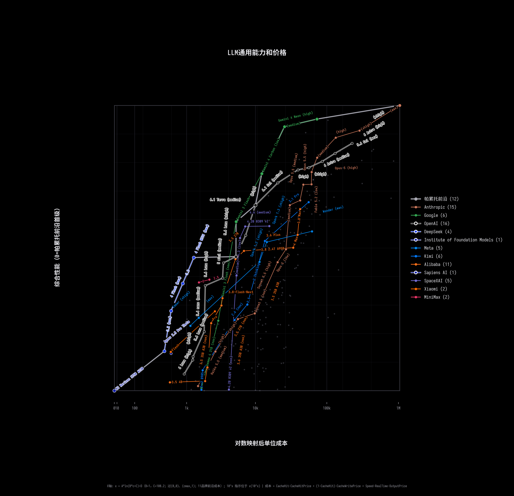

# LLM Leaderboard Pareto Analysis



## 全部模型（综合能力从高到低，最优 = 1，最差 = 0）

共收录 **Status: All**（含已弃用）的全部模型；按重新归一化后的综合能力排序。「帕累托」列：✅ = 总体帕累托前沿模型，❌ = 被支配，— = 无成本数据无法判定。图表纵轴以总体帕累托前沿第一级（y0 = 0.4575，即前沿左端点 K2 Horizon 375B A23B）为 0：综合能力 ≥ 该级且有成本数据的 259 个模型入图，325 个能力低于第一级、74 个缺少成本数据的模型不出现在图中，成本高于品牌前沿最大值的模型同样不入图（本表不受影响，仍完整列出全部模型）。

| # | 品牌 | 模型 | 综合能力 | 单请求成本 | 横轴位置 | 帕累托 |
|---|------|------|---------|-----------|-----------|------|
| 1 |  Anthropic | Claude Fable 5.2 (max) | 1.0000 | 1,042,925.79 | 1.0000 | ✅ |
| 2 |  Google | Gemini 4 Neon (high) | 0.9740 | 72,650.01 | 0.7098 | ✅ |
| 3 |  Google | Gemini 4 Neon (xhigh) | 0.9717 | 103,920.06 | 0.7487 | ❌ |
| 4 |  Google | Gemini 4 Carbon (medium) | 0.9594 | 25,537.91 | 0.5961 | ✅ |
| 5 |  Anthropic | Claude Fable 5.2 (xhigh) | 0.9522 | 285,220.13 | 0.8587 | ❌ |
| 6 |  Google | Gemini 4 Carbon (high) | 0.9481 | 50,700.85 | 0.6706 | ❌ |
| 7 |  Anthropic | Claude Fable 5.2 (high) | 0.9387 | 133,074.90 | 0.7757 | ❌ |
| 8 |  OpenAI | GPT-6 Astra (xhigh) | 0.9278 | 225,159.83 | 0.8329 | ❌ |
| 9 |  OpenAI | GPT-6 Astra (max) | 0.9162 | 448,523.13 | 0.9080 | ❌ |
| 10 |  Anthropic | Claude Opus 5.5 (xhigh) | 0.9134 | 153,941.94 | 0.7915 | ❌ |
| 11 |  OpenAI | GPT-6.2 Astra (max) | 0.9132 | 425,398.00 | 0.9023 | ❌ |
| 12 |  OpenAI | GPT-6 Astra (high) | 0.9088 | 130,217.43 | 0.7733 | ❌ |
| 13 |  Anthropic | Claude Fable 5.2 (medium) | 0.9006 | 72,975.07 | 0.7102 | ❌ |
| 14 |  Google | Gemini 4 Neon (medium) | 0.8970 | 41,235.15 | 0.6481 | ❌ |
| 15 |  Anthropic | Claude Fable 5 | 0.8952 | 307,953.57 | 0.8671 | ❌ |
| 16 |  Anthropic | Claude Opus 5.5 (max) | 0.8941 | 857,534.76 | 0.9787 | ❌ |
| 17 |  OpenAI | GPT-5.6 Sol (max) | 0.8935 | 86,273.63 | 0.7285 | ❌ |
| 18 |  OpenAI | GPT-6 Astra (medium) | 0.8817 | 56,017.51 | 0.6815 | ❌ |
| 19 |  OpenAI | GPT-6.2 Astra (xhigh) | 0.8810 | 168,856.21 | 0.8016 | ❌ |
| 20 |  Anthropic | Claude Sonnet 5.5 (max) | 0.8787 | 430,665.81 | 0.9036 | ❌ |
| 21 |  OpenAI | GPT-6.1 Sol (xhigh) | 0.8773 | 39,408.33 | 0.6432 | ❌ |
| 22 |  OpenAI | GPT-5.6 Sol (xhigh) | 0.8769 | 49,084.50 | 0.6671 | ❌ |
| 23 |  Anthropic | Claude Fable 5.2 (low) | 0.8732 | 61,208.57 | 0.6911 | ❌ |
| 24 |  OpenAI | GPT-6.1 Sol (max) | 0.8721 | 76,610.29 | 0.7155 | ❌ |
| 25 |  Google | Gemini 4 Carbon (low) | 0.8701 | 12,290.06 | 0.5169 | ✅ |
| 26 |  OpenAI | GPT-5.4 (xhigh) | 0.8689 | 115,361.79 | 0.7601 | ❌ |
| 27 |  OpenAI | GPT-5.2 (xhigh) | 0.8671 | 103,913.56 | 0.7487 | ❌ |
| 28 |  OpenAI | GPT-6.2 Astra (high) | 0.8648 | 86,010.14 | 0.7281 | ❌ |
| 29 |  Google | Gemini 4 Hydrogen (xhigh) | 0.8590 | 64,723.52 | 0.6972 | ❌ |
| 30 |  Anthropic | Claude Opus 5 (xhigh) | 0.8582 | 64,631.42 | 0.6970 | ❌ |
| 31 |  Google | Gemini 4 Hydrogen (high) | 0.8545 | 28,985.41 | 0.6098 | ❌ |
| 32 |  Google | Gemini 3.7 Flash (medium) | 0.8531 | — | — | — |
| 33 |  OpenAI | GPT-6.1 Sol (high) | 0.8526 | 20,604.38 | 0.5728 | ❌ |
| 34 |  Anthropic | Claude Fable 5.1 (xhigh) | 0.8514 | 312,269.32 | 0.8686 | ❌ |
| 35 |  OpenAI | GPT-5.6 Sol (high) | 0.8509 | 34,637.33 | 0.6292 | ❌ |
| 36 |  Anthropic | Claude Opus 5.5 (high) | 0.8499 | 60,890.81 | 0.6905 | ❌ |
| 37 |  Google | Gemini 3 Pro Preview (high) | 0.8495 | — | — | — |
| 38 |  Anthropic | Claude Opus 5 (high) | 0.8495 | 46,944.02 | 0.6622 | ❌ |
| 39 |  Meta | Muse Wonder Full (max) | 0.8449 | — | — | — |
| 40 |  OpenAI | GPT-6.1 Terra (max) | 0.8365 | 53,260.00 | 0.6760 | ❌ |
| 41 |  OpenAI | GPT-6.2 Sol (max) | 0.8358 | 66,642.19 | 0.7004 | ❌ |
| 42 |  OpenAI | GPT-5.3 Codex (xhigh) | 0.8292 | 57,627.74 | 0.6845 | ❌ |
| 43 |  Google | Gemini 4 Argon (medium) | 0.8281 | 15,216.64 | 0.5400 | ❌ |
| 44 |  OpenAI | GPT-5.5 (xhigh) | 0.8254 | 126,130.34 | 0.7698 | ❌ |
| 45 |  Anthropic | Claude Fable 5.1 (max) | 0.8233 | 790,522.21 | 0.9698 | ❌ |
| 46 |  OpenAI | GPT-5.6 Sol (medium) | 0.8213 | 27,549.57 | 0.6043 | ❌ |
| 47 |  Anthropic | Claude Opus 4.7 (max) | 0.8201 | 60,215.47 | 0.6893 | ❌ |
| 48 |  Anthropic | Claude Opus 5.5 (medium) | 0.8193 | 42,196.25 | 0.6506 | ❌ |
| 49 |  Anthropic | Claude Fable 5.1 (high) | 0.8186 | 78,427.75 | 0.7181 | ❌ |
| 50 |  Kimi | Kimi K3.1 Pro | 0.8162 | 55,689.91 | 0.6808 | ❌ |
| 51 |  Anthropic | Claude Opus 5 (medium) | 0.8103 | 30,306.97 | 0.6147 | ❌ |
| 52 |  OpenAI | GPT-6.1 Sol (medium) | 0.8103 | 10,006.38 | 0.4947 | ✅ |
| 53 |  Anthropic | Claude Opus 5 (max) | 0.8068 | 97,944.17 | 0.7423 | ❌ |
| 54 |  OpenAI | GPT-6 Astra (low) | 0.8067 | 49,973.59 | 0.6690 | ❌ |
| 55 |  OpenAI | GPT-6.2 Astra (medium) | 0.8041 | 36,988.94 | 0.6363 | ❌ |
| 56 |  OpenAI | GPT-5.5 (high) | 0.8038 | 52,865.53 | 0.6752 | ❌ |
| 57 |  Alibaba | Qwen3.8 Max | 0.8028 | 42,218.02 | 0.6507 | ❌ |
| 58 |  Anthropic | Claude Sonnet 5.5 (xhigh) | 0.7983 | 48,065.63 | 0.6648 | ❌ |
| 59 |  OpenAI | GPT-5.2 Codex (xhigh) | 0.7934 | 61,702.56 | 0.6920 | ❌ |
| 60 |  Sapiens AI | Agnes 2.5 Pro Beta | 0.7931 | — | — | — |
| 61 |  Anthropic | Claude Opus 4.8 (max) | 0.7918 | 80,277.76 | 0.7206 | ❌ |
| 62 |  Google | Gemini 3.5 Flash (medium) | 0.7882 | 22,403.95 | 0.5819 | ❌ |
| 63 |  Anthropic | Claude Opus 4.5 | 0.7877 | 39,828.58 | 0.6444 | ❌ |
| 64 |  OpenAI | GPT-5 Codex (high) | 0.7864 | 24,179.71 | 0.5902 | ❌ |
| 65 |  OpenAI | GPT-6.1 Terra (xhigh) | 0.7811 | 13,629.11 | 0.5280 | ❌ |
| 66 |  OpenAI | GPT-5.2 (medium) | 0.7810 | 15,710.37 | 0.5434 | ❌ |
| 67 |  OpenAI | GPT-6.2 Sol (xhigh) | 0.7791 | 30,303.86 | 0.6147 | ❌ |
| 68 |  Google | Gemini 3 Flash | 0.7789 | 5,312.47 | 0.4267 | ✅ |
| 69 |  Google | Gemini 3.7 Flash (low) | 0.7750 | — | — | — |
| 70 |  OpenAI | GPT-6 Sol (xhigh) | 0.7746 | 23,006.87 | 0.5848 | ❌ |
| 71 |  Google | Gemini 3.7 Flash (high) | 0.7735 | — | — | — |
| 72 |  SpaceXAI | Grok 4.6 (medium) | 0.7704 | 15,672.51 | 0.5432 | ❌ |
| 73 |  Anthropic | Claude Fable 5.1 (medium) | 0.7702 | 57,055.21 | 0.6835 | ❌ |
| 74 |  SpaceXAI | Grok 4.20 0309 v2 | 0.7700 | 7,160.47 | 0.4587 | ❌ |
| 75 |  OpenAI | GPT-5.1 Codex (high) | 0.7641 | 22,527.23 | 0.5825 | ❌ |
| 76 |  Meta | Muse Spark | 0.7630 | — | — | — |
| 77 |  Meta | Muse Wonder (max) | 0.7605 | 61,892.68 | 0.6923 | ❌ |
| 78 |  OpenAI | GPT-6.2 Sol (high) | 0.7603 | 15,593.25 | 0.5426 | ❌ |
| 79 |  Alibaba | Qwen3.6 Max Preview | 0.7593 | — | — | — |
| 80 |  Anthropic | Claude Opus 4.6 (max) | 0.7583 | 44,069.49 | 0.6554 | ❌ |
| 81 |  Google | Gemini 4 Neon (low) | 0.7581 | 31,089.81 | 0.6175 | ❌ |
| 82 |  SpaceXAI | Grok 4.6 (high) | 0.7576 | 17,676.35 | 0.5562 | ❌ |
| 83 |  OpenAI | GPT-5.5 (medium) | 0.7574 | 35,183.87 | 0.6309 | ❌ |
| 84 |  Alibaba | Qwen4 Max | 0.7539 | 39,096.66 | 0.6424 | ❌ |
| 85 |  OpenAI | GPT-6.1 Terra (high) | 0.7530 | 7,264.78 | 0.4602 | ❌ |
| 86 |  OpenAI | GPT-6 Sol (max) | 0.7530 | 51,176.50 | 0.6716 | ❌ |
| 87 |  Google | Gemini 4 Argon (high) | 0.7525 | 38,050.66 | 0.6394 | ❌ |
| 88 |  OpenAI | GPT-5.5 (low) | 0.7517 | 27,180.14 | 0.6029 | ❌ |
| 89 |  SpaceXAI | Grok 4.3 (medium) | 0.7481 | 6,043.71 | 0.4405 | ❌ |
| 90 |  OpenAI | GPT-6 Sol (high) | 0.7439 | 14,406.19 | 0.5340 | ❌ |
| 91 |  Google | Gemini 4 Hydrogen (medium) | 0.7439 | 21,407.90 | 0.5769 | ❌ |
| 92 |  Kimi | Kimi K2 Thinking | 0.7423 | 13,562.42 | 0.5275 | ❌ |
| 93 |  OpenAI | GPT-5 (medium) | 0.7417 | 25,366.14 | 0.5954 | ❌ |
| 94 |  Xiaomi | MiMo-V2-Flash | 0.7401 | — | — | — |
| 95 |  Meta | Muse Spark 1.3 (xhigh) | 0.7401 | 14,407.32 | 0.5340 | ❌ |
| 96 |  DeepSeek | DeepSeek V4 Pro (high) | 0.7398 | — | — | — |
| 97 |  OpenAI | GPT-5.1 (high) | 0.7383 | 43,789.91 | 0.6547 | ❌ |
| 98 |  Anthropic | Claude Fable 5.1 (low) | 0.7379 | 47,341.88 | 0.6632 | ❌ |
| 99 |  Google | Gemini 3.5 Flash (high) | 0.7376 | 22,307.01 | 0.5814 | ❌ |
| 100 |  SpaceXAI | Grok 4.5 (high) | 0.7342 | 10,345.59 | 0.4983 | ❌ |
| 101 |  OpenAI | GPT-5.4 (low) | 0.7325 | 14,532.93 | 0.5350 | ❌ |
| 102 |  OpenAI | GPT-5.6 Terra (max) | 0.7317 | 77,874.71 | 0.7173 | ❌ |
| 103 |  OpenAI | o3 | 0.7295 | 15,437.84 | 0.5415 | ❌ |
| 104 |  Alibaba | Qwen3.8 2.4T A95B | 0.7294 | 33,922.73 | 0.6269 | ❌ |
| 105 |  OpenAI | GPT-6.2 Sol (medium) | 0.7277 | 9,778.16 | 0.4922 | ❌ |
| 106 |  Anthropic | Claude Opus 5 (low) | 0.7262 | 26,781.64 | 0.6013 | ❌ |
| 107 |  OpenAI | GPT-5.6 Sol (low) | 0.7247 | 23,715.39 | 0.5881 | ❌ |
| 108 |  Alibaba | Qwen3.6 Plus | 0.7233 | 6,863.71 | 0.4541 | ❌ |
| 109 |  Meta | Muse Wonder (high) | 0.7162 | 39,395.46 | 0.6432 | ❌ |
| 110 |  OpenAI | GPT-6.1 Terra (medium) | 0.7124 | 5,288.78 | 0.4262 | ✅ |
| 111 |  SpaceXAI | Grok 4 | 0.7111 | 26,492.07 | 0.6001 | ❌ |
| 112 |  Meta | Muse Spark 1.3 (max) | 0.7108 | 18,622.42 | 0.5618 | ❌ |
| 113 |  DeepSeek | DeepSeek V4 Flash 0731 (max) | 0.7106 | 1,284.82 | 0.2786 | ✅ |
| 114 |  SpaceXAI | Grok 4.20 0309 | 0.7091 | — | — | — |
| 115 |  Alibaba | Qwen3.5 27B | 0.7074 | 5,205.54 | 0.4245 | ❌ |
| 116 |  Meta | Muse Spark 1.2 (xhigh) | 0.7025 | 11,379.57 | 0.5085 | ❌ |
| 117 |  Motif Technologies | Motif 3 (Beta) | 0.7024 | — | — | — |
| 118 |  Anthropic | Claude Sonnet 5.5 (high) | 0.7018 | 20,431.02 | 0.5719 | ❌ |
| 119 |  OpenAI | GPT-5.6 Terra (xhigh) | 0.7017 | 26,305.23 | 0.5993 | ❌ |
| 120 |  OpenAI | GPT-5.6 Luna (xhigh) | 0.7005 | 3,502.13 | 0.3824 | ❌ |
| 121 |  DeepSeek | DeepSeek V4 Flash Vision (max) | 0.6974 | 10,043.47 | 0.4951 | ❌ |
| 122 |  OpenAI | GPT-6 Sol (medium) | 0.6974 | — | — | — |
| 123 |  Anthropic | Claude Opus 4.7 (non-reasoning, high) | 0.6972 | 23,620.74 | 0.5876 | ❌ |
| 124 |  Alibaba | Qwen3.8 Max (0902) | 0.6957 | 39,413.76 | 0.6432 | ❌ |
| 125 |  OpenAI | GPT-6.1 Sol (low) | 0.6952 | 9,032.37 | 0.4836 | ❌ |
| 126 |  MiniMax | MiniMax-M2.1 | 0.6932 | — | — | — |
| 127 |  Kimi | Kimi K3 (max) | 0.6911 | 37,391.59 | 0.6375 | ❌ |
| 128 |  SpaceXAI | Grok 4.1 Fast | 0.6909 | — | — | — |
| 129 |  Xiaomi | MiMo-V2-Pro | 0.6898 | — | — | — |
| 130 |  OpenAI | GPT-6.2 Astra (low) | 0.6898 | 35,687.57 | 0.6324 | ❌ |
| 131 |  Z AI | GLM-4.7 | 0.6886 | 7,024.35 | 0.4566 | ❌ |
| 132 |  Anthropic | Claude Sonnet 5 (max) | 0.6870 | 145,906.39 | 0.7857 | ❌ |
| 133 |  Google | Gemini 3 Pro Preview (low) | 0.6843 | — | — | — |
| 134 |  OpenAI | GPT-5.1 Codex mini (high) | 0.6840 | 4,981.41 | 0.4198 | ❌ |
| 135 |  Z AI | GLM-5-Turbo | 0.6827 | — | — | — |
| 136 |  Xiaomi | MiMo-V2-Omni-0327 | 0.6801 | — | — | — |
| 137 |  InclusionAI | Ling 3.1 Flash | 0.6783 | 4,534.83 | 0.4098 | ❌ |
| 138 |  SpaceXAI | Grok 4.3 (low) | 0.6766 | 5,373.53 | 0.4279 | ❌ |
| 139 |  OpenAI | GPT-5 (high) | 0.6749 | 63,613.58 | 0.6953 | ❌ |
| 140 |  Thinking Machines | Inkling 2 Small | 0.6739 | 5,321.00 | 0.4269 | ❌ |
| 141 |  Anthropic | Claude 4 Opus | 0.6739 | — | — | — |
| 142 |  OpenAI | GPT-5 (low) | 0.6724 | 12,871.96 | 0.5219 | ❌ |
| 143 |  OpenAI | GPT-5 mini (medium) | 0.6714 | 3,399.44 | 0.3792 | ❌ |
| 144 |  MiniMax | MiniMax-M2.5 | 0.6686 | 2,023.54 | 0.3249 | ❌ |
| 145 |  SpaceXAI | Grok 4.7 (high) | 0.6682 | 24,768.51 | 0.5928 | ❌ |
| 146 |  Anthropic | Claude Opus 5.5 (low) | 0.6670 | 25,827.53 | 0.5973 | ❌ |
| 147 |  Google | Gemini 3.6 Flash (high) | 0.6661 | 12,029.36 | 0.5145 | ❌ |
| 148 |  SpaceXAI | Grok 4.6 (xhigh) | 0.6646 | 22,316.82 | 0.5815 | ❌ |
| 149 |  MiniMax | MiniMax-M2 | 0.6633 | 1,527.63 | 0.2961 | ❌ |
| 150 |  Tencent | Hy3-preview | 0.6622 | — | — | — |
| 151 |  Google | Gemini 3.8 Flash (medium) | 0.6616 | 9,630.83 | 0.4905 | ❌ |
| 152 |  Xiaomi | MiMo-V2-Flash (Feb 2026) | 0.6615 | — | — | — |
| 153 |  DeepSeek | DeepSeek V3.2 | 0.6612 | 867.35 | 0.2397 | ✅ |
| 154 |  Z AI | GLM-5.2 (max) | 0.6597 | 14,632.98 | 0.5357 | ❌ |
| 155 |  DeepSeek | DeepSeek V3.2 Speciale | 0.6591 | — | — | — |
| 156 |  Z AI | GLM-5 | 0.6573 | 12,084.10 | 0.5150 | ❌ |
| 157 |  OpenAI | GPT-5.6 Luna (high) | 0.6572 | 1,906.86 | 0.3188 | ❌ |
| 158 |  SpaceXAI | Grok Build 0.1 0616 | 0.6539 | 6,400.48 | 0.4466 | ❌ |
| 159 |  Anthropic | Claude Haiku 5.5 (max) | 0.6529 | 23,706.91 | 0.5880 | ❌ |
| 160 |  Z AI | GLM 5V Turbo | 0.6498 | — | — | — |
| 161 |  OpenAI | GPT-5.6 Terra (high) | 0.6496 | 16,087.76 | 0.5460 | ❌ |
| 162 |  DeepSeek | DeepSeek V4 Pro (max) | 0.6480 | 13,264.47 | 0.5251 | ❌ |
| 163 |  Xiaomi | MiMo-V2-Omni | 0.6462 | — | — | — |
| 164 |  Alibaba | Qwen3 Max Thinking | 0.6444 | — | — | — |
| 165 |  SpaceXAI | Grok 4 Fast | 0.6443 | — | — | — |
| 166 |  Anthropic | Claude Opus 4.6 (non-reasoning, high) | 0.6437 | 24,009.47 | 0.5894 | ❌ |
| 167 |  DeepSeek | DeepSeek V4.1 Flash 1017 (max) | 0.6408 | 9,175.88 | 0.4853 | ❌ |
| 168 |  Anthropic | Claude 4.1 Opus | 0.6400 | — | — | — |
| 169 |  Anthropic | Claude Opus 4.5 (non-reasoning) | 0.6390 | 23,430.00 | 0.5867 | ❌ |
| 170 |  Google | Gemini 3.1 Pro Preview | 0.6387 | 30,332.39 | 0.6148 | ❌ |
| 171 |  SpaceXAI | Grok 4.7 (xhigh) | 0.6374 | 31,089.19 | 0.6174 | ❌ |
| 172 |  SpaceXAI | Grok 4.6 (low) | 0.6355 | 13,051.34 | 0.5234 | ❌ |
| 173 |  OpenAI | o4-mini (high) | 0.6350 | 12,580.68 | 0.5194 | ❌ |
| 174 |  Alibaba | Qwen3.5 35B A3B | 0.6334 | 3,379.50 | 0.3786 | ❌ |
| 175 |  Alibaba | Qwen3.7 Max | 0.6324 | 21,186.88 | 0.5758 | ❌ |
| 176 |  Motif Technologies | Motif 3 | 0.6315 | — | — | — |
| 177 |  StepFun | Step 3.5 Flash 2603 | 0.6290 | 1,114.66 | 0.2644 | ❌ |
| 178 |  Nex AGI | Nex-N2-Pro | 0.6288 | — | — | — |
| 179 |  Amazon | Nova 2.0 Pro Preview (medium) | 0.6249 | 24,930.89 | 0.5935 | ❌ |
| 180 |  Meta | Muse Spark 1.1 (xhigh) | 0.6246 | 13,983.95 | 0.5308 | ❌ |
| 181 |  SpaceXAI | Grok 4.7 (low) | 0.6214 | 14,494.58 | 0.5347 | ❌ |
| 182 |  Kimi | Kimi K2.5 | 0.6214 | 7,673.54 | 0.4661 | ❌ |
| 183 |  Alibaba | Qwen3.8-Flash-Next | 0.6194 | 3,269.19 | 0.3751 | ❌ |
| 184 |  Kimi | Kimi K2.6 | 0.6161 | 16,340.43 | 0.5477 | ❌ |
| 185 |  Google | Gemini 3.5 Flash (minimal) | 0.6140 | 9,879.93 | 0.4933 | ❌ |
| 186 |  OpenAI | GPT-6.1 Terra (low) | 0.6139 | 4,638.64 | 0.4122 | ❌ |
| 187 |  KwaiKAT | KAT-Coder-Pro V2 | 0.6120 | — | — | — |
| 188 |  StepFun | Step 5 Preview | 0.6115 | 10,986.77 | 0.5048 | ❌ |
| 189 |  ByteDance Seed | Doubao Seed Code | 0.6098 | — | — | — |
| 190 |  DeepSeek | DeepSeek V4 Flash (max) | 0.6092 | 562.11 | 0.1988 | ✅ |
| 191 |  Google | Gemini 3.8 Flash (high) | 0.6091 | 12,821.02 | 0.5214 | ❌ |
| 192 |  DeepSeek | DeepSeek V4.1 Flash (max) | 0.6090 | 10,387.38 | 0.4987 | ❌ |
| 193 |  Xiaomi | MiMo-V2.6-Pro | 0.6084 | 2,631.04 | 0.3523 | ❌ |
| 194 |  Amazon | Nova 2.0 Lite (medium) | 0.6078 | 9,069.63 | 0.4841 | ❌ |
| 195 |  OpenAI | GPT-6 Sol (low) | 0.6071 | 10,403.04 | 0.4989 | ❌ |
| 196 |  OpenAI | GPT-5.5 Instant (May 2026) | 0.6070 | — | — | — |
| 197 |  Z AI | GLM-5.3 (max) | 0.6057 | 30,010.73 | 0.6136 | ❌ |
| 198 |  Anthropic | Claude Sonnet 5 (non-reasoning) | 0.6043 | 9,745.20 | 0.4918 | ❌ |
| 199 |  Anthropic | Claude Sonnet 4.6 (max) | 0.6036 | 127,947.40 | 0.7714 | ❌ |
| 200 |  Baidu | ERNIE 5.0 Thinking Preview | 0.6032 | — | — | — |
| 201 |  Z AI | GLM-5.1 (non-reasoning) | 0.6010 | 6,822.17 | 0.4535 | ❌ |
| 202 |  OpenAI | GPT-5.6 Luna (max) | 0.5998 | 6,160.38 | 0.4425 | ❌ |
| 203 |  DeepSeek | DeepSeek V3.2 Exp | 0.5986 | — | — | — |
| 204 |  China Mobile | JT-4.1 Flash 236B A21B 0709 (non-reasoning) | 0.5977 | — | — | — |
| 205 |  Anthropic | Claude Sonnet 4.6 (non-reasoning, high) | 0.5966 | 14,039.09 | 0.5312 | ❌ |
| 206 |  OpenAI | GPT-5.4 mini (xhigh) | 0.5964 | 104,283.20 | 0.7491 | ❌ |
| 207 |  Meta | Muse Ember (max) | 0.5959 | 1,518.69 | 0.2955 | ❌ |
| 208 |  KwaiKAT | KAT-Coder-Pro V1 | 0.5948 | — | — | — |
| 209 |  Anthropic | Claude Haiku 5.5 (xhigh) | 0.5935 | 5,636.30 | 0.4330 | ❌ |
| 210 |  StepFun | Step 3.5 Flash | 0.5933 | 1,013.64 | 0.2550 | ❌ |
| 211 |  Upstage | Solar Open2 250B | 0.5932 | — | — | — |
| 212 |  OpenAI | GPT-6.2 Sol (low) | 0.5929 | 8,835.42 | 0.4813 | ❌ |
| 213 |  Z AI | GLM-5.1 | 0.5920 | 11,662.90 | 0.5112 | ❌ |
| 214 |  Kimi | Kimi K2.6 (non-reasoning) | 0.5919 | 5,047.21 | 0.4212 | ❌ |
| 215 |  Google | Gemini 3 Flash (non-reasoning) | 0.5905 | 2,942.01 | 0.3640 | ❌ |
| 216 |  InclusionAI | Ling 3.1 Flash 1019 | 0.5886 | — | — | — |
| 217 |  DeepSeek | DeepSeek V4 Flash (high) | 0.5878 | — | — | — |
| 218 |  ServiceNow | Apriel-v1.6-15B-Thinker | 0.5865 | — | — | — |
| 219 |  Alibaba | Qwen3.5 27B (non-reasoning) | 0.5859 | 2,315.06 | 0.3389 | ❌ |
| 220 |  Meta | Muse Spark Open (xhigh) | 0.5846 | 11,100.99 | 0.5059 | ❌ |
| 221 |  Anthropic | Claude Sonnet 4.6 (non-reasoning, low) | 0.5844 | 13,867.72 | 0.5299 | ❌ |
| 222 |  Z AI | GLM-5.3-Flash | 0.5840 | 2,976.47 | 0.3652 | ❌ |
| 223 |  OpenAI | GPT-5.6 Sol (non-reasoning) | 0.5832 | 20,736.63 | 0.5735 | ❌ |
| 224 |  Alibaba | Qwen3.5 397B A17B (non-reasoning) | 0.5831 | 2,605.94 | 0.3513 | ❌ |
| 225 |  DeepSeek | DeepSeek V4 Pro 0813 (max) | 0.5829 | 22,403.63 | 0.5819 | ❌ |
| 226 |  Amazon | Nova 2.0 Omni (medium) | 0.5822 | — | — | — |
| 227 |  Google | Gemini 2.5 Flash (Sep) | 0.5821 | — | — | — |
| 228 |  OpenAI | GPT-5.6 Terra (medium) | 0.5820 | 12,602.63 | 0.5196 | ❌ |
| 229 |  Tencent | Tencent Hy4 | 0.5818 | 29,338.35 | 0.6112 | ❌ |
| 230 |  LG AI Research | K-EXAONE | 0.5813 | — | — | — |
| 231 |  Meta | Muse Ember (xhigh) | 0.5808 | 1,135.80 | 0.2662 | ❌ |
| 232 |  China Mobile | JT-4.1 Flash 236B A21B 0709 | 0.5795 | — | — | — |
| 233 |  SpaceXAI | Grok 3 mini Reasoning (high) | 0.5780 | — | — | — |
| 234 |  OpenAI | GPT-5.4 mini (medium) | 0.5768 | 6,728.49 | 0.4520 | ❌ |
| 235 |  StepFun | Step 3.7 Flash | 0.5761 | 2,722.85 | 0.3559 | ❌ |
| 236 |  Anthropic | Claude Sonnet 5 (xhigh) | 0.5754 | 33,207.77 | 0.6246 | ❌ |
| 237 |  MiniMax | MiniMax-M3.1-Flash | 0.5739 | 4,323.76 | 0.4047 | ❌ |
| 238 |  Alibaba | Qwen3.5 Omni Plus | 0.5737 | 3,569.58 | 0.3844 | ❌ |
| 239 |  Amazon | Nova 2.0 Lite (high) | 0.5701 | 10,918.63 | 0.5041 | ❌ |
| 240 |  OpenAI | GPT-5.4 nano (medium) | 0.5697 | 1,835.33 | 0.3149 | ❌ |
| 241 |  Alibaba | Qwen3 VL 235B A22B | 0.5696 | — | — | — |
| 242 |  Anthropic | Claude Sonnet 5.5 (medium) | 0.5695 | 14,101.08 | 0.5317 | ❌ |
| 243 |  Alibaba | Qwen3.7 Plus | 0.5690 | 5,734.26 | 0.4348 | ❌ |
| 244 |  Kimi | Kimi K2.7 Code | 0.5687 | 10,591.58 | 0.5008 | ❌ |
| 245 |  Alibaba | Qwen3 Max Thinking (Preview) | 0.5664 | — | — | — |
| 246 |  OpenAI | GPT-6 Luna (max) | 0.5642 | 3,891.76 | 0.3935 | ❌ |
| 247 |  Alibaba | Qwen3.8 27B (xhigh) | 0.5599 | 20,335.50 | 0.5714 | ❌ |
| 248 |  Amazon | Nova 2.0 Pro Preview (low) | 0.5567 | 11,836.28 | 0.5128 | ❌ |
| 249 |  Anthropic | Claude 4 Sonnet | 0.5557 | — | — | — |
| 250 |  Alibaba | Qwen3 Max | 0.5528 | — | — | — |
| 251 |  Google | Gemini 3.8 Flash (low) | 0.5520 | 4,654.03 | 0.4126 | ❌ |
| 252 |  Alibaba | Qwen3.6 27B (non-reasoning) | 0.5510 | 3,380.01 | 0.3786 | ❌ |
| 253 |  Amazon | Nova 2.0 Omni (low) | 0.5472 | — | — | — |
| 254 |  DeepSeek | DeepSeek V3.1 | 0.5464 | 5,232.47 | 0.4251 | ❌ |
| 255 |  Kimi | Kimi K2.5 (non-reasoning) | 0.5449 | 7,878.68 | 0.4689 | ❌ |
| 256 |  Xiaomi | MiMo-V2.5 | 0.5448 | — | — | — |
| 257 |  OpenAI | GPT-6.1 Terra (non-reasoning) | 0.5448 | 4,560.14 | 0.4104 | ❌ |
| 258 |  Z AI | GLM-4.6 | 0.5424 | 4,908.29 | 0.4182 | ❌ |
| 259 |  Alibaba | Qwen3.5 122B A10B (non-reasoning) | 0.5407 | 3,199.18 | 0.3728 | ❌ |
| 260 |  OpenAI | GPT-5.5 (non-reasoning) | 0.5401 | 26,716.72 | 0.6010 | ❌ |
| 261 |  Alibaba | Qwen3 VL 32B | 0.5384 | — | — | — |
| 262 |  OpenAI | GPT-5.4 nano (xhigh) | 0.5384 | 10,796.80 | 0.5029 | ❌ |
| 263 |  Anthropic | Claude 4.5 Sonnet | 0.5377 | 25,219.94 | 0.5947 | ❌ |
| 264 |  China Mobile | JT-35B-Flash | 0.5374 | — | — | — |
| 265 |  Google | Gemini 4 Hydrogen (low) | 0.5370 | 12,693.26 | 0.5204 | ❌ |
| 266 |  Google | Gemini 2.5 Flash | 0.5355 | 7,308.25 | 0.4609 | ❌ |
| 267 |  OpenAI | GPT-5.6 Terra (low) | 0.5353 | 11,951.62 | 0.5138 | ❌ |
| 268 |  Alibaba | Qwen3.6 27B | 0.5329 | 7,900.49 | 0.4692 | ❌ |
| 269 |  DeepSeek | DeepSeek V3.2 (non-reasoning) | 0.5325 | 431.32 | 0.1752 | ✅ |
| 270 |  Anthropic | Claude Haiku 5.5 (high) | 0.5321 | 2,674.02 | 0.3540 | ❌ |
| 271 |  Xiaomi | MiMo-V2.6-Flash | 0.5313 | 555.03 | 0.1977 | ❌ |
| 272 |  OpenAI | GPT-5 nano (high) | 0.5286 | 3,593.07 | 0.3851 | ❌ |
| 273 |  OpenAI | o1 | 0.5286 | — | — | — |
| 274 |  Sapiens AI | Agnes 2.5 Pro Theta | 0.5283 | 562.40 | 0.1989 | ❌ |
| 275 |  ServiceNow | Apriel-v1.5-15B-Thinker | 0.5263 | — | — | — |
| 276 |  Z AI | GLM-5 (non-reasoning) | 0.5222 | 4,579.30 | 0.4108 | ❌ |
| 277 |  OpenAI | GPT-5.6 Luna (medium) | 0.5220 | 1,252.47 | 0.2760 | ❌ |
| 278 |  OpenAI | GPT-6 Luna (xhigh) | 0.5158 | 1,236.64 | 0.2747 | ❌ |
| 279 |  DeepSeek | DeepSeek V4 Pro (non-reasoning) | 0.5152 | 5,043.28 | 0.4211 | ❌ |
| 280 |  Xiaomi | MiMo-V2.5-Pro | 0.5129 | — | — | — |
| 281 |  DeepSeek | DeepSeek V4.1 Flash 1017 (high) | 0.5107 | 4,486.43 | 0.4087 | ❌ |
| 282 |  OpenAI | GPT-5 nano (medium) | 0.5107 | 1,688.68 | 0.3063 | ❌ |
| 283 |  Z AI | GLM-4.5 | 0.5106 | — | — | — |
| 284 |  Anthropic | Claude Sonnet 5 (high) | 0.5100 | 24,740.16 | 0.5926 | ❌ |
| 285 |  DeepSeek | DeepSeek R1 0528 | 0.5092 | 23,140.50 | 0.5854 | ❌ |
| 286 |  InclusionAI | Ling-2.6-1T | 0.5091 | — | — | — |
| 287 |  Mistral | Mistral Large 4 Preview | 0.5078 | 11,154.75 | 0.5064 | ❌ |
| 288 |  Z AI | GLM-4.7 (non-reasoning) | 0.5078 | 4,343.41 | 0.4052 | ❌ |
| 289 |  Anthropic | Claude Sonnet 5.5 (low) | 0.5036 | 10,745.36 | 0.5024 | ❌ |
| 290 |  ByteDance Seed | Seed-OSS-36B-Instruct | 0.5026 | 1,558.49 | 0.2981 | ❌ |
| 291 |  Alibaba | Qwen3.6 35B A3B (non-reasoning) | 0.5018 | 2,049.47 | 0.3263 | ❌ |
| 292 |  Google | Gemini 2.5 Flash-Lite (Sep) | 0.5010 | — | — | — |
| 293 |  Alibaba | Qwen3.5 397B A17B | 0.5005 | 8,896.36 | 0.4820 | ❌ |
| 294 |  OpenAI | GPT-5.4 (non-reasoning) | 0.5005 | 12,736.19 | 0.5207 | ❌ |
| 295 |  Anthropic | Claude 4.5 Sonnet (non-reasoning) | 0.4992 | 14,014.18 | 0.5311 | ❌ |
| 296 |  Tencent | Hy3 | 0.4982 | 2,158.94 | 0.3317 | ❌ |
| 297 |  SpaceXAI | Grok 4.3 (high) | 0.4974 | 6,978.92 | 0.4559 | ❌ |
| 298 |  Kimi | Kimi K2 0905 | 0.4964 | 1,735.14 | 0.3091 | ❌ |
| 299 |  AI9Stars | G9v3-39A5B | 0.4958 | — | — | — |
| 300 |  LG AI Research | EXAONE 4.5 33B | 0.4955 | — | — | — |
| 301 |  Kimi | Kimi K3 (low) | 0.4940 | 13,115.38 | 0.5239 | ❌ |
| 302 |  DeepSeek | DeepSeek V4 Flash (non-reasoning) | 0.4934 | — | — | — |
| 303 |  OpenAI | GPT-5 mini (high) | 0.4895 | 9,571.92 | 0.4899 | ❌ |
| 304 |  OpenAI | GPT-6 Luna (high) | 0.4892 | 914.59 | 0.2449 | ❌ |
| 305 |  Xiaomi | MiMo-V2-Flash (non-reasoning) | 0.4868 | — | — | — |
| 306 |  OpenAI | GPT-5.5 Instant (June 2026) | 0.4833 | 29,558.16 | 0.6120 | ❌ |
| 307 |  InclusionAI | Ling-3.0-flash-VL | 0.4823 | — | — | — |
| 308 |  Xiaomi | MiMo-V2.5-Pro (non-reasoning) | 0.4788 | — | — | — |
| 309 |  SpaceXAI | Grok 4.20 0309 (non-reasoning) | 0.4771 | — | — | — |
| 310 |  Google | Gemini 2.5 Flash (Sep) (non-reasoning) | 0.4769 | — | — | — |
| 311 |  Z AI | GLM-4.5-Air | 0.4760 | 1,366.95 | 0.2848 | ❌ |
| 312 |  Z AI | GLM-4.7-Flash | 0.4758 | 1,007.37 | 0.2544 | ❌ |
| 313 |  Alibaba | Qwen3.5 35B A3B (non-reasoning) | 0.4757 | 1,888.25 | 0.3178 | ❌ |
| 314 |  OpenAI | GPT-5.2 (non-reasoning) | 0.4749 | 11,482.85 | 0.5095 | ❌ |
| 315 |  Alibaba | Qwen3.5 4B | 0.4734 | 533.93 | 0.1941 | ❌ |
| 316 |  SpaceXAI | Grok Code Fast 1 | 0.4727 | — | — | — |
| 317 |  Multiverse Computing | Quasar 438B (max) | 0.4722 | — | — | — |
| 318 |  Alibaba | Qwen3 Max (Preview) | 0.4714 | — | — | — |
| 319 |  InclusionAI | Ring-1T | 0.4684 | — | — | — |
| 320 |  Joy Future Academy | JoyAI-VL-Preview | 0.4671 | — | — | — |
| 321 |  Anthropic | Claude Haiku 5.5 (medium) | 0.4663 | 1,486.95 | 0.2933 | ❌ |
| 322 |  Google | Gemini 2.5 Pro | 0.4644 | 26,106.18 | 0.5985 | ❌ |
| 323 |  Amazon | Nova 2.0 Lite (low) | 0.4638 | 4,953.65 | 0.4192 | ❌ |
| 324 |  DeepSeek | DeepSeek V3.1 Terminus | 0.4626 | — | — | — |
| 325 |  Google | Gemma 4 31B (non-reasoning) | 0.4617 | 1,669.38 | 0.3051 | ❌ |
| 326 |  DeepSeek | DeepSeek V4 Pro 0813 (high) | 0.4598 | 20,437.54 | 0.5719 | ❌ |
| 327 |  OpenAI | GPT-5.6 Luna (low) | 0.4595 | 1,175.32 | 0.2696 | ❌ |
| 328 |  SpaceXAI | Grok 4.20 0309 v2 (non-reasoning) | 0.4595 | 4,196.58 | 0.4016 | ❌ |
| 329 |  Kimi | Kimi K2 | 0.4593 | 1,671.80 | 0.3053 | ❌ |
| 330 |  OpenAI | GPT-6 Sol (non-reasoning) | 0.4582 | 10,009.01 | 0.4947 | ❌ |
| 331 |  MiniMax | MiniMax-M2.7 | 0.4575 | 1,843.25 | 0.3153 | ❌ |
| 332 |  MiniMax | MiniMax-M3 | 0.4575 | 11,532.22 | 0.5100 | ❌ |
| 333 |  Institute of Foundation Models | K2 Horizon 375B A23B | 0.4575 | 0.00 | 0.0000 | ✅ |
| 334 |  Z AI | GLM-5.3 (low) | 0.4575 | 7,510.29 | 0.4638 | ❌ |
| 335 |  Anthropic | Claude 4 Opus (non-reasoning) | 0.4571 | — | — | — |
| 336 |  Alibaba | Qwen3.5 122B A10B | 0.4565 | 6,317.53 | 0.4452 | ❌ |
| 337 |  Anthropic | Claude Sonnet 5 (medium) | 0.4564 | 11,742.39 | 0.5119 | ❌ |
| 338 |  Alibaba | Qwen3.5 9B (non-reasoning) | 0.4545 | 286.23 | 0.1410 | ❌ |
| 339 |  Alibaba | Qwen3.5 Omni Flash | 0.4535 | 740.18 | 0.2245 | ❌ |
| 340 |  Institute of Foundation Models | K2-V2 (high) | 0.4519 | — | — | — |
| 341 |  Prime Intellect | INTELLECT-3 | 0.4501 | — | — | — |
| 342 |  Z AI | GLM-5.2 (non-reasoning) | 0.4499 | 5,377.83 | 0.4280 | ❌ |
| 343 |  Deep Cogito | Cogito v2.1 | 0.4481 | — | — | — |
| 344 |  Korea Telecom | Mi:dm K 2.5 Pro | 0.4474 | — | — | — |
| 345 |  Tencent | Hy3-preview (non-reasoning) | 0.4469 | — | — | — |
| 346 |  Anthropic | Claude 3.7 Sonnet | 0.4468 | — | — | — |
| 347 |  Alibaba | Qwen3 VL 30B A3B | 0.4449 | — | — | — |
| 348 |  OpenAI | GPT-6 Luna (medium) | 0.4426 | 675.99 | 0.2159 | ❌ |
| 349 |  Alibaba | Qwen3.6 35B A3B | 0.4423 | 5,430.06 | 0.4290 | ❌ |
| 350 |  Alibaba | Qwen3 Next 80B A3B | 0.4415 | — | — | — |
| 351 |  DeepSeek | DeepSeek V3.1 Terminus (non-reasoning) | 0.4398 | 2,047.04 | 0.3261 | ❌ |
| 352 |  Anthropic | Claude 4 Sonnet (non-reasoning) | 0.4393 | — | — | — |
| 353 |  Alibaba | Qwen3.8 27B (medium) | 0.4387 | 5,647.11 | 0.4332 | ❌ |
| 354 |  DeepSeek | DeepSeek V3.2 Exp (non-reasoning) | 0.4375 | — | — | — |
| 355 |  Mistral | Magistral Medium 1.2 | 0.4352 | — | — | — |
| 356 |  OpenAI | GPT-5 (minimal) | 0.4348 | 8,894.14 | 0.4820 | ❌ |
| 357 |  Apodex | Apodex 1.1 | 0.4347 | — | — | — |
| 358 |  NVIDIA | Nemotron Cascade 2 30B A3B | 0.4345 | — | — | — |
| 359 |  Alibaba | Qwen3 VL 235B A22B | 0.4326 | 2,466.16 | 0.3455 | ❌ |
| 360 |  Google | Gemma 4 26B A4B (non-reasoning) | 0.4321 | 988.00 | 0.2524 | ❌ |
| 361 |  Mistral | Mistral Large 4 (medium) | 0.4293 | 7,652.02 | 0.4658 | ❌ |
| 362 |  OpenAI | GPT-4.1 | 0.4265 | 12,391.18 | 0.5177 | ❌ |
| 363 |  MiniMax | MiniMax M1 80k | 0.4263 | 1,863.32 | 0.3164 | ❌ |
| 364 |  Motif Technologies | Motif-2-12.7B | 0.4250 | — | — | — |
| 365 |  OpenAI | o3-mini | 0.4247 | 12,513.50 | 0.5188 | ❌ |
| 366 |  OpenAI | GPT-5 (ChatGPT) | 0.4239 | — | — | — |
| 367 |  Reflection | Beam 1.0 | 0.4225 | 3,517.72 | 0.3828 | ❌ |
| 368 |  Alibaba | Qwen3 235B 2507 | 0.4219 | 2,754.68 | 0.3571 | ❌ |
| 369 |  OpenAI | GPT-5.1 (non-reasoning) | 0.4209 | 9,175.33 | 0.4853 | ❌ |
| 370 |  Z AI | GLM-4.6 (non-reasoning) | 0.4191 | 5,266.77 | 0.4258 | ❌ |
| 371 |  SpaceXAI | Grok 3 | 0.4184 | — | — | — |
| 372 |  Alibaba | Qwen3.8 27B (low) | 0.4155 | 4,333.40 | 0.4050 | ❌ |
| 373 |  Alibaba | Qwen3 Next 80B A3B | 0.4150 | 1,596.51 | 0.3006 | ❌ |
| 374 |  OpenAI | gpt-oss-20b (low) | 0.4149 | 218.06 | 0.1203 | ❌ |
| 375 |  DeepSeek | DeepSeek V3.1 (non-reasoning) | 0.4142 | 4,976.77 | 0.4197 | ❌ |
| 376 |  Mistral | Mistral Large 4 (high) | 0.4135 | 11,895.37 | 0.5133 | ❌ |
| 377 |  Google | Gemma 4 26B A4B | 0.4132 | 1,349.69 | 0.2835 | ❌ |
| 378 |  Google | Gemini 2.5 Flash-Lite (Sep) (non-reasoning) | 0.4105 | — | — | — |
| 379 |  Naver | HyperCLOVA X SEED Think (32B) | 0.4101 | — | — | — |
| 380 |  NVIDIA | Llama Nemotron Super 49B v1.5 | 0.4099 | — | — | — |
| 381 |  Anthropic | Claude 4.5 Haiku (non-reasoning) | 0.4077 | 4,753.04 | 0.4148 | ❌ |
| 382 |  InclusionAI | Ling-1T | 0.4076 | — | — | — |
| 383 |  Alibaba | Qwen3 4B 2507 | 0.4063 | — | — | — |
| 384 |  Upstage | Solar Pro 4 | 0.4057 | 4,014.26 | 0.3968 | ❌ |
| 385 |  Google | Gemini 2.5 Flash (non-reasoning) | 0.4052 | 1,969.54 | 0.3222 | ❌ |
| 386 |  Google | Gemini 2.5 Flash-Lite | 0.4050 | 2,599.58 | 0.3510 | ❌ |
| 387 |  Alibaba | QwQ-32B | 0.4036 | — | — | — |
| 388 |  LG AI Research | EXAONE 4.0 32B | 0.4026 | — | — | — |
| 389 |  Alibaba | Qwen3 VL 32B | 0.4019 | — | — | — |
| 390 |  OpenAI | GPT-5 mini (minimal) | 0.4017 | 1,693.12 | 0.3066 | ❌ |
| 391 |  Upstage | Solar Mini 4 | 0.4004 | 1,991.43 | 0.3233 | ❌ |
| 392 |  Korea Telecom | Mi:dm K 2.5 Pro Preview | 0.3989 | — | — | — |
| 393 |  TII UAE | Falcon-H1R-7B | 0.3977 | — | — | — |
| 394 |  Anthropic | Claude 3.7 Sonnet (non-reasoning) | 0.3963 | — | — | — |
| 395 |  Google | Gemini 3.5 Flash-Lite | 0.3924 | 5,569.54 | 0.4317 | ❌ |
| 396 |  Anthropic | Claude Sonnet 5 (low) | 0.3919 | 10,156.04 | 0.4963 | ❌ |
| 397 |  Thinking Machines | Inkling Small | 0.3889 | 4,126.99 | 0.3998 | ❌ |
| 398 |  InclusionAI | Ring-2.6-1T | 0.3889 | — | — | — |
| 399 |  InclusionAI | Ling 3.0 Flash | 0.3856 | 494.23 | 0.1872 | ❌ |
| 400 |  Anthropic | Claude Haiku 5.5 (low) | 0.3856 | 1,015.49 | 0.2551 | ❌ |
| 401 |  Alibaba | Qwen3 Coder 480B | 0.3850 | 3,676.69 | 0.3875 | ❌ |
| 402 |  DeepSeek | DeepSeek V4.1 Flash (non-reasoning) | 0.3836 | 1,092.24 | 0.2624 | ❌ |
| 403 |  Institute of Foundation Models | K2 Horizon MoVA 36B A4B | 0.3824 | — | — | — |
| 404 |  Z AI | GLM-4.6V | 0.3815 | 2,635.09 | 0.3524 | ❌ |
| 405 |  NVIDIA | NVIDIA Nemotron Nano 12B v2 VL | 0.3811 | — | — | — |
| 406 |  InclusionAI | Ling-3.0-flash-Fin | 0.3808 | — | — | — |
| 407 |  OpenAI | GPT-5.6 Terra (non-reasoning) | 0.3794 | 11,107.12 | 0.5059 | ❌ |
| 408 |  Alibaba | Qwen3.5 9B | 0.3775 | 787.62 | 0.2304 | ❌ |
| 409 |  Alibaba | Qwen3 Omni 30B A3B | 0.3771 | 2,864.74 | 0.3612 | ❌ |
| 410 |  Alibaba | Qwen3 235B A22B 2507 | 0.3768 | 9,871.23 | 0.4932 | ❌ |
| 411 |  Nous Research | Hermes 4 405B | 0.3767 | 4,241.12 | 0.4027 | ❌ |
| 412 |  OpenAI | gpt-oss-120b (low) | 0.3759 | 1,645.83 | 0.3037 | ❌ |
| 413 |  LG AI Research | K-EXAONE (non-reasoning) | 0.3751 | — | — | — |
| 414 |  DeepSeek | DeepSeek V4.1 Flash 1017 (non-reasoning) | 0.3749 | 1,057.40 | 0.2591 | ❌ |
| 415 |  Alibaba | Qwen3 VL 30B A3B | 0.3724 | 567.06 | 0.1996 | ❌ |
| 416 |  LongCat | LongCat 2.0 | 0.3723 | 10,301.01 | 0.4978 | ❌ |
| 417 |  Nanbeige | Nanbeige4.3-33B | 0.3714 | — | — | — |
| 418 |  Google | DiffusionGemma 26B A4B | 0.3686 | — | — | — |
| 419 |  Thinking Machines | Inkling (xhigh) | 0.3667 | 10,648.35 | 0.5014 | ❌ |
| 420 |  Amazon | Nova 2.0 Pro Preview (non-reasoning) | 0.3656 | 7,332.50 | 0.4612 | ❌ |
| 421 |  InclusionAI | Ring-flash-2.0 | 0.3652 | — | — | — |
| 422 |  Institute of Foundation Models | K2-V2 (medium) | 0.3644 | — | — | — |
| 423 |  NVIDIA | Nemotron 3.5 Bolt 74B-A9B | 0.3636 | — | — | — |
| 424 |  Alibaba | Qwen3.5 4B (non-reasoning) | 0.3628 | 101.66 | 0.0722 | ❌ |
| 425 |  China Mobile | JT-MINI | 0.3625 | — | — | — |
| 426 |  InclusionAI | Ling 2.6 Flash | 0.3586 | — | — | — |
| 427 |  NVIDIA | Nemotron 3 Ultra | 0.3581 | 5,403.10 | 0.4285 | ❌ |
| 428 |  SpaceXAI | Grok 4.1 Fast (non-reasoning) | 0.3557 | — | — | — |
| 429 |  LongCat | LongCat Flash Lite | 0.3556 | — | — | — |
| 430 |  Anthropic | Claude 4.5 Haiku | 0.3547 | 15,510.67 | 0.5420 | ❌ |
| 431 |  NVIDIA | Nemotron 3.5 Super VL | 0.3546 | 2,522.28 | 0.3479 | ❌ |
| 432 |  Upstage | Solar Open 100B | 0.3543 | — | — | — |
| 433 |  MiniMax | MiniMax M1 40k | 0.3520 | — | — | — |
| 434 |  Inception | Mercury 2 | 0.3518 | 1,679.34 | 0.3058 | ❌ |
| 435 |  Google | Gemma 4 12B | 0.3513 | — | — | — |
| 436 |  SpaceXAI | Grok 4 Fast (non-reasoning) | 0.3507 | — | — | — |
| 437 |  Google | Gemma 4 12B (non-reasoning) | 0.3499 | — | — | — |
| 438 |  Alibaba | Qwen3 235B | 0.3496 | — | — | — |
| 439 |  Google | Gemma 4 31B | 0.3471 | 0.00 | 0.0000 | ❌ |
| 440 |  NVIDIA | Llama Nemotron Ultra | 0.3446 | — | — | — |
| 441 |  OpenAI | GPT-5.4 mini (non-reasoning) | 0.3442 | 4,172.41 | 0.4009 | ❌ |
| 442 |  OpenAI | GPT-4.1 mini | 0.3422 | 2,234.34 | 0.3352 | ❌ |
| 443 |  Multiverse Computing | HyperNova 60B 2605 (high) | 0.3388 | — | — | — |
| 444 |  Trillion Labs | Tri-21B-think Preview | 0.3361 | — | — | — |
| 445 |  Allen Institute for AI | Olmo 3.1 32B Think | 0.3357 | — | — | — |
| 446 |  Meta | Muse Glimmer (high) | 0.3347 | 3,440.19 | 0.3805 | ❌ |
| 447 |  Z AI | GLM-4.5V | 0.3334 | 3,481.97 | 0.3818 | ❌ |
| 448 |  SK Telecom | A.X-K2 | 0.3319 | — | — | — |
| 449 |  Trillion Labs | Tri-21B-Think | 0.3316 | — | — | — |
| 450 |  SpaceXAI | Grok 4.3 (non-reasoning) | 0.3315 | 4,143.73 | 0.4002 | ❌ |
| 451 |  InclusionAI | Ling-flash-2.0 | 0.3311 | 453.98 | 0.1797 | ❌ |
| 452 |  Nous Research | Hermes 4 70B | 0.3285 | — | — | — |
| 453 |  Mistral | Mistral Medium 3.5 | 0.3284 | 25,199.53 | 0.5946 | ❌ |
| 454 |  Alibaba | Qwen3.8 27B (non-reasoning) | 0.3280 | 3,361.43 | 0.3780 | ❌ |
| 455 |  OpenAI | GPT-5.6 Luna (non-reasoning) | 0.3232 | 1,104.45 | 0.2635 | ❌ |
| 456 |  Amazon | Nova 2.0 Lite (non-reasoning) | 0.3198 | 1,930.96 | 0.3201 | ❌ |
| 457 |  China Mobile | JT-4.1 Flash 236B A21B | 0.3196 | — | — | — |
| 458 |  NVIDIA | NVIDIA Nemotron Nano 9B V2 | 0.3193 | 131.19 | 0.0866 | ❌ |
| 459 |  NVIDIA | Nemotron 3 Nano Omni 30B A3B | 0.3171 | — | — | — |
| 460 |  Z AI | GLM-4.7-Flash (non-reasoning) | 0.3146 | 767.89 | 0.2280 | ❌ |
| 461 |  Alibaba | Qwen3 30B A3B 2507 (non-reasoning) | 0.3115 | 251.84 | 0.1311 | ❌ |
| 462 |  NVIDIA | Nemotron 3 Nano | 0.3114 | 966.95 | 0.2503 | ❌ |
| 463 |  OpenAI | GPT-6 Luna (low) | 0.3109 | 531.56 | 0.1937 | ❌ |
| 464 |  Upstage | Solar Pro 2 | 0.3104 | — | — | — |
| 465 |  DeepSeek | DeepSeek R1 Distill Qwen 32B | 0.3104 | — | — | — |
| 466 |  Institute of Foundation Models | K2 Horizon 7B | 0.3095 | — | — | — |
| 467 |  Mistral | Magistral Small 1.2 | 0.3070 | 1,072.14 | 0.2605 | ❌ |
| 468 |  NVIDIA | NVIDIA Nemotron Nano 9B V2 (non-reasoning) | 0.3057 | 168.49 | 0.1024 | ❌ |
| 469 |  NVIDIA | Nemotron 3 Super | 0.3057 | 6,810.66 | 0.4533 | ❌ |
| 470 |  Allen Institute for AI | Olmo 3 32B Think | 0.3037 | — | — | — |
| 471 |  Amazon | Nova 2.0 Omni (non-reasoning) | 0.3037 | — | — | — |
| 472 |  Arcee AI | Trinity Large Thinking | 0.3015 | — | — | — |
| 473 |  Institute of Foundation Models | K2 Think V2 | 0.3006 | — | — | — |
| 474 |  Alibaba | Qwen3 30B | 0.3005 | 1,159.40 | 0.2683 | ❌ |
| 475 |  OpenAI | GPT-4o (Aug) | 0.2961 | 20,071.79 | 0.5700 | ❌ |
| 476 |  Alibaba | Qwen3 VL 8B | 0.2952 | — | — | — |
| 477 |  Mistral | Mistral Medium 3 | 0.2928 | 1,607.63 | 0.3013 | ❌ |
| 478 |  OpenAI | gpt-oss-20b (high) | 0.2921 | 1,512.07 | 0.2950 | ❌ |
| 479 |  Google | Gemini 3.1 Flash-Lite | 0.2920 | 7,662.64 | 0.4659 | ❌ |
| 480 |  DeepSeek | DeepSeek R1 Distill Qwen 14B | 0.2896 | — | — | — |
| 481 |  Cohere | Command A+ | 0.2888 | 0.00 | 0.0000 | ❌ |
| 482 |  Alibaba | Qwen3 Coder Next | 0.2868 | 3,465.25 | 0.3813 | ❌ |
| 483 |  StepFun | Step3 VL 10B | 0.2850 | — | — | — |
| 484 |  Baidu | ERNIE 4.5 300B A47B | 0.2845 | — | — | — |
| 485 |  OpenAI | GPT-5.4 nano (non-reasoning) | 0.2838 | 1,125.76 | 0.2654 | ❌ |
| 486 |  Mistral | Pixtral Large | 0.2837 | — | — | — |
| 487 |  LG AI Research | K-EXAONE 2.0 | 0.2811 | — | — | — |
| 488 |  OpenAI | o3-mini (high) | 0.2807 | 20,144.36 | 0.5704 | ❌ |
| 489 |  DeepSeek | DeepSeek R1 (Jan) | 0.2799 | 7,765.95 | 0.4674 | ❌ |
| 490 |  Alibaba | Qwen3 Coder 30B A3B | 0.2787 | 1,159.02 | 0.2683 | ❌ |
| 491 |  InclusionAI | Ling 3.0 Tiny | 0.2780 | 0.00 | 0.0000 | ❌ |
| 492 |  NVIDIA | Llama 3.3 Nemotron Super 49B | 0.2661 | — | — | — |
| 493 |  OpenAI | gpt-oss-120b (high) | 0.2657 | 2,761.58 | 0.3574 | ❌ |
| 494 |  Google | Gemma 4 E4B (non-reasoning) | 0.2654 | 71.90 | 0.0556 | ❌ |
| 495 |  Google | Gemini 2.5 Flash-Lite (non-reasoning) | 0.2653 | 408.59 | 0.1705 | ❌ |
| 496 |  Alibaba | Qwen3 Omni 30B A3B | 0.2648 | 727.99 | 0.2229 | ❌ |
| 497 |  Mistral | Devstral 2 | 0.2644 | — | — | — |
| 498 |  Allen Institute for AI | Olmo 3 7B Think | 0.2625 | — | — | — |
| 499 |  Mistral | Mistral Medium 3.1 | 0.2596 | — | — | — |
| 500 |  Google | Gemini 2.0 Flash | 0.2594 | — | — | — |
| 501 |  Mistral | Magistral Medium 1 | 0.2591 | — | — | — |
| 502 |  Amazon | Nova Premier | 0.2576 | — | — | — |
| 503 |  DeepSeek | DeepSeek V4 Pro 0813 (non-reasoning) | 0.2572 | 4,118.54 | 0.3996 | ❌ |
| 504 |  Alibaba | Qwen3 30B A3B 2507 | 0.2551 | — | — | — |
| 505 |  Nous Research | Hermes 4 405B (non-reasoning) | 0.2527 | 2,714.56 | 0.3556 | ❌ |
| 506 |  NVIDIA | Llama 3.1 Nemotron Nano 4B v1.1 | 0.2505 | — | — | — |
| 507 |  Thinking Machines | Inkling (high) | 0.2497 | 10,745.59 | 0.5024 | ❌ |
| 508 |  Institute of Foundation Models | K2 Horizon 3.7B | 0.2488 | — | — | — |
| 509 |  Alibaba | Qwen3 4B | 0.2477 | — | — | — |
| 510 |  Institute of Foundation Models | K2-V2 (low) | 0.2477 | — | — | — |
| 511 |  Alibaba | Qwen3 4B 2507 (non-reasoning) | 0.2466 | — | — | — |
| 512 |  OpenAI | GPT-6 Luna (non-reasoning) | 0.2450 | 490.05 | 0.1864 | ❌ |
| 513 |  Mistral | Mistral Small 4 (non-reasoning) | 0.2449 | 650.69 | 0.2124 | ❌ |
| 514 |  Mistral | Devstral Small 2 | 0.2443 | — | — | — |
| 515 |  IBM | Granite 4.2 30B | 0.2442 | — | — | — |
| 516 |  DeepSeek | DeepSeek V3 0324 | 0.2440 | 1,974.83 | 0.3224 | ❌ |
| 517 |  Mistral | Magistral Small 1 | 0.2433 | — | — | — |
| 518 |  LG AI Research | EXAONE 4.0 32B (non-reasoning) | 0.2401 | — | — | — |
| 519 |  Z AI | GLM-4.6V (non-reasoning) | 0.2401 | 2,585.26 | 0.3504 | ❌ |
| 520 |  OpenBMB | MiniCPM5-1B | 0.2385 | — | — | — |
| 521 |  Sarvam | Sarvam 105B (high) | 0.2377 | 587.27 | 0.2028 | ❌ |
| 522 |  DeepSeek | DeepSeek R1 0528 Qwen3 8B | 0.2375 | — | — | — |
| 523 |  OpenBMB | MiniCPM5-2B | 0.2352 | — | — | — |
| 524 |  Alibaba | Qwen3 VL 4B | 0.2343 | — | — | — |
| 525 |  Institute of Foundation Models | K2 Horizon 32B | 0.2333 | — | — | — |
| 526 |  Mistral | Mistral Large 3 | 0.2316 | 1,872.88 | 0.3170 | ❌ |
| 527 |  OpenAI | GPT-4o (Nov) | 0.2314 | 23,243.76 | 0.5859 | ❌ |
| 528 |  Upstage | Solar Pro 3 | 0.2307 | 1,256.07 | 0.2763 | ❌ |
| 529 |  Kimi | Kimi Linear 48B A3B Instruct | 0.2302 | — | — | — |
| 530 |  InclusionAI | Ling-mini-2.0 | 0.2285 | — | — | — |
| 531 |  Anthropic | Claude 3.5 Haiku | 0.2281 | — | — | — |
| 532 |  OpenAI | GPT-5 nano (minimal) | 0.2272 | 360.98 | 0.1599 | ❌ |
| 533 |  Alibaba | Qwen3 VL 8B | 0.2231 | — | — | — |
| 534 |  Thinking Machines | Inkling Small (high) | 0.2231 | 4,115.21 | 0.3995 | ❌ |
| 535 |  Mistral | Devstral Small (May) | 0.2227 | — | — | — |
| 536 |  Alibaba | Qwen3.5 2B | 0.2222 | — | — | — |
| 537 |  Upstage | Solar Pro 2 (non-reasoning) | 0.2204 | — | — | — |
| 538 |  Inception | Mercury 2.5 | 0.2184 | 1,597.81 | 0.3007 | ❌ |
| 539 |  Alibaba | Qwen3 32B (non-reasoning) | 0.2161 | 398.99 | 0.1684 | ❌ |
| 540 |  Alibaba | Qwen3 235B (non-reasoning) | 0.2115 | — | — | — |
| 541 |  IBM | Granite 4.1 30B | 0.2110 | — | — | — |
| 542 |  Meta | Llama 4 Maverick | 0.2105 | 2,972.84 | 0.3651 | ❌ |
| 543 |  Alibaba | Qwen3 32B | 0.2088 | 908.21 | 0.2442 | ❌ |
| 544 |  LG AI Research | Exaone 4.0 1.2B | 0.2087 | — | — | — |
| 545 |  Alibaba | Qwen3 14B (non-reasoning) | 0.2080 | 370.82 | 0.1622 | ❌ |
| 546 |  Alibaba | Qwen3.5 2B (non-reasoning) | 0.2048 | — | — | — |
| 547 |  Alibaba | Qwen2.5 72B | 0.2047 | 578.17 | 0.2014 | ❌ |
| 548 |  Mistral | Mistral Small 4 | 0.2036 | 1,642.85 | 0.3035 | ❌ |
| 549 |  NVIDIA | NVIDIA Nemotron Nano 12B v2 VL (non-reasoning) | 0.2030 | 548.98 | 0.1967 | ❌ |
| 550 |  Alibaba | Qwen3 VL 4B | 0.2028 | — | — | — |
| 551 |  NVIDIA | Nemotron 3.5 Lightning | 0.2014 | 1,323.11 | 0.2815 | ❌ |
| 552 |  Mistral | Devstral Small | 0.2011 | — | — | — |
| 553 |  Cohere | North Mini Code | 0.2009 | 0.00 | 0.0000 | ❌ |
| 554 |  OpenBMB | MiniCPM5-1B (non-reasoning) | 0.2005 | — | — | — |
| 555 |  Mistral | Devstral Medium | 0.1981 | — | — | — |
| 556 |  Amazon | Nova Pro | 0.1968 | 4,815.06 | 0.4162 | ❌ |
| 557 |  Meta | Llama 3.1 405B | 0.1966 | — | — | — |
| 558 |  Z AI | GLM-4.5V (non-reasoning) | 0.1946 | 2,740.60 | 0.3566 | ❌ |
| 559 |  DeepSeek | DeepSeek R1 Distill Llama 70B | 0.1926 | — | — | — |
| 560 |  Mistral | Mistral Large 2 (Nov) | 0.1925 | — | — | — |
| 561 |  Liquid AI | LFM2.5-8B-A1B | 0.1915 | — | — | — |
| 562 |  Mistral | Mistral Large 2 (Jul) | 0.1874 | — | — | — |
| 563 |  DeepSeek | DeepSeek R1 Distill Llama 8B | 0.1871 | — | — | — |
| 564 |  NVIDIA | Llama Nemotron Super 49B v1.5 (non-reasoning) | 0.1866 | — | — | — |
| 565 |  Alibaba | Qwen3 14B | 0.1860 | 347.72 | 0.1568 | ❌ |
| 566 |  AI9Stars | G9v3-3B | 0.1849 | — | — | — |
| 567 |  IBM | Granite 4.2 8B | 0.1831 | 1,172.29 | 0.2694 | ❌ |
| 568 |  OpenAI | GPT-4o mini | 0.1827 | 1,161.46 | 0.2685 | ❌ |
| 569 |  Cohere | Command A | 0.1819 | 9,873.38 | 0.4932 | ❌ |
| 570 |  Alibaba | Qwen3 30B (non-reasoning) | 0.1790 | 327.43 | 0.1519 | ❌ |
| 571 |  Google | Gemma 4 E2B (non-reasoning) | 0.1789 | — | — | — |
| 572 |  DeepSeek | DeepSeek V3 (Dec) | 0.1762 | 720.15 | 0.2219 | ❌ |
| 573 |  NVIDIA | Nemotron 3 Nano (non-reasoning) | 0.1754 | 627.94 | 0.2090 | ❌ |
| 574 |  Sarvam | Sarvam 30B (high) | 0.1747 | — | — | — |
| 575 |  OpenAI | GPT-4.1 nano | 0.1724 | 564.05 | 0.1991 | ❌ |
| 576 |  Mistral | Ministral 3 14B | 0.1715 | 451.25 | 0.1791 | ❌ |
| 577 |  Anthropic | Claude 3 Haiku | 0.1679 | — | — | — |
| 578 |  Reka AI | Reka Flash 3 | 0.1676 | 252.60 | 0.1313 | ❌ |
| 579 |  OpenBMB | MiniCPM-V 4.6 1.3B | 0.1675 | — | — | — |
| 580 |  NVIDIA | Llama 3.3 Nemotron Super 49B (non-reasoning) | 0.1659 | — | — | — |
| 581 |  Google | Gemma 4 E2B | 0.1620 | — | — | — |
| 582 |  Nanbeige | Nanbeige4.1-3B | 0.1612 | — | — | — |
| 583 |  Mistral | Mistral Small 3.2 | 0.1590 | 172.09 | 0.1038 | ❌ |
| 584 |  Alibaba | Qwen3 1.7B | 0.1583 | — | — | — |
| 585 |  Allen Institute for AI | Olmo 3 7B | 0.1577 | — | — | — |
| 586 |  Google | Gemma 4 E4B | 0.1576 | 291.13 | 0.1424 | ❌ |
| 587 |  Amazon | Nova Lite | 0.1575 | 351.39 | 0.1577 | ❌ |
| 588 |  Meta | Llama 3.3 70B | 0.1555 | 6,963.52 | 0.4557 | ❌ |
| 589 |  Mistral | Mistral Small 3 | 0.1539 | 74.39 | 0.0571 | ❌ |
| 590 |  Allen Institute for AI | Olmo 3.1 32B Instruct | 0.1519 | — | — | — |
| 591 |  Mistral | Mistral Small 3.1 | 0.1515 | 134.17 | 0.0879 | ❌ |
| 592 |  Meta | Llama 4 Scout | 0.1470 | 514.83 | 0.1909 | ❌ |
| 593 |  AI21 Labs | Jamba Reasoning 3B | 0.1469 | — | — | — |
| 594 |  IBM | Granite 4.0 H Small | 0.1433 | — | — | — |
| 595 |  IBM | Granite 4.1 8B | 0.1433 | — | — | — |
| 596 |  NVIDIA | Llama 3.1 Nemotron 70B | 0.1426 | — | — | — |
| 597 |  Celeris | Celeris-1 | 0.1414 | 1,277.02 | 0.2780 | ❌ |
| 598 |  Nous Research | Hermes 4 70B (non-reasoning) | 0.1406 | — | — | — |
| 599 |  Mistral | Ministral 3 8B | 0.1405 | 335.17 | 0.1538 | ❌ |
| 600 |  Alibaba | Qwen3 8B (non-reasoning) | 0.1405 | — | — | — |
| 601 |  LG AI Research | Exaone 4.0 1.2B (non-reasoning) | 0.1394 | — | — | — |
| 602 |  Liquid AI | LFM2 24B A2B | 0.1362 | — | — | — |
| 603 |  Meta | Llama 3.1 70B | 0.1354 | 711.17 | 0.2207 | ❌ |
| 604 |  IBM | Granite 4.2 3B | 0.1327 | — | — | — |
| 605 |  Liquid AI | LFM3-1.7B | 0.1321 | 783.89 | 0.2300 | ❌ |
| 606 |  Alibaba | Qwen3 8B | 0.1316 | — | — | — |
| 607 |  AI21 Labs | Jamba 1.7 Large | 0.1281 | — | — | — |
| 608 |  Liquid AI | LFM2.5-2.6B | 0.1270 | — | — | — |
| 609 |  Liquid AI | LFM2.5-1.2B-Thinking | 0.1200 | — | — | — |
| 610 |  Microsoft | Phi-4 | 0.1197 | 435.62 | 0.1760 | ❌ |
| 611 |  Liquid AI | LFM2 8B A1B | 0.1141 | — | — | — |
| 612 |  Sarvam | Sarvam M | 0.1093 | — | — | — |
| 613 |  Liquid AI | LFM2.5-1.2B-Instruct | 0.1087 | — | — | — |
| 614 |  Alibaba | Qwen3.5 0.8B (non-reasoning) | 0.1072 | — | — | — |
| 615 |  Amazon | Nova Micro | 0.1039 | 212.67 | 0.1185 | ❌ |
| 616 |  Meta | Llama 3 70B | 0.0979 | 1,861.92 | 0.3164 | ❌ |
| 617 |  Meta | Llama 3.2 3B | 0.0964 | — | — | — |
| 618 |  Allen Institute for AI | Molmo2-8B | 0.0962 | — | — | — |
| 619 |  Google | Gemma 3 27B | 0.0952 | 0.00 | 0.0000 | ❌ |
| 620 |  Mistral | Ministral 3 3B | 0.0920 | 232.82 | 0.1252 | ❌ |
| 621 |  IBM | Granite 4.1 3B | 0.0912 | — | — | — |
| 622 |  IBM | Granite 4.0 Micro | 0.0883 | — | — | — |
| 623 |  Meta | Llama 3.2 11B (Vision) | 0.0875 | 430.44 | 0.1750 | ❌ |
| 624 |  AI21 Labs | Jamba 1.7 Mini | 0.0832 | — | — | — |
| 625 |  Liquid AI | LFM2.5-VL-1.6B | 0.0791 | — | — | — |
| 626 |  Alibaba | Qwen3 0.6B | 0.0776 | — | — | — |
| 627 |  NVIDIA | Nemotron 3 Nano 4B | 0.0776 | — | — | — |
| 628 |  IBM | Granite 4.0 H 1B | 0.0775 | — | — | — |
| 629 |  IBM | Granite 3.3 8B (non-reasoning) | 0.0732 | — | — | — |
| 630 |  Allen Institute for AI | OLMo 2 32B | 0.0726 | — | — | — |
| 631 |  Google | Gemma 3 12B | 0.0724 | 0.00 | 0.0000 | ❌ |
| 632 |  Meta | Llama 3.1 8B | 0.0714 | 66.63 | 0.0523 | ❌ |
| 633 |  Google | Gemma 3 4B | 0.0679 | 0.00 | 0.0000 | ❌ |
| 634 |  Alibaba | Qwen3 1.7B (non-reasoning) | 0.0672 | — | — | — |
| 635 |  Alibaba | Qwen3.5 0.8B | 0.0641 | — | — | — |
| 636 |  IBM | Granite 4.0 1B | 0.0629 | — | — | — |
| 637 |  Google | Gemma 3n E4B | 0.0623 | — | — | — |
| 638 |  Microsoft | Phi-3 Mini | 0.0608 | — | — | — |
| 639 |  Swiss AI Initiative | Apertus 70B Instruct | 0.0577 | — | — | — |
| 640 |  Microsoft | Phi-4 Mini | 0.0564 | 218.59 | 0.1205 | ❌ |
| 641 |  Liquid AI | LFM2 2.6B | 0.0542 | — | — | — |
| 642 |  Alibaba | Qwen3 0.6B (non-reasoning) | 0.0479 | — | — | — |
| 643 |  Swiss AI Initiative | Apertus 8B Instruct | 0.0431 | — | — | — |
| 644 |  Meta | Llama 3 8B | 0.0425 | 107.05 | 0.0750 | ❌ |
| 645 |  Allen Institute for AI | OLMo 2 7B | 0.0339 | — | — | — |
| 646 |  Google | Gemma 3n E2B | 0.0324 | — | — | — |
| 647 |  DeepSeek | DeepSeek R1 Distill Qwen 1.5B | 0.0305 | — | — | — |
| 648 |  Liquid AI | LFM2 1.2B | 0.0297 | — | — | — |
| 649 |  Cohere | Tiny Aya Global | 0.0291 | 0.00 | 0.0000 | ❌ |
| 650 |  IBM | Granite 4.0 H 350M | 0.0274 | — | — | — |
| 651 |  Allen Institute for AI | Molmo 7B-D | 0.0259 | — | — | — |
| 652 |  Google | Gemma 3 1B | 0.0240 | — | — | — |
| 653 |  IBM | Granite 4.0 350M | 0.0207 | — | — | — |
| 654 |  Meta | Llama 3.2 1B | 0.0153 | — | — | — |
| 655 |  Institute of Foundation Models | K2 Horizon 0.9B | 0.0141 | — | — | — |
| 656 |  Mistral | Mistral 7B | 0.0106 | 203.78 | 0.1155 | ❌ |
| 657 |  Liquid AI | LFM3-VL-2B | 0.0083 | 1,550.93 | 0.2976 | ❌ |
| 658 |  Google | Gemma 3 270M | 0.0000 | — | — | — |

## 品牌帕累托前沿连线（仅体现在图中）

以下 12 个品牌在图中拥有单独的帕累托连线（较窄宽度，品牌主题色，图层高于总体灰色连线）。表中数量为**入图顶点数**——品牌前沿上低于总体前沿第一级的顶点同样不入图（本表与图例一致）：

| 品牌 | 主题色 | 品牌前沿模型数（入图） |
|------|--------|--------------|
|  Anthropic | `#cc785c` | 15 |
|  Google | `#34A853` | 6 |
|  OpenAI | `#1f1f1f` | 16 |
|  DeepSeek | `#2243e6` | 4 |
|  Institute of Foundation Models | `#1521a9` | 1 |
|  Meta | `#0089f4` | 5 |
|  Kimi | `#047AFE` | 6 |
|  Alibaba | `#ff7018` | 11 |
|  Sapiens AI | `#1521a9` | 1 |
|  SpaceXAI | `#736cd3` | 5 |
|  Xiaomi | `#ff6900` | 2 |
|  MiniMax | `#EB3568` | 2 |

## 基准测试动态标定（Leave-One-Out Calibration）

不同基准测试的参测模型群体能力分布存在差异（例如部分高难度或专业领域基准测试仅覆盖头部高能力模型）。系统在标准归一化之后执行了**留一交叉动态映射标定流程**：

1. **排除单项基准**：暂时排除某项基准测试，计算各模型在其余测试项上的平均能力；
2. **全域归一化评估**：将排除后的平均能力归一化至 `[0, 1]`；
3. **锁定参测区间**：提取实际参测该基准测试的所有模型，以它们排除该项后的能力最高值和最低值分别作为该项的新映射上界和下界；
4. **并行同步迭代**：所有基准测试以 `[0, 1]` 为初值同步更新，完成一轮后以新上下界作为输入进入下一轮，重复迭代直至收敛。

> 标定状态：已完成 **24** 轮并行迭代收敛（容差阈值 $\Delta < 1e-05$）。标定得到的数据作为新指标独立保存，不覆盖原始基准测试归一化与综合能力。

| 基准测试项 | 英文标识 | 参测模型数 | 标定映射下界 | 标定映射上界 | 映射跨度 |
| :--- | :--- | :---: | :---: | :---: | :---: |
| AA Intelligence Index | `intelligenceIndex` | 155 | `0.0868` | `1.0000` | `0.9132` |
| GPQA Diamond | `gpqa` | 543 | `0.0000` | `0.9101` | `0.9101` |
| Humanity's Last Exam | `hle` | 619 | `0.0000` | `1.0000` | `1.0000` |
| HLE Diamond | `hleDiamond` | 196 | `0.0855` | `1.0000` | `0.9145` |
| CritPt Physics | `critpt` | 599 | `0.0000` | `1.0000` | `1.0000` |
| CritPt v2 Hard | `critptV2Hard` | 159 | `0.0876` | `1.0000` | `0.9124` |
| AIME 2025 | `aime2025` | 268 | `0.0000` | `0.7177` | `0.7177` |
| SciCode Coding | `scicode` | 253 | `0.0876` | `1.0000` | `0.9124` |
| LiveCodeBench | `livecodebench` | 278 | `0.0000` | `0.7175` | `0.7175` |
| FrontierCode 1.1 | `frontiercode` | 83 | `0.1348` | `1.0000` | `0.8652` |
| FrontierCode 2.0 | `frontiercode20` | 156 | `0.0876` | `1.0000` | `0.9124` |
| Terminal-Bench Hard | `terminalbenchHard` | 432 | `0.0000` | `0.8424` | `0.8424` |
| Terminal-Bench 2.1 | `terminalbenchV21` | 243 | `0.0621` | `0.9098` | `0.8477` |
| Terminal-Bench 4.0 | `terminalbenchV40` | 280 | `0.0872` | `1.0000` | `0.9128` |
| Terminal-Bench Science | `terminalbenchScience` | 167 | `0.0874` | `1.0000` | `0.9126` |
| τ²-Bench Telecom | `tau2` | 439 | `0.0000` | `0.8500` | `0.8500` |
| τ³-Bench Banking | `tauBanking` | 210 | `0.0644` | `0.9147` | `0.8503` |
| AutomationBench-AA | `automationbench` | 284 | `0.0875` | `1.0000` | `0.9125` |
| AA-Briefcase v1.1 | `briefcase` | 291 | `0.0876` | `1.0000` | `0.9124` |
| GDPval-AA Normalized | `gdpvalNormalized` | 318 | `0.0625` | `1.0000` | `0.9375` |
| GDP.pdf | `gdpPdf` | 283 | `0.0854` | `1.0000` | `0.9146` |
| AA-LCR Long Context | `lcr` | 597 | `0.0000` | `1.0000` | `1.0000` |
| MLCR Medical Long Context | `mlcr` | 194 | `0.1254` | `1.0000` | `0.8746` |
| MMMU Pro | `mmmuPro` | 306 | `0.0127` | `0.9369` | `0.9242` |
| Code2Video-AA | `code2video` | 28 | `0.4238` | `0.9113` | `0.4875` |
| AA-3D | `aa3d` | 27 | `0.4245` | `1.0000` | `0.5755` |
| AA Omniscience Index | `omniscience` | 169 | `0.0822` | `1.0000` | `0.9178` |
| AA-Omniscience Accuracy | `omniscienceAccuracy` | 169 | `0.0873` | `1.0000` | `0.9127` |
| AA-Omniscience Non-Hallucination | `omniscienceNonHallucination` | 169 | `0.0729` | `1.0000` | `0.9271` |
| IFBench Instruction Following | `ifbench` | 449 | `0.0000` | `0.8552` | `0.8552` |
| AA Analyst Agent | `analystAgent` | 63 | `0.2530` | `0.9328` | `0.6798` |
| APEX-Agents-AA | `apexAgents` | 34 | `0.3007` | `0.8069` | `0.5063` |
| EnterpriseOps-Gym-AA | `enterpriseOps` | 62 | `0.2682` | `0.9575` | `0.6893` |
| ITBench-SRE | `itbenchSre` | 45 | `0.1559` | `0.9211` | `0.7652` |
| Harvey LAB-AA | `harveyLab` | 44 | `0.4365` | `1.0000` | `0.5635` |
| HealthBench | `healthbench` | 29 | `0.6403` | `1.0000` | `0.3597` |
| HealthBench Professional | `healthbenchProfessional` | 19 | `0.6391` | `1.0000` | `0.3609` |
| VIALS-AA / MKA | `vials` | 26 | `0.4905` | `1.0000` | `0.5095` |


## 评分方法

1. **38项全域评估指标**各自线性归一化到 [0,1]
   （AA Intelligence Index、GPQA Diamond、Humanity's Last Exam、HLE Diamond、CritPt Physics、CritPt v2 Hard、AIME 2025、SciCode Coding、LiveCodeBench、FrontierCode 1.1、FrontierCode 2.0、Terminal-Bench Hard、Terminal-Bench 2.1、Terminal-Bench 4.0、Terminal-Bench Science、τ²-Bench Telecom、τ³-Bench Banking、AutomationBench-AA、AA-Briefcase v1.1、GDPval-AA Normalized、GDP.pdf、AA-LCR Long Context、MLCR Medical Long Context、MMMU Pro、Code2Video-AA、AA-3D、AA Omniscience Index、AA-Omniscience Accuracy、AA-Omniscience Non-Hallucination、IFBench Instruction Following、AA Analyst Agent、APEX-Agents-AA、EnterpriseOps-Gym-AA、ITBench-SRE、Harvey LAB-AA、HealthBench、HealthBench Professional、VIALS-AA / MKA）
   > 全域基准升级：收录全部 38 项基准测试，涵盖通用推理 (AA Intelligence Index, HLE, HLE Diamond, GPQA Diamond)、数理逻辑 (CritPt, CritPt v2 Hard, AIME 2025)、代码编程 (LiveCodeBench, SciCode, FrontierCode 1.1/2.0)、Agent 智能体 (Terminal-Bench 系列, τ-Bench 系列, AutomationBench, Briefcase, ITBench-SRE, Harvey LAB, HealthBench)、多模态 (MMMU Pro, Code2Video, AA-3D, VIALS)、长上下文 (AA-LCR, MLCR, GDP.pdf) 及事实性 (Omniscience 系列, IFBench) 等核心维度。
2. **综合能力值** = 所有有效归一化分数的算术平均
3. **综合能力再归一化**：线性映射到 [0,1]，性能最好的模型 = 1，最差的模型 = 0
4. **Pareto前沿** = 不被任何其他模型支配的模型（综合能力 ≥ 且成本 ≤，且至少一项严格更优；成本为 0 的免费模型同样参与——横轴左端恒为 0，免费模型是合法前沿候选）
5. **模型范围** = Status: All（含已弃用模型；缺少足够评估数据者不参与排名）
6. **图表纵轴基线（V17）**：图表的 y = 0 取总体帕累托前沿的第一级（最低能力；本例 y0 = 0.4575，即前沿左端点 K2 Horizon 375B A23B）；综合能力低于该级的模型不出现在图表中（表格不受影响）。图中纵坐标 chart_y = (能力 - y0)/(1 - y0)，因此前沿左端点恰好落在 (0, 0)、最优模型恰好为 y = 1。该过滤在横轴映射构建之前完成


## 模型系列层级与单调性评分引擎（Model Hierarchy & Monotonic Scoring Engine）

为解决多基准评估中由于各模型参测项不齐、评测噪声以及偶然波动导致的反直觉能力倒挂（例如同一系列同版本高阶模型得分低于低阶模型、同一系列同等级新版本低于旧版本、同一模型高思考程度低于低思考程度、同代更新快照后出版本低于先出版本），系统在 `src/hierarchy.py` 中实现了**分厂商系列层级网格（Vendor Series Hierarchy Grids）与严格单调约束 Dykstra 等保投影（Isotonic Projection）评分引擎**：

### 1. 厂商与系列隔离（Series Isolation）
系统维护了覆盖全部主流与新兴厂商的 **82 个系列层级网格**（保存在 `output/model_hierarchy/` 目录下的 CSV 文件中），每个系列维护二维网格：
- **行（Tiers）**：性能层级（如 Tier 1 Flagship / Large、Tier 2 Medium / MoE、Tier 3 Small / Fast、Tier 4 Compact / Nano）
- **列（Versions）**：架构代际与版本演进（从旧到新按时间列排布）
- **严格系列隔离**：不同系列（例如 OpenAI 的 `GPT` 系列与 `o` 推理系列、Google 的 `Gemini` 与 `Gemma` 开源系列、Meta 的 `Llama` 与 `Muse` 系列）物理隔离，绝不产生跨系列强行绑定的单调性约束。

### 2. 四大严格单调序规则（Strict Monotonic Ordering Rules）
在系列网格与模型元数据基础上，自动生成有向无环约束图（DAG，$S(u) \ge S(v)$）：
- **Rule 1（同系列同版本，高等级 $\ge$ 低等级）**：同一系列、同一版本列内，高行 Tier 模型能力必须大于等于低行 Tier 模型的所有快照与变体（支持思考程度对齐匹配）。
- **Rule 2（同系列同等级，新版本 $\ge$ 旧版本）**：同一系列、同一等级行内，新版本列模型能力必须大于等于旧版本列模型。
- **Rule 3（同模型基座，高思考程度 $\ge$ 低思考程度）**：同一基座模型，高思考算力档位能力必须大于等于低思考算力档位（$\text{max} > \text{xhigh} > \text{high} > \text{medium} > \text{low} > \text{minimal} > \text{non-reasoning}$）。
- **Rule 4（同模型主干，新日期快照 $\ge$ 旧日期快照）**：同一模型主干内，后发布的日期快照能力大于等于先发布的快照（如 GPT-4o Nov $\ge$ Aug $\ge$ May，Claude 3.5 Sonnet Oct $\ge$ June，DeepSeek V4 Pro 0813 $\ge$ 0424）。

### 3. 去偏隐能力估计与 Dykstra 等保投影（Isotonic Projection）
- **留一标定动态去偏**：首先通过动态留一交叉标定（Leave-One-Out Scaling）消除不同评测项覆盖群体的难度偏差；
- **Dykstra 凸优化投影**：针对多变量交织的庞大约束集合，采用 Dykstra 循环 Bregman 投影算法寻找满足全部单调性条件的最近凸解：
  $$\min_{\mathbf{s} \in \mathcal{K}} \|\mathbf{s} - \mathbf{s}_0\|_2^2 \quad \text{s.t.} \quad s_u \ge s_v \quad \forall (u,v) \in \mathcal{E}$$
- **实测结果**：在 723 个参测模型、4,568 条强约束条件下，达成 **100.00% 约束满足率（0 违背项）**。详见 [层级诊断报告](output/model_hierarchy/hierarchy_score_report.md) 与 [层级分析结果](output/hierarchy_analysis_results.json)。

### 4. 人工校验与 CSV 双向工作流（Calibration & Diff Workflow）
全部 82 个系列层级网格均以易于阅读与编辑的标准 2D CSV 存储于 `output/model_hierarchy/`。
- **导出与查看**：运行 `python src/hierarchy.py` 会导出全部单独 CSV 及汇总表 `all_vendors_hierarchy.csv`；
- **自定义层级微调**：用户可直接用 Excel 或文本编辑器修改任意系列 CSV（例如调整某些新模型的归属代际或层级）；
- **差异审查与校验**：运行 `python src/hierarchy.py --diff <SeriesName>` 或 `--diff all`，系统会自动将本地修改与默认预置层级进行三向比对，报告所有变更并校验单调性。


## 横轴映射（对数映射，真零点，V21）与分布分析

横轴（单请求成本）为 **Y = A·ln(B·c+C)+D 对数映射**（B = 1；A、D 由端点解出；C = 108.16，r = B/C = 0.00924585 经网格搜索确定）：

```
x = 0                            当 c = 0（免费模型，真零点）
x = A·ln(c+C)+D                  当 c > 0（B = 1 并入；A、D 由端点解出）
```

其中 C = 108.16（r = B/C = 0.00924585），拟合集为 11 品牌前沿入图正成本模型（综合能力 ≥ 前沿第一级）的成本分布，目标为组内名次分位数（最小二乘误差 mse = 0.014772，最大偏离 0.2064）。该映射在 **y 基线过滤之后**构建（V17：先以帕累托前沿第一级为 y = 0、剔除低性能模型，再对入图模型建映射）。

**该映射保证：**

- **函数端点严格钉死**：c = 0 → x = 0；最大成本 → x = 1——函数经过 (0,0) 与 (1,1)；
- 各数量级区间的入图模型数：1–10: 0，10–100: 0，100–1k: 7，1k–10k: 86，10k–100k: 144，100k–1M: 20，1M–1.043M: 1
- **同倍率区间宽度相近**（对数轴性质）：1k→10k 与 100k→1M 同为 10 倍率，宽度相近（前者 86 个模型、后者 20 个）；与 V17 分位数映射不同，本图不追求均匀密度——密度不等如实显示；
- **左端恒为 0**（c = 0；1 个免费模型位于最左缘）
- 前沿最低正成本 431.32 → x = 0.1752（真实对数位置，不再钉 0；x = 0 恒为 c = 0 免费模型）；前沿最大成本 1,042,926 → x = 1.0000（= 1；高于前沿最大成本的模型不入图，仅表格保留）
- 中位数位置 0.531（≈ 0.5 居中）；左右两半模型数：左 100 / 右 159
- 横轴十分位模型数：1，5，15，27，52，75，53，20，5，6（对数映射下各十分位模型数自然不等）
- **10^x 数量级指示**（位置 = x(10^x)）：10^0 → 0.001，10^1 → 0.010，10^2 → 0.071，10^3 → 0.254，10^4 → 0.495，10^5 → 0.745，10^6 → 0.995

## 图中标注规则

品牌帕累托前沿模型全部标注。V13/V15/V16 规则：

1. **品牌公共前缀剔除（最长有效切点）**：品牌全部前沿模型共享的前导块被剔除 —— 切点须止于分界符（空格/连字符/下划线，如 'Claude '、'GPT-'、'GLM-'、'Grok '、'DeepSeek V4 '），或止于字母且每个名称在切点后紧跟数字（品牌/系列字母 + 版本号，如 'Kimi K|2.6'、'Qwen|3.8'、'MiMo-V|2.5'、'MiniMax-M|2.1'）—— 实例：Claude Opus 5 (high) → Opus 5 (high)、GPT-5.6 Sol → 5.6 Sol、Kimi K2.6 → 2.6、Qwen3.8 Max → 3.8 Max、MiMo-V2.5-Pro → 2.5-Pro；剔除后任一名称为空或产生重复标签则该切点作废，顺次尝试更短切点；
2. **(non-reasoning) → (non)**：思考程度中的 Non-reasoning 简写为 non（含组合式：Non-reasoning, high → non, high）；
3. **相邻同名 run 短标签（每次重新计算）**：品牌连线上连续 2 个以上顶点属于同一模型时，仅性能最低者（run 首位）保留全名，其后相邻的较高者只标思考程度（如 Opus 5 的 (low) (medium) (high) (xhigh) 序列仅首项带族名）；同名模型不相邻的重复出现不合并、保留全名 —— A-B(high)-B(xhigh)-C-B(max) 标注为 A-B(high)-(xhigh)-C-B(max)，因此交错家族（Gemini 3.7 / 3.8 Flash、Claude Fable 5.1 / Opus 5）始终可分辨。

4. **标签位置与序列同向（V15）**：品牌前沿上越靠右上的模型，其标签重心必须同时更靠右且更靠上 —— 对前沿相邻对 A→B（B 更靠右上），标签位移的两个分量须同时 >= 0（至少是 (0,0)），既不得更左、也不得更低（只要有一个分量非负不算合格；V14 的投影规则会放过「更右但更低」，V15 起视为违反；等成本堆叠即：上方模型的标签既在上方、也不更左）；初始放置违反时就近重摆（不产生新的重叠、不破坏与前后邻居的同向关系，最多 6 轮；单标签重摆无解——标签被前后邻居夹死、局部约束盒为空——时，自动升级为以违规对为中心逐级扩大的窗口级联重排，整段相邻标签作为一个阶梯整体重排，修不好的配对在日志中报告）。

5. **标签摆放四级优先（V16）**：① 尽量多的标签骑在连线段上——点的右侧（去路段）或左侧（来路段）皆可，同一条线段允许容纳两个标签（各贴各的点）；目标骑线位仅被其他标签占据时触发「让位」——占用者挪到自己的另一个骑线位，双方都保持骑线。② 骑不上线的标签在「假设线能放下该标签」的离点最近位置的上方或下方、与线平行摆放（右/左侧 × 上/下方四组合；互相掣肘的标签自然错开成对角组合）。③ 仍放不下时放在点的两条连线延长线上的最近点。④ 最后在两条连线夹角形成的扇区（连线前上方空白区）内就近放置，文字保持与邻近连线平行。

标注文字与连线平行且中轴线重合；文字下方不绘制连线，仅在文字两侧绘制（若两侧仍有区域）；文字使用品牌颜色，无边框、无背景。

## 成本计算公式

**X轴成本 = 单请求估算成本（公式）**

```
cost = (CacheHitRate × CacheHitPrice × InputTokens)
     + ((1 − CacheHitRate) × CacheWritePrice × InputTokens)
     + (SpeedMedian × RealTime × OutputPrice)
```

**参数来源与处理逻辑：**

| 参数 | 来源 | 说明 |
|------|------|------|
| CacheHitRate | [AA Coding Agents](https://artificialanalysis.ai/agents/coding-agents) | 全部模型-Agent搭配的 `cacheHitRate` 求平均（40 个有效值，均值 = 0.9367），对所有模型统一使用 |
| CacheHitPrice | AA `cacheHitPrice` | 缓存命中的输入价格 (USD / 1M tokens) |
| CacheWritePrice | AA `cacheWritePrice` | 若缺失，回退到 `price1mInputTokens` (普通输入价格) |
| InputTokens | `10000` | AA 默认的 10k input-token 工作负载（[方法论](https://artificialanalysis.ai/methodology/performance-benchmarking)） |
| SpeedMedian | AA `medianOutputTokensPerSecond` | 输出速度中位数 (tokens/sec)，10k input-token 工作负载下测量 |
| OutputPrice | AA `price1mOutputTokens` | 输出价格 (USD / 1M tokens) |
| RealTime | 见下 | 生成输出 token 的实际耗时（秒） |

**RealTime 计算逻辑：**

- 如果存在 Reasoning Time（推理模型）：
  `RealTime = End-to-End Response Time Total − Latency First Chunk`
  = `medianEndToEndResponseTimeSeconds − medianTimeToFirstTokenSeconds`
- 如果 Reasoning Time 为 `--`（非推理模型）：
  `RealTime = End-to-End Response Time Total`
  = `medianEndToEndResponseTimeSeconds`

**单位说明：** AA 价格以 USD / 1M tokens 为单位，InputTokens 为原始计数（10000），Speed 为 tokens/sec，RealTime 为秒。公式按原样计算，不做单位换算。最终成本是一个相对得分（用于 Pareto 比较和对数映射），不是真实的美元金额。

### 数据来源与自动化流程

**主数据源**: [Artificial Analysis Leaderboard](https://artificialanalysis.ai/leaderboards/models)（Status: All）  
**Cache Hit Rate 数据源**: [AA Coding Agents](https://artificialanalysis.ai/agents/coding-agents)  
**性能方法论**: [AA Performance Benchmarking](https://artificialanalysis.ai/methodology/performance-benchmarking)  
**模型总数（Status: All）**: 658 个参与排名（共抓取 763 个模型，另有模型因评估数据不足未列入；总体帕累托前沿 12 个；图表入图 259 个——综合能力 ≥ 前沿第一级）  

**技术架构与更新流程：**
1. **高速数据抓取 (`src/scrape.py`)**：解析 Artificial Analysis 的 Next.js RSC 动态清单（Manifest），通过 AES-GCM 快速解密全量模型数据集，解压缩 GZip 流并解析嵌套的 38 项基准维度分数与发布时间；
2. **缓存命中率抓取 (`src/cache_hit_rate.py`)**：通过 Playwright 抓取 Coding Agents 页面的全局均值作为成本公式参数；
3. **帕累托与图表分析 (`src/analyze.py`)**：执行动态留一标定、成本计算、真零点对数坐标映射与多品牌前沿图表绘制；
4. **模型层级单调性引擎 (`src/hierarchy.py`)**：基于 82 个系列层级网格（Tiers x Versions）执行 4 大单调序规则与 Dykstra 等保投影校验；
5. **自动化 GitHub Actions (`.github/workflows/update-leaderboard.yml`)**：每日定时及手动触发运行抓取、层级计算、单元测试验证与看板自动更新。


## 图表说明（黑底）

（V17 起本说明置于文末，图表之后直接跟随模型表格。）

图表说明：**灰色实线** = 总体帕累托前沿；**彩色细线** = 选定品牌的单独帕累托前沿（共 12 个品牌，（品牌主题色，图层高于总体连线；暗色品牌元素带窄白边；顶点按（横轴位置、能力升序）连接，等成本点自下而上）；品牌前沿模型圆点同样使用品牌颜色。模型名称/思考程度标注优先骑在连线之上（点的左/右两侧皆可，同一条线段可容纳两个标签——各贴各的点；文字与连线平行、中轴线重合，连线仅在文字两侧绘制）；骑线位被其他标签占据时自动「让位」——占用者挪到自己的另一个骑线位，双方都保持骑线；实在骑不上线时按四级优先依次退让（V16）：离点最近位置的上方/下方平行偏移 → 点的两条连线延长线上就近 → 两连线夹角扇区内就近。标签规则（V13/V15）：品牌前沿模型共享的前导块按「最长有效切点」剔除 —— 切点止于分界符，或止于字母且其后紧跟数字（如 Claude Opus 5 → Opus 5、GPT-5.6 Sol → 5.6 Sol、Kimi K2.6 → 2.6、Qwen3.8 Max → 3.8 Max、MiMo-V2.5 → 2.5、MiniMax-M2.1 → 2.1）；(non-reasoning) 简写为 (non)；同一模型在品牌连线上相邻出现 2 次以上时仅性能最低者保留全名、相邻较高者只标思考程度，不相邻的重复出现保留全名（每次重新计算）；标签位置与序列同向（V15）——品牌前沿上越靠右上的模型，其标签重心必须同时更靠右且更靠上（两分量都 >= 0，至少是 (0,0)，仅其一非负不算合格；初始放置违反时自动就近重摆，单标签无解（被前后邻居夹死）时按窗口级联重排整体挪动，均不产生新的重叠）。纵轴 y = 0 = 总体帕累托前沿第一级（y0 = 0.4575，前沿左端点 K2 Horizon 375B A23B 恰为 (0,0)），能力低于该级的 325 个模型、缺少成本数据的 74 个模型与成本高于品牌前沿最大值的模型不出现在图中；横轴为对数映射（见上文「横轴映射」节），10^x 数量级指示位于 x(10^x)，同一倍率区间的宽度相近（对数轴性质；本图不追求均匀密度）。
