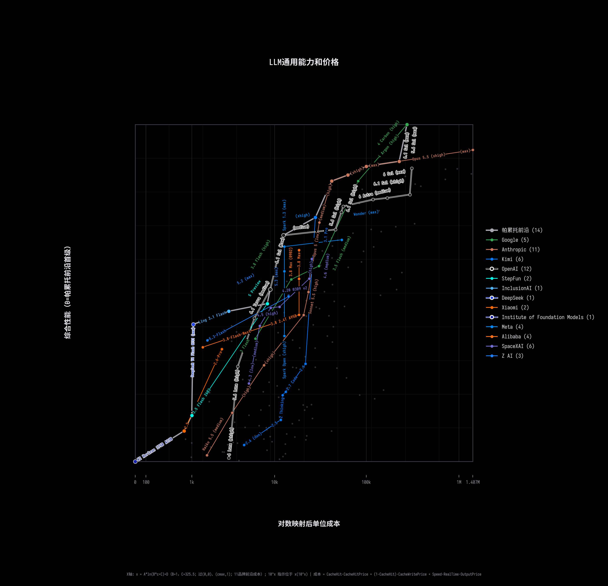

# LLM Leaderboard Pareto Analysis



## 全部模型（综合能力从高到低，最优 = 1，最差 = 0）

共收录 **Status: All**（含已弃用）的全部模型；按重新归一化后的综合能力排序。「帕累托」列：✅ = 总体帕累托前沿模型，❌ = 被支配，— = 无成本数据无法判定。图表纵轴以总体帕累托前沿第一级（y0 = 0.5561，即前沿左端点 K2 Horizon 375B A23B）为 0：综合能力 ≥ 该级且有成本数据的 180 个模型入图，389 个能力低于第一级、41 个缺少成本数据的模型不出现在图中，成本高于品牌前沿最大值的模型同样不入图（本表不受影响，仍完整列出全部模型）。

| # | 品牌 | 模型 | 综合能力 | 单请求成本 | 横轴位置 | 帕累托 |
|---|------|------|---------|-----------|-----------|------|
| 1 |  Google | Gemini 4 Carbon (high) | 1.0000 | 292,668.19 | 0.8257 | ✅ |
| 2 |  Google | Gemini 4 Carbon (medium) | 0.9759 | 73,092.63 | 0.6559 | ✅ |
| 3 |  Anthropic | Claude Opus 5.5 (max with fallback) | 0.9665 | 1,212,364.85 | 1.0000 | ❌ |
| 4 |  Anthropic | Claude Opus 5.5 (xhigh with fallback) | 0.9516 | 194,210.23 | 0.7754 | ❌ |
| 5 |  Anthropic | Claude Opus 5 (max) | 0.9449 | 120,629.14 | 0.7171 | ❌ |
| 6 |  OpenAI | GPT-5.6 Sol (max) | 0.9423 | 310,196.19 | 0.8328 | ❌ |
| 7 |  Anthropic | Claude Fable 5.1 (max with fallback) | 0.9416 | 912,322.50 | 0.9651 | ❌ |
| 8 |  OpenAI | GPT-6 Astra (xhigh) | 0.9411 | 730,013.02 | 0.9378 | ❌ |
| 9 |  OpenAI | GPT-6 Astra (max) | 0.9349 | 1,343,206.79 | 1.0000 | ❌ |
| 10 |  Anthropic | Claude Opus 5 (xhigh) | 0.9335 | 65,327.76 | 0.6422 | ✅ |
| 11 |  Anthropic | Claude Fable 5.1 (xhigh with fallback) | 0.9317 | 274,183.38 | 0.8177 | ❌ |
| 12 |  Anthropic | Claude Sonnet 5.5 (max with fallback) | 0.9277 | 639,771.73 | 0.9216 | ❌ |
| 13 |  Google | Gemini 4 Argon (high) | 0.9255 | 81,468.41 | 0.6691 | ❌ |
| 14 |  Anthropic | Claude Opus 5 (high) | 0.9254 | 47,800.41 | 0.6041 | ✅ |
| 15 |  OpenAI | GPT-6 Astra (high) | 0.9215 | 372,276.03 | 0.8552 | ❌ |
| 16 |  Anthropic | Claude Fable 5 (with fallback) | 0.9187 | 440,715.47 | 0.8759 | ❌ |
| 17 |  Meta | Muse Wonder Full (max) | 0.9178 | — | — | — |
| 18 |  Anthropic | Claude Opus 5.5 (high with fallback) | 0.9146 | 84,098.87 | 0.6730 | ❌ |
| 19 |  OpenAI | GPT-6.1 Sol (max) | 0.9077 | 294,998.13 | 0.8267 | ❌ |
| 20 |  OpenAI | GPT-6 Sol (max) | 0.9032 | 164,391.94 | 0.7550 | ❌ |
| 21 |  OpenAI | GPT-6.1 Sol (xhigh) | 0.9012 | 127,294.00 | 0.7237 | ❌ |
| 22 |  Google | Gemini 4 Carbon (low) | 0.8979 | — | — | — |
| 23 |  Anthropic | Claude Fable 5.1 (high with fallback) | 0.8960 | 90,454.67 | 0.6819 | ❌ |
| 24 |  OpenAI | GPT-6 Astra (medium) | 0.8923 | 58,362.14 | 0.6284 | ❌ |
| 25 |  OpenAI | GPT-5.6 Sol (xhigh) | 0.8865 | 131,629.26 | 0.7278 | ❌ |
| 26 |  OpenAI | GPT-6.1 Sol (high) | 0.8844 | 56,838.27 | 0.6252 | ❌ |
| 27 |  Anthropic | Claude Opus 5.5 (medium with fallback) | 0.8784 | 50,107.20 | 0.6098 | ❌ |
| 28 |  Kimi | Kimi K3.1 Pro | 0.8775 | 28,060.33 | 0.5393 | ✅ |
| 29 |  Anthropic | Claude Opus 5 (medium) | 0.8708 | 34,219.40 | 0.5634 | ❌ |
| 30 |  OpenAI | GPT-5.4 (xhigh) | 0.8693 | 323,490.87 | 0.8380 | ❌ |
| 31 |  OpenAI | GPT-5.5 (xhigh) | 0.8653 | 200,675.45 | 0.7794 | ❌ |
| 32 |  OpenAI | GPT-5.3 Codex (xhigh) | 0.8618 | 110,608.98 | 0.7065 | ❌ |
| 33 |  OpenAI | GPT-5.6 Sol (high) | 0.8616 | 47,383.38 | 0.6030 | ❌ |
| 34 |  OpenAI | GPT-6.1 Terra (max) | 0.8589 | 156,027.71 | 0.7486 | ❌ |
| 35 |  Anthropic | Claude Fable 5.1 (medium with fallback) | 0.8568 | 76,061.75 | 0.6607 | ❌ |
| 36 |  OpenAI | GPT-6.1 Sol (medium) | 0.8540 | 12,983.69 | 0.4465 | ✅ |
| 37 |  Kimi | Kimi K3 (max) | 0.8505 | 42,090.50 | 0.5886 | ❌ |
| 38 |  Meta | Muse Wonder (max) | 0.8482 | 54,238.48 | 0.6195 | ❌ |
| 39 |  OpenAI | GPT-6 Astra (low) | 0.8476 | 48,709.84 | 0.6064 | ❌ |
| 40 |  Anthropic | Claude Sonnet 5.5 (xhigh with fallback) | 0.8399 | 45,702.73 | 0.5986 | ❌ |
| 41 |  Meta | Muse Spark 1.3 (xhigh) | 0.8392 | 12,772.98 | 0.4445 | ✅ |
| 42 |  OpenAI | GPT-5.5 (high) | 0.8388 | 128,926.83 | 0.7253 | ❌ |
| 43 |  Alibaba | Qwen3.8 Max | 0.8345 | 18,530.88 | 0.4892 | ❌ |
| 44 |  OpenAI | GPT-5.6 Sol (medium) | 0.8335 | 28,742.99 | 0.5422 | ❌ |
| 45 |  OpenAI | GPT-6 Sol (xhigh) | 0.8330 | 90,758.26 | 0.6823 | ❌ |
| 46 |  Anthropic | Claude Fable 5.1 (low with fallback) | 0.8241 | 42,613.89 | 0.5901 | ❌ |
| 47 |  SpaceXAI | Grok 4.6 (high) | 0.8230 | 25,147.43 | 0.5260 | ❌ |
| 48 |  Anthropic | Claude Opus 4.8 (max) | 0.8189 | 110,610.52 | 0.7065 | ❌ |
| 49 |  Google | Gemini 3.7 Flash (medium) | 0.8169 | — | — | — |
| 50 |  OpenAI | GPT-6.1 Terra (xhigh) | 0.8156 | 39,298.07 | 0.5802 | ❌ |
| 51 |  Google | Gemini 3.7 Flash (high) | 0.8146 | — | — | — |
| 52 |  SpaceXAI | Grok 4.6 (xhigh) | 0.8144 | 32,556.06 | 0.5573 | ❌ |
| 53 |  Google | Gemini 3.5 Flash (medium) | 0.8136 | 28,653.83 | 0.5419 | ❌ |
| 54 |  Anthropic | Claude Opus 4.7 (max) | 0.8118 | 57,070.56 | 0.6257 | ❌ |
| 55 |  Meta | Muse Spark 1.3 (max) | 0.8068 | 12,772.98 | 0.4445 | ❌ |
| 56 |  OpenAI | GPT-5.6 Terra (max) | 0.8049 | 256,898.29 | 0.8097 | ❌ |
| 57 |  OpenAI | GPT-6 Sol (high) | 0.8031 | 32,904.57 | 0.5586 | ❌ |
| 58 |  SpaceXAI | Grok 4.6 (medium) | 0.7969 | 25,003.71 | 0.5254 | ❌ |
| 59 |  Alibaba | Qwen3.8 Max (0902) | 0.7967 | 18,530.88 | 0.4892 | ❌ |
| 60 |  OpenAI | GPT-5.2 (xhigh) | 0.7966 | 177,959.37 | 0.7647 | ❌ |
| 61 |  Google | Gemini 3.8 Flash (high) | 0.7959 | 15,959.55 | 0.4712 | ❌ |
| 62 |  OpenAI | GPT-6.1 Terra (high) | 0.7933 | 13,437.26 | 0.4506 | ❌ |
| 63 |  Meta | Muse Spark | 0.7901 | — | — | — |
| 64 |  OpenAI | GPT-5.5 (medium) | 0.7891 | 41,218.38 | 0.5860 | ❌ |
| 65 |  Sapiens AI | Agnes 2.5 Pro Beta | 0.7842 | — | — | — |
| 66 |  OpenAI | GPT-6.1 Sol (low) | 0.7827 | 8,977.98 | 0.4026 | ✅ |
| 67 |  OpenAI | GPT-5.2 Codex (xhigh) | 0.7825 | 266,755.45 | 0.8143 | ❌ |
| 68 |  Google | Gemini 3 Pro Preview (high) | 0.7810 | — | — | — |
| 69 |  Google | Gemini 3.5 Flash (high) | 0.7798 | 33,603.82 | 0.5612 | ❌ |
| 70 |  Anthropic | Claude Opus 5 (low) | 0.7794 | 23,748.25 | 0.5191 | ❌ |
| 71 |  Anthropic | Claude Sonnet 5 (max) | 0.7750 | 145,156.75 | 0.7398 | ❌ |
| 72 |  Z AI | GLM-5.3 (max) | 0.7745 | 14,271.54 | 0.4578 | ❌ |
| 73 |  Z AI | GLM-5.2 (max) | 0.7733 | 14,271.54 | 0.4578 | ❌ |
| 74 |  OpenAI | GPT-5.6 Luna (max) | 0.7679 | 20,403.86 | 0.5008 | ❌ |
| 75 |  Anthropic | Claude Opus 4.6 (max) | 0.7670 | 44,335.80 | 0.5949 | ❌ |
| 76 |  StepFun | Step 5 Preview | 0.7641 | 8,280.17 | 0.3931 | ✅ |
| 77 |  Google | Gemini 3.7 Flash (low) | 0.7630 | — | — | — |
| 78 |  SpaceXAI | Grok 4.7 (xhigh) | 0.7619 | 64,992.82 | 0.6415 | ❌ |
| 79 |  OpenAI | GPT-6 Sol (medium) | 0.7605 | — | — | — |
| 80 |  SpaceXAI | Grok 4.5 (high) | 0.7600 | 12,284.70 | 0.4399 | ❌ |
| 81 |  SpaceXAI | Grok 4.7 (high) | 0.7593 | 38,810.35 | 0.5787 | ❌ |
| 82 |  SpaceXAI | Grok 4.20 0309 v2 | 0.7585 | 9,948.33 | 0.4148 | ❌ |
| 83 |  Anthropic | Claude Opus 5.5 (low with fallback) | 0.7574 | 32,169.33 | 0.5559 | ❌ |
| 84 |  Google | Gemini 3.8 Flash (medium) | 0.7547 | — | — | — |
| 85 |  InclusionAI | Ling 3.1 Flash | 0.7541 | 2,991.38 | 0.2767 | ✅ |
| 86 |  Meta | Muse Spark 1.2 (xhigh) | 0.7522 | 12,772.98 | 0.4445 | ❌ |
| 87 |  Alibaba | Qwen3.8 2.4T A95B | 0.7493 | 18,530.88 | 0.4892 | ❌ |
| 88 |  Anthropic | Claude Sonnet 5.5 (high with fallback) | 0.7491 | 22,447.35 | 0.5123 | ❌ |
| 89 |  Google | Gemini 3.1 Pro Preview | 0.7480 | 43,012.11 | 0.5912 | ❌ |
| 90 |  OpenAI | GPT-5.6 Sol (low) | 0.7475 | 22,292.76 | 0.5115 | ❌ |
| 91 |  Alibaba | Qwen3.6 Max Preview | 0.7471 | — | — | — |
| 92 |  OpenAI | GPT-6.1 Terra (medium) | 0.7448 | 5,633.50 | 0.3482 | ❌ |
| 93 |  DeepSeek | DeepSeek V4 Flash 0731 (max) | 0.7367 | 1,045.98 | 0.1696 | ✅ |
| 94 |  OpenAI | GPT-5.5 (low) | 0.7360 | 26,569.49 | 0.5327 | ❌ |
| 95 |  DeepSeek | DeepSeek V4.1 Flash (max) | 0.7348 | 3,233.19 | 0.2852 | ❌ |
| 96 |  SpaceXAI | Grok 4.3 (medium) | 0.7347 | 7,816.25 | 0.3863 | ❌ |
| 97 |  Anthropic | Claude Haiku 5.5 (max) | 0.7335 | 39,695.90 | 0.5814 | ❌ |
| 98 |  DeepSeek | DeepSeek V4 Flash Vision (max) | 0.7268 | 3,690.95 | 0.3000 | ❌ |
| 99 |  DeepSeek | DeepSeek V4 Pro (high) | 0.7268 | — | — | — |
| 100 |  OpenAI | GPT-5.6 Luna (xhigh) | 0.7257 | 9,697.81 | 0.4118 | ❌ |
| 101 |  Meta | Muse Spark Open (xhigh) | 0.7216 | 12,772.98 | 0.4445 | ❌ |
| 102 |  OpenAI | GPT-5.6 Terra (xhigh) | 0.7213 | 49,565.23 | 0.6085 | ❌ |
| 103 |  OpenAI | GPT-5.4 (low) | 0.7208 | 13,316.82 | 0.4495 | ❌ |
| 104 |  Google | Gemini 3 Flash | 0.7180 | 5,890.68 | 0.3533 | ❌ |
| 105 |  Meta | Muse Spark 1.1 (xhigh) | 0.7174 | 12,772.98 | 0.4445 | ❌ |
| 106 |  Google | Gemini 3.6 Flash (high) | 0.7160 | 15,657.03 | 0.4689 | ❌ |
| 107 |  Z AI | GLM-5.3-Flash | 0.7158 | 1,620.69 | 0.2119 | ❌ |
| 108 |  DeepSeek | DeepSeek V4.1 Flash 1017 (max) | 0.7144 | 3,233.19 | 0.2852 | ❌ |
| 109 |  Anthropic | Claude Opus 4.5 | 0.7133 | 43,858.79 | 0.5936 | ❌ |
| 110 |  Alibaba | Qwen3.8-Flash-Next | 0.7067 | 1,413.94 | 0.1983 | ❌ |
| 111 |  Alibaba | Qwen3.6 Plus | 0.7057 | 18,915.08 | 0.4917 | ❌ |
| 112 |  OpenAI | GPT-5 Codex (high) | 0.7054 | 40,094.86 | 0.5827 | ❌ |
| 113 |  Xiaomi | MiMo-V2.6-Pro | 0.7041 | 2,465.13 | 0.2556 | ❌ |
| 114 |  SpaceXAI | Grok 4.20 0309 | 0.7039 | — | — | — |
| 115 |  Motif Technologies | Motif 3 (Beta) | 0.7006 | — | — | — |
| 116 |  InclusionAI | Ling 3.1 Flash 1019 | 0.6963 | — | — | — |
| 117 |  SpaceXAI | Grok 4.7 (low) | 0.6958 | 11,553.55 | 0.4326 | ❌ |
| 118 |  Anthropic | Claude Opus 4.7 (non-reasoning, high) | 0.6941 | 21,985.91 | 0.5098 | ❌ |
| 119 |  OpenAI | GPT-5.2 (medium) | 0.6938 | — | — | — |
| 120 |  Motif Technologies | Motif 3 | 0.6905 | — | — | — |
| 121 |  Alibaba | Qwen3.5 27B | 0.6901 | 6,176.72 | 0.3588 | ❌ |
| 122 |  Nex AGI | Nex-N2-Pro | 0.6890 | — | — | — |
| 123 |  Kimi | Kimi K2.6 | 0.6849 | 21,869.37 | 0.5092 | ❌ |
| 124 |  Anthropic | Claude Haiku 5.5 (xhigh) | 0.6830 | 6,512.32 | 0.3650 | ❌ |
| 125 |  OpenAI | GPT-5.6 Luna (high) | 0.6814 | 3,920.29 | 0.3068 | ❌ |
| 126 |  OpenAI | GPT-5.1 Codex (high) | 0.6804 | 25,550.19 | 0.5280 | ❌ |
| 127 |  Alibaba | Qwen3.7 Max | 0.6802 | 27,995.65 | 0.5390 | ❌ |
| 128 |  OpenAI | GPT-5.6 Terra (high) | 0.6801 | 14,285.74 | 0.4579 | ❌ |
| 129 |  DeepSeek | DeepSeek V4 Pro (max) | 0.6795 | 16,995.90 | 0.4788 | ❌ |
| 130 |  OpenAI | GPT-5 (medium) | 0.6790 | 47,621.37 | 0.6036 | ❌ |
| 131 |  Xiaomi | MiMo-V2-Pro | 0.6780 | — | — | — |
| 132 |  Z AI | GLM-5-Turbo | 0.6698 | — | — | — |
| 133 |  OpenAI | GPT-5.1 (high) | 0.6662 | 62,162.33 | 0.6361 | ❌ |
| 134 |  Xiaomi | MiMo-V2-Omni-0327 | 0.6641 | — | — | — |
| 135 |  OpenAI | GPT-6.1 Terra (low) | 0.6641 | 4,395.91 | 0.3197 | ❌ |
| 136 |  Anthropic | Claude Sonnet 5.5 (medium with fallback) | 0.6605 | 8,579.38 | 0.3973 | ❌ |
| 137 |  SpaceXAI | Grok 4.3 (low) | 0.6589 | 5,322.64 | 0.3416 | ❌ |
| 138 |  OpenAI | GPT-6 Sol (low) | 0.6556 | 10,519.31 | 0.4214 | ❌ |
| 139 |  Google | Gemini 3.8 Flash (low) | 0.6544 | — | — | — |
| 140 |  Z AI | GLM-5 | 0.6532 | 14,007.26 | 0.4556 | ❌ |
| 141 |  MiniMax | MiniMax-M2.5 | 0.6531 | 3,503.23 | 0.2942 | ❌ |
| 142 |  Tencent | Hy3-preview | 0.6515 | — | — | — |
| 143 |  OpenAI | o3 | 0.6509 | 18,764.79 | 0.4907 | ❌ |
| 144 |  Alibaba | Qwen3.7 Plus | 0.6502 | 4,988.50 | 0.3342 | ❌ |
| 145 |  Anthropic | Claude Sonnet 4.6 (max) | 0.6501 | 119,024.40 | 0.7155 | ❌ |
| 146 |  Kimi | Kimi K2.7 Code | 0.6480 | 13,263.70 | 0.4490 | ❌ |
| 147 |  SpaceXAI | Grok Build 0.1 0616 | 0.6479 | 7,471.26 | 0.3810 | ❌ |
| 148 |  Xiaomi | MiMo-V2-Flash (Feb 2026) | 0.6475 | — | — | — |
| 149 |  MiniMax | MiniMax-M3.1-Flash | 0.6467 | 1,729.52 | 0.2185 | ❌ |
| 150 |  Kimi | Kimi K2 Thinking | 0.6436 | 12,250.00 | 0.4395 | ❌ |
| 151 |  OpenAI | GPT-5 (high) | 0.6435 | 89,855.54 | 0.6811 | ❌ |
| 152 |  SpaceXAI | Grok 4.6 (low) | 0.6430 | 12,639.41 | 0.4433 | ❌ |
| 153 |  DeepSeek | DeepSeek V4 Pro 0813 (max) | 0.6407 | 11,091.66 | 0.4277 | ❌ |
| 154 |  OpenAI | GPT-5.4 mini (xhigh) | 0.6387 | 132,434.64 | 0.7286 | ❌ |
| 155 |  Xiaomi | MiMo-V2-Flash | 0.6357 | — | — | — |
| 156 |  DeepSeek | DeepSeek V4 Flash (max) | 0.6349 | 1,716.29 | 0.2177 | ❌ |
| 157 |  Alibaba | Qwen3 Max Thinking | 0.6332 | — | — | — |
| 158 |  Z AI | GLM 5V Turbo | 0.6323 | — | — | — |
| 159 |  Xiaomi | MiMo-V2-Omni | 0.6310 | — | — | — |
| 160 |  Anthropic | Claude Sonnet 5 (xhigh) | 0.6309 | 28,075.52 | 0.5394 | ❌ |
| 161 |  Z AI | GLM-5.1 | 0.6305 | 19,196.18 | 0.4934 | ❌ |
| 162 |  Alibaba | Qwen3.8 27B (xhigh) | 0.6296 | 8,735.63 | 0.3994 | ❌ |
| 163 |  Anthropic | Claude Opus 4.6 (non-reasoning, high) | 0.6279 | 22,706.22 | 0.5137 | ❌ |
| 164 |  OpenAI | GPT-6 Luna (max) | 0.6239 | 7,446.81 | 0.3806 | ❌ |
| 165 |  SpaceXAI | Grok 4 | 0.6237 | 20,708.60 | 0.5026 | ❌ |
| 166 |  Apodex | Apodex 1.1 | 0.6233 | — | — | — |
| 167 |  Anthropic | Claude Haiku 5.5 (high) | 0.6205 | 3,354.23 | 0.2893 | ❌ |
| 168 |  China Mobile | JT-4.1 Flash 236B A21B | 0.6202 | — | — | — |
| 169 |  Anthropic | Claude 4 Opus | 0.6194 | — | — | — |
| 170 |  Alibaba | Qwen3.5 35B A3B | 0.6170 | 5,147.27 | 0.3378 | ❌ |
| 171 |  StepFun | Step 3.5 Flash 2603 | 0.6168 | 997.13 | 0.1652 | ✅ |
| 172 |  OpenAI | GPT-5.6 Terra (medium) | 0.6148 | 11,541.58 | 0.4324 | ❌ |
| 173 |  OpenAI | GPT-5.4 nano (xhigh) | 0.6127 | 24,894.49 | 0.5248 | ❌ |
| 174 |  DeepSeek | DeepSeek V4 Flash (high) | 0.6110 | — | — | — |
| 175 |  Kimi | Kimi K2.5 | 0.6110 | 11,698.54 | 0.4341 | ❌ |
| 176 |  OpenAI | GPT-5.6 Sol (non-reasoning) | 0.6103 | 18,691.55 | 0.4902 | ❌ |
| 177 |  MiniMax | MiniMax-M2.1 | 0.6078 | 3,503.23 | 0.2942 | ❌ |
| 178 |  Anthropic | Claude Sonnet 5 (high) | 0.6058 | 19,722.38 | 0.4967 | ❌ |
| 179 |  Mistral | Mistral Large 4 Preview | 0.6031 | 6,709.90 | 0.3685 | ❌ |
| 180 |  OpenAI | GPT-5 mini (medium) | 0.6010 | 4,890.56 | 0.3319 | ❌ |
| 181 |  SpaceXAI | Grok 4.1 Fast | 0.6007 | — | — | — |
| 182 |  Anthropic | Claude Sonnet 5.5 (low with fallback) | 0.6007 | 8,678.77 | 0.3986 | ❌ |
| 183 |  Google | Gemini 3.5 Flash (minimal) | 0.6005 | 8,074.79 | 0.3902 | ❌ |
| 184 |  Z AI | GLM-4.7 | 0.5978 | 8,194.32 | 0.3919 | ❌ |
| 185 |  Xiaomi | MiMo-V2.5 | 0.5964 | 769.70 | 0.1425 | ✅ |
| 186 |  Kimi | Kimi K3 (low) | 0.5962 | 42,090.50 | 0.5886 | ❌ |
| 187 |  OpenAI | GPT-5.5 Instant (May 2026) | 0.5941 | — | — | — |
| 188 |  InclusionAI | Ling-3.0-flash-VL | 0.5939 | — | — | — |
| 189 |  KwaiKAT | KAT-Coder-Pro V2 | 0.5933 | — | — | — |
| 190 |  Alibaba | Qwen3.5 397B A17B | 0.5923 | 13,623.04 | 0.4522 | ❌ |
| 191 |  Z AI | GLM-5.1 (non-reasoning) | 0.5902 | 5,625.00 | 0.3480 | ❌ |
| 192 |  Alibaba | Qwen3.6 27B | 0.5898 | 22,587.04 | 0.5131 | ❌ |
| 193 |  Anthropic | Claude Sonnet 5 (non-reasoning) | 0.5889 | 8,890.65 | 0.4015 | ❌ |
| 194 |  OpenAI | GPT-5 (low) | 0.5883 | 14,547.39 | 0.4601 | ❌ |
| 195 |  OpenAI | GPT-5.1 Codex mini (high) | 0.5856 | 8,159.30 | 0.3914 | ❌ |
| 196 |  Xiaomi | MiMo-V2.6-Flash | 0.5854 | 808.82 | 0.1468 | ❌ |
| 197 |  Google | Gemini 3 Pro Preview (low) | 0.5847 | — | — | — |
| 198 |  Anthropic | Claude Opus 4.5 (non-reasoning) | 0.5846 | 22,278.06 | 0.5114 | ❌ |
| 199 |  Upstage | Solar Open2 250B | 0.5844 | — | — | — |
| 200 |  China Mobile | JT-4.1 Flash 236B A21B (non-reasoning) | 0.5826 | — | — | — |
| 201 |  SpaceXAI | Grok 4.3 (high) | 0.5821 | 10,221.70 | 0.4180 | ❌ |
| 202 |  StepFun | Step 3.7 Flash | 0.5812 | 3,369.25 | 0.2898 | ❌ |
| 203 |  StepFun | Step 3.5 Flash | 0.5805 | 997.13 | 0.1652 | ❌ |
| 204 |  MiniMax | MiniMax-M3 | 0.5803 | 3,785.56 | 0.3028 | ❌ |
| 205 |  DeepSeek | DeepSeek V3.2 | 0.5794 | — | — | — |
| 206 |  Anthropic | Claude Sonnet 4.6 (non-reasoning, high) | 0.5790 | 13,169.25 | 0.4482 | ❌ |
| 207 |  Xiaomi | MiMo-V2.5-Pro | 0.5782 | 2,904.04 | 0.2734 | ❌ |
| 208 |  Kimi | Kimi K2.6 (non-reasoning) | 0.5779 | 4,523.07 | 0.3230 | ❌ |
| 209 |  Tencent | Hy3 | 0.5751 | 1,787.59 | 0.2219 | ❌ |
| 210 |  Anthropic | Claude 4.1 Opus | 0.5734 | — | — | — |
| 211 |  Alibaba | Qwen3.5 122B A10B | 0.5709 | 8,235.63 | 0.3925 | ❌ |
| 212 |  MiniMax | MiniMax-M2 | 0.5701 | 3,176.72 | 0.2833 | ❌ |
| 213 |  Alibaba | Qwen3.5 27B (non-reasoning) | 0.5686 | 2,488.10 | 0.2566 | ❌ |
| 214 |  Alibaba | Qwen3.5 397B A17B (non-reasoning) | 0.5684 | 2,623.04 | 0.2623 | ❌ |
| 215 |  Anthropic | Claude Sonnet 4.6 (non-reasoning, low) | 0.5663 | 13,238.16 | 0.4488 | ❌ |
| 216 |  Anthropic | Claude Haiku 5.5 (medium) | 0.5644 | 1,632.90 | 0.2127 | ❌ |
| 217 |  OpenAI | GPT-5.4 mini (medium) | 0.5626 | 10,183.54 | 0.4176 | ❌ |
| 218 |  Multiverse Computing | Quasar 438B (max) | 0.5617 | 982.97 | 0.1639 | ❌ |
| 219 |  OpenAI | GPT-6 Luna (xhigh) | 0.5609 | 2,711.79 | 0.2660 | ❌ |
| 220 |  OpenAI | GPT-5.6 Terra (low) | 0.5590 | 11,233.66 | 0.4292 | ❌ |
| 221 |  Alibaba | Qwen3.5 Omni Plus | 0.5572 | 3,947.14 | 0.3075 | ❌ |
| 222 |  Institute of Foundation Models | K2 Horizon 375B A23B | 0.5561 | 0.00 | 0.0000 | ✅ |
| 223 |  DeepSeek | DeepSeek V4.1 Flash 1017 (high) | 0.5553 | 3,233.19 | 0.2852 | ❌ |
| 224 |  OpenAI | GPT-5.6 Luna (medium) | 0.5553 | 1,296.30 | 0.1898 | ❌ |
| 225 |  OpenAI | GPT-5.4 nano (medium) | 0.5553 | 2,191.03 | 0.2431 | ❌ |
| 226 |  Anthropic | Claude 4.5 Sonnet | 0.5543 | 23,899.54 | 0.5199 | ❌ |
| 227 |  Upstage | Solar Pro 4 | 0.5516 | 3,741.38 | 0.3015 | ❌ |
| 228 |  Z AI | GLM-5.3 (low) | 0.5476 | 14,271.54 | 0.4578 | ❌ |
| 229 |  Amazon | Nova 2.0 Pro Preview (medium) | 0.5440 | 28,672.55 | 0.5419 | ❌ |
| 230 |  SpaceXAI | Grok 4 Fast | 0.5419 | — | — | — |
| 231 |  Alibaba | Qwen3.6 35B A3B | 0.5387 | 13,484.65 | 0.4510 | ❌ |
| 232 |  OpenAI | GPT-6 Luna (high) | 0.5364 | 2,025.64 | 0.2348 | ❌ |
| 233 |  Alibaba | Qwen3.6 27B (non-reasoning) | 0.5336 | 2,903.16 | 0.2734 | ❌ |
| 234 |  DeepSeek | DeepSeek V3.2 Speciale | 0.5328 | — | — | — |
| 235 |  OpenAI | GPT-6.1 Terra (non-reasoning) | 0.5287 | 4,127.96 | 0.3126 | ❌ |
| 236 |  Kimi | Kimi K2.5 (non-reasoning) | 0.5285 | 7,834.82 | 0.3866 | ❌ |
| 237 |  Google | Gemini 3 Flash (non-reasoning) | 0.5275 | 2,743.99 | 0.2672 | ❌ |
| 238 |  Thinking Machines | Inkling (xhigh) | 0.5267 | 12,313.93 | 0.4402 | ❌ |
| 239 |  Reflection | Beam 1.0 | 0.5242 | 3,612.07 | 0.2976 | ❌ |
| 240 |  Alibaba | Qwen3.5 122B A10B (non-reasoning) | 0.5237 | 2,877.73 | 0.2724 | ❌ |
| 241 |  Institute of Foundation Models | K2 Horizon MoVA 36B A4B | 0.5234 | — | — | — |
| 242 |  OpenAI | o4-mini (high) | 0.5232 | 19,489.95 | 0.4953 | ❌ |
| 243 |  KwaiKAT | KAT-Coder-Pro V1 | 0.5229 | — | — | — |
| 244 |  Thinking Machines | Inkling Small | 0.5227 | 3,741.38 | 0.3015 | ❌ |
| 245 |  OpenAI | GPT-5.5 (non-reasoning) | 0.5227 | 24,683.25 | 0.5238 | ❌ |
| 246 |  ByteDance Seed | Doubao Seed Code | 0.5216 | — | — | — |
| 247 |  MiniMax | MiniMax-M2.7 | 0.5211 | 4,339.96 | 0.3183 | ❌ |
| 248 |  NVIDIA | Nemotron 3 Ultra | 0.5204 | 8,975.26 | 0.4026 | ❌ |
| 249 |  Anthropic | Claude Sonnet 5 (medium) | 0.5201 | 12,456.48 | 0.4415 | ❌ |
| 250 |  Amazon | Nova 2.0 Lite (medium) | 0.5194 | 6,426.72 | 0.3634 | ❌ |
| 251 |  China Mobile | JT-35B-Flash | 0.5182 | — | — | — |
| 252 |  OpenAI | GPT-6 Sol (non-reasoning) | 0.5095 | 9,478.67 | 0.4091 | ❌ |
| 253 |  InclusionAI | Ling 3.0 Flash | 0.5062 | 735.34 | 0.1387 | ❌ |
| 254 |  Anthropic | Claude Haiku 5.5 (low) | 0.5053 | 1,164.79 | 0.1796 | ❌ |
| 255 |  Z AI | GLM-5 (non-reasoning) | 0.5039 | 4,422.24 | 0.3204 | ❌ |
| 256 |  Amazon | Nova 2.0 Pro Preview (low) | 0.5030 | 25,736.34 | 0.5288 | ❌ |
| 257 |  Alibaba | Qwen3.8 27B (medium) | 0.5008 | 8,735.63 | 0.3994 | ❌ |
| 258 |  Google | Gemini 3.5 Flash-Lite | 0.5006 | 8,778.06 | 0.4000 | ❌ |
| 259 |  OpenAI | GPT-6 Luna (medium) | 0.5002 | — | — | — |
| 260 |  DeepSeek | DeepSeek V4 Pro (non-reasoning) | 0.4978 | 5,076.22 | 0.3362 | ❌ |
| 261 |  Google | Gemini 2.5 Flash (Sep) | 0.4972 | — | — | — |
| 262 |  Alibaba | Qwen3.8 27B (low) | 0.4961 | 8,735.63 | 0.3994 | ❌ |
| 263 |  Amazon | Nova 2.0 Omni (low) | 0.4957 | — | — | — |
| 264 |  Anthropic | Claude 4 Sonnet | 0.4934 | — | — | — |
| 265 |  OpenAI | GPT-5.6 Luna (low) | 0.4930 | 1,147.46 | 0.1782 | ❌ |
| 266 |  Alibaba | Qwen3 Max Thinking (Preview) | 0.4922 | — | — | — |
| 267 |  InclusionAI | Ling-2.6-1T | 0.4918 | — | — | — |
| 268 |  SK Telecom | A.X-K2 | 0.4905 | — | — | — |
| 269 |  InclusionAI | Ling-3.0-flash-Fin | 0.4895 | — | — | — |
| 270 |  OpenAI | GPT-5 mini (high) | 0.4890 | 16,466.13 | 0.4750 | ❌ |
| 271 |  Baidu | ERNIE 5.0 Thinking Preview | 0.4871 | — | — | — |
| 272 |  Amazon | Nova 2.0 Omni (medium) | 0.4865 | — | — | — |
| 273 |  Alibaba | Qwen3.6 35B A3B (non-reasoning) | 0.4850 | 2,035.46 | 0.2353 | ❌ |
| 274 |  OpenAI | GPT-5.4 (non-reasoning) | 0.4844 | 12,046.88 | 0.4376 | ❌ |
| 275 |  AI9Stars | G9v3-39A5B | 0.4829 | — | — | — |
| 276 |  DeepSeek | DeepSeek V3.2 Exp | 0.4813 | — | — | — |
| 277 |  Google | Gemma 4 26B A4B | 0.4809 | 1,379.45 | 0.1959 | ❌ |
| 278 |  LG AI Research | K-EXAONE | 0.4806 | — | — | — |
| 279 |  LG AI Research | EXAONE 4.5 33B | 0.4790 | — | — | — |
| 280 |  Alibaba | Qwen3 VL 235B A22B | 0.4773 | — | — | — |
| 281 |  Amazon | Nova 2.0 Lite (high) | 0.4770 | 6,426.72 | 0.3634 | ❌ |
| 282 |  DeepSeek | DeepSeek V3.2 (non-reasoning) | 0.4770 | — | — | — |
| 283 |  DeepSeek | DeepSeek V4 Flash (non-reasoning) | 0.4761 | — | — | — |
| 284 |  SpaceXAI | Grok 3 mini Reasoning (high) | 0.4744 | 2,132.54 | 0.2402 | ❌ |
| 285 |  Google | Gemma 4 31B | 0.4743 | 0.00 | 0.0000 | ❌ |
| 286 |  NVIDIA | Nemotron 3.5 Super VL | 0.4720 | 1,838.36 | 0.2247 | ❌ |
| 287 |  Google | Gemma 4 12B | 0.4715 | 808.91 | 0.1468 | ❌ |
| 288 |  OpenAI | o1 | 0.4710 | — | — | — |
| 289 |  Anthropic | Claude 4.5 Sonnet (non-reasoning) | 0.4704 | 13,150.41 | 0.4480 | ❌ |
| 290 |  SpaceXAI | Grok 4.20 0309 (non-reasoning) | 0.4669 | — | — | — |
| 291 |  Z AI | GLM-4.7 (non-reasoning) | 0.4665 | 4,168.67 | 0.3137 | ❌ |
| 292 |  Xiaomi | MiMo-V2.5-Pro (non-reasoning) | 0.4655 | 1,067.56 | 0.1715 | ❌ |
| 293 |  Mistral | Mistral Large 4 (high) | 0.4625 | — | — | — |
| 294 |  LG AI Research | K-EXAONE 2.0 | 0.4608 | — | — | — |
| 295 |  Google | Gemini 2.5 Pro | 0.4599 | 36,500.35 | 0.5712 | ❌ |
| 296 |  Alibaba | Qwen3.5 35B A3B (non-reasoning) | 0.4596 | 1,823.43 | 0.2239 | ❌ |
| 297 |  Z AI | GLM-4.7-Flash | 0.4588 | 1,135.34 | 0.1772 | ❌ |
| 298 |  Z AI | GLM-4.6 | 0.4570 | 6,859.19 | 0.3710 | ❌ |
| 299 |  Alibaba | Qwen3.5 4B | 0.4565 | 392.67 | 0.0922 | ❌ |
| 300 |  Upstage | Solar Mini 4 | 0.4539 | 1,153.02 | 0.1787 | ❌ |
| 301 |  Alibaba | Qwen3.5 9B | 0.4523 | 579.52 | 0.1197 | ❌ |
| 302 |  SpaceXAI | Grok 4.20 0309 v2 (non-reasoning) | 0.4512 | 4,018.27 | 0.3096 | ❌ |
| 303 |  LongCat | LongCat 2.0 | 0.4509 | 7,957.97 | 0.3884 | ❌ |
| 304 |  Google | Gemini 2.5 Flash | 0.4499 | 9,397.19 | 0.4080 | ❌ |
| 305 |  Anthropic | Claude Sonnet 5 (low) | 0.4487 | 9,205.60 | 0.4056 | ❌ |
| 306 |  Mistral | Mistral Large 4 (medium) | 0.4484 | — | — | — |
| 307 |  InclusionAI | Ring-2.6-1T | 0.4467 | 6,426.72 | 0.3634 | ❌ |
| 308 |  Google | Gemma 4 31B (non-reasoning) | 0.4454 | 1,657.21 | 0.2141 | ❌ |
| 309 |  DeepSeek | DeepSeek V3.1 Terminus | 0.4448 | — | — | — |
| 310 |  Nanbeige | Nanbeige4.3-33B | 0.4445 | — | — | — |
| 311 |  Xiaomi | MiMo-V2-Flash (non-reasoning) | 0.4438 | — | — | — |
| 312 |  Mistral | Mistral Medium 3.5 | 0.4435 | 21,045.25 | 0.5045 | ❌ |
| 313 |  Alibaba | Qwen3.8 27B (non-reasoning) | 0.4430 | 3,284.40 | 0.2870 | ❌ |
| 314 |  ServiceNow | Apriel-v1.6-15B-Thinker | 0.4429 | — | — | — |
| 315 |  OpenAI | GPT-5.5 Instant (June 2026) | 0.4389 | 82,650.83 | 0.6709 | ❌ |
| 316 |  Alibaba | Qwen3.5 9B (non-reasoning) | 0.4384 | 237.06 | 0.0634 | ❌ |
| 317 |  Alibaba | Qwen3 Max | 0.4371 | — | — | — |
| 318 |  Alibaba | Qwen3.5 Omni Flash | 0.4370 | 802.27 | 0.1461 | ❌ |
| 319 |  Z AI | GLM-5.2 (non-reasoning) | 0.4358 | 6,116.06 | 0.3577 | ❌ |
| 320 |  Institute of Foundation Models | K2 Horizon 7B | 0.4317 | — | — | — |
| 321 |  Amazon | Nova 2.0 Lite (low) | 0.4308 | 6,426.72 | 0.3634 | ❌ |
| 322 |  Tencent | Hy3-preview (non-reasoning) | 0.4304 | — | — | — |
| 323 |  Alibaba | Qwen3 VL 32B | 0.4298 | — | — | — |
| 324 |  Kimi | Kimi K2 0905 | 0.4289 | 1,834.02 | 0.2245 | ❌ |
| 325 |  Meta | Muse Glimmer (high) | 0.4288 | 3,553.16 | 0.2957 | ❌ |
| 326 |  Google | Gemini 3.1 Flash-Lite | 0.4222 | 3,908.19 | 0.3064 | ❌ |
| 327 |  Anthropic | Claude 4.5 Haiku | 0.4217 | 13,696.15 | 0.4529 | ❌ |
| 328 |  Cohere | Command A+ | 0.4213 | 0.00 | 0.0000 | ❌ |
| 329 |  NVIDIA | Nemotron Cascade 2 30B A3B | 0.4196 | — | — | — |
| 330 |  Google | Gemma 4 26B A4B (non-reasoning) | 0.4177 | 878.93 | 0.1540 | ❌ |
| 331 |  Anthropic | Claude 4 Sonnet (non-reasoning) | 0.4168 | — | — | — |
| 332 |  OpenAI | GPT-5.2 (non-reasoning) | 0.4147 | 10,506.18 | 0.4213 | ❌ |
| 333 |  SpaceXAI | Grok Code Fast 1 | 0.4143 | — | — | — |
| 334 |  ServiceNow | Apriel-v1.5-15B-Thinker | 0.4137 | — | — | — |
| 335 |  DeepSeek | DeepSeek V3.1 | 0.4136 | 10,000.00 | 0.4154 | ❌ |
| 336 |  NVIDIA | Nemotron 3.5 Bolt 74B-A9B | 0.4132 | — | — | — |
| 337 |  Google | Gemini 2.5 Flash-Lite (Sep) | 0.4130 | — | — | — |
| 338 |  OpenAI | GPT-5 nano (high) | 0.4111 | 5,839.12 | 0.3523 | ❌ |
| 339 |  DeepSeek | DeepSeek V4.1 Flash 1017 (non-reasoning) | 0.4111 | 1,137.56 | 0.1774 | ❌ |
| 340 |  Google | Gemini 2.5 Flash (Sep) (non-reasoning) | 0.4109 | — | — | — |
| 341 |  OpenAI | GPT-6 Luna (low) | 0.4107 | 563.82 | 0.1176 | ❌ |
| 342 |  Inception | Mercury 2 | 0.4090 | — | — | — |
| 343 |  OpenAI | GPT-5.6 Terra (non-reasoning) | 0.4085 | 10,465.25 | 0.4208 | ❌ |
| 344 |  OpenAI | GPT-4.1 | 0.4042 | 11,190.45 | 0.4288 | ❌ |
| 345 |  DeepSeek | DeepSeek V4.1 Flash (non-reasoning) | 0.4030 | 1,152.25 | 0.1786 | ❌ |
| 346 |  OpenAI | GPT-5 (minimal) | 0.4023 | 7,963.63 | 0.3885 | ❌ |
| 347 |  Z AI | GLM-4.5 | 0.4013 | — | — | — |
| 348 |  OpenAI | GPT-5 nano (medium) | 0.4004 | 2,988.72 | 0.2766 | ❌ |
| 349 |  Anthropic | Claude 3.7 Sonnet (non-reasoning) | 0.3963 | — | — | — |
| 350 |  Kimi | Kimi K2 | 0.3929 | 1,706.68 | 0.2171 | ❌ |
| 351 |  DeepSeek | DeepSeek R1 0528 | 0.3919 | 23,728.09 | 0.5190 | ❌ |
| 352 |  NVIDIA | Nemotron 3 Super | 0.3911 | 3,226.65 | 0.2850 | ❌ |
| 353 |  Anthropic | Claude 3.7 Sonnet | 0.3884 | — | — | — |
| 354 |  OpenAI | GPT-5.1 (non-reasoning) | 0.3875 | 8,229.25 | 0.3924 | ❌ |
| 355 |  Arcee AI | Trinity Large Thinking | 0.3793 | — | — | — |
| 356 |  DeepSeek | DeepSeek V3.1 Terminus (non-reasoning) | 0.3789 | 1,978.80 | 0.2324 | ❌ |
| 357 |  SpaceXAI | Grok 4.3 (non-reasoning) | 0.3750 | 3,980.89 | 0.3085 | ❌ |
| 358 |  ByteDance Seed | Seed-OSS-36B-Instruct | 0.3672 | 1,548.71 | 0.2073 | ❌ |
| 359 |  Anthropic | Claude 4.5 Haiku (non-reasoning) | 0.3669 | 4,400.12 | 0.3198 | ❌ |
| 360 |  DeepSeek | DeepSeek V3.2 Exp (non-reasoning) | 0.3660 | — | — | — |
| 361 |  Alibaba | Qwen3 Max (Preview) | 0.3641 | — | — | — |
| 362 |  OpenAI | gpt-oss-120b (high) | 0.3628 | 2,529.45 | 0.2584 | ❌ |
| 363 |  SpaceXAI | Grok 3 | 0.3612 | 18,129.29 | 0.4865 | ❌ |
| 364 |  Z AI | GLM-4.6 (non-reasoning) | 0.3611 | 5,226.87 | 0.3395 | ❌ |
| 365 |  OpenAI | GPT-5.6 Luna (non-reasoning) | 0.3580 | 1,036.58 | 0.1688 | ❌ |
| 366 |  OpenAI | GPT-5 (ChatGPT) | 0.3575 | — | — | — |
| 367 |  Alibaba | Qwen3 235B A22B 2507 | 0.3574 | 7,767.67 | 0.3856 | ❌ |
| 368 |  Google | DiffusionGemma 26B A4B | 0.3557 | — | — | — |
| 369 |  Z AI | GLM-4.5-Air | 0.3532 | 2,550.14 | 0.2593 | ❌ |
| 370 |  Alibaba | Qwen3 Coder Next | 0.3493 | 3,436.57 | 0.2920 | ❌ |
| 371 |  Alibaba | Qwen3.5 4B (non-reasoning) | 0.3481 | 96.00 | 0.0297 | ❌ |
| 372 |  China Mobile | JT-MINI | 0.3478 | — | — | — |
| 373 |  Multiverse Computing | HyperNova 60B 2605 (high) | 0.3474 | — | — | — |
| 374 |  Cohere | North Mini Code | 0.3468 | 0.00 | 0.0000 | ❌ |
| 375 |  LG AI Research | K-EXAONE (non-reasoning) | 0.3464 | — | — | — |
| 376 |  DeepSeek | DeepSeek V3.1 (non-reasoning) | 0.3442 | 6,679.73 | 0.3679 | ❌ |
| 377 |  OpenAI | GPT-5 mini (minimal) | 0.3440 | 1,560.31 | 0.2081 | ❌ |
| 378 |  InclusionAI | Ling 2.6 Flash | 0.3432 | — | — | — |
| 379 |  Upstage | Solar Open 100B | 0.3418 | — | — | — |
| 380 |  Alibaba | Qwen3 VL 235B A22B | 0.3412 | 2,372.65 | 0.2515 | ❌ |
| 381 |  LongCat | LongCat Flash Lite | 0.3409 | — | — | — |
| 382 |  Institute of Foundation Models | K2 Horizon 3.7B | 0.3406 | — | — | — |
| 383 |  IBM | Granite 4.2 30B | 0.3403 | — | — | — |
| 384 |  Google | Gemini 2.5 Flash-Lite (Sep) (non-reasoning) | 0.3401 | — | — | — |
| 385 |  InclusionAI | Ring-1T | 0.3389 | — | — | — |
| 386 |  Google | Gemini 2.5 Flash (non-reasoning) | 0.3370 | 1,904.00 | 0.2284 | ❌ |
| 387 |  Mistral | Magistral Medium 1.2 | 0.3361 | — | — | — |
| 388 |  Google | Gemma 4 12B (non-reasoning) | 0.3355 | 285.24 | 0.0730 | ❌ |
| 389 |  Amazon | Nova 2.0 Pro Preview (non-reasoning) | 0.3346 | 7,151.03 | 0.3759 | ❌ |
| 390 |  Google | Gemini 2.5 Flash-Lite | 0.3322 | 2,972.73 | 0.2760 | ❌ |
| 391 |  Alibaba | Qwen3 235B 2507 | 0.3297 | 2,690.49 | 0.2651 | ❌ |
| 392 |  OpenAI | GPT-5.4 mini (non-reasoning) | 0.3293 | 4,176.67 | 0.3139 | ❌ |
| 393 |  Alibaba | Qwen3 Next 80B A3B | 0.3291 | — | — | — |
| 394 |  Korea Telecom | Mi:dm K 2.5 Pro | 0.3291 | — | — | — |
| 395 |  SpaceXAI | Grok 4.1 Fast (non-reasoning) | 0.3288 | — | — | — |
| 396 |  InclusionAI | Ling 3.0 Tiny | 0.3275 | 0.00 | 0.0000 | ❌ |
| 397 |  Mistral | Pixtral Large | 0.3268 | — | — | — |
| 398 |  Institute of Foundation Models | K2-V2 (high) | 0.3266 | — | — | — |
| 399 |  Z AI | GLM-4.6V | 0.3254 | 4,097.16 | 0.3118 | ❌ |
| 400 |  Institute of Foundation Models | K2 Think V2 | 0.3244 | — | — | — |
| 401 |  Alibaba | Qwen3 Coder 480B | 0.3218 | 3,617.66 | 0.2978 | ❌ |
| 402 |  Trillion Labs | Tri-21B-think Preview | 0.3218 | — | — | — |
| 403 |  MiniMax | MiniMax M1 80k | 0.3188 | 5,823.99 | 0.3520 | ❌ |
| 404 |  Trillion Labs | Tri-21B-Think | 0.3176 | — | — | — |
| 405 |  Deep Cogito | Cogito v2.1 | 0.3168 | — | — | — |
| 406 |  Naver | HyperCLOVA X SEED Think (32B) | 0.3144 | — | — | — |
| 407 |  OpenAI | GPT-6 Luna (non-reasoning) | 0.3133 | 462.71 | 0.1033 | ❌ |
| 408 |  NVIDIA | Nemotron 3.5 Lightning | 0.3131 | 864.73 | 0.1525 | ❌ |
| 409 |  DeepSeek | DeepSeek V4 Pro 0813 (non-reasoning) | 0.3127 | 3,831.18 | 0.3042 | ❌ |
| 410 |  SpaceXAI | Grok 4 Fast (non-reasoning) | 0.3111 | — | — | — |
| 411 |  OpenAI | gpt-oss-20b (low) | 0.3109 | 791.24 | 0.1449 | ❌ |
| 412 |  Alibaba | Qwen3 VL 30B A3B | 0.3104 | — | — | — |
| 413 |  Alibaba | Qwen3 VL 32B | 0.3099 | — | — | — |
| 414 |  Inception | Mercury 2.5 | 0.3091 | — | — | — |
| 415 |  OpenBMB | MiniCPM5-2B | 0.3048 | — | — | — |
| 416 |  NVIDIA | Nemotron 3 Nano Omni 30B A3B | 0.3025 | 3,485.63 | 0.2936 | ❌ |
| 417 |  MiniMax | MiniMax M1 40k | 0.3010 | — | — | — |
| 418 |  Z AI | GLM-4.7-Flash (non-reasoning) | 0.3005 | 694.34 | 0.1340 | ❌ |
| 419 |  Alibaba | Qwen3 Next 80B A3B | 0.3002 | 1,636.31 | 0.2129 | ❌ |
| 420 |  NVIDIA | Nemotron 3 Nano | 0.3001 | 1,000.00 | 0.1655 | ❌ |
| 421 |  Motif Technologies | Motif-2-12.7B | 0.2964 | — | — | — |
| 422 |  OpenAI | o3-mini (high) | 0.2958 | 33,886.94 | 0.5622 | ❌ |
| 423 |  Prime Intellect | INTELLECT-3 | 0.2956 | — | — | — |
| 424 |  OpenAI | GPT-4.1 mini | 0.2936 | 2,193.10 | 0.2432 | ❌ |
| 425 |  OpenAI | gpt-oss-20b (high) | 0.2936 | 579.45 | 0.1197 | ❌ |
| 426 |  Amazon | Nova 2.0 Lite (non-reasoning) | 0.2920 | 1,889.79 | 0.2276 | ❌ |
| 427 |  Mistral | Mistral Small 4 | 0.2855 | 1,729.52 | 0.2185 | ❌ |
| 428 |  InclusionAI | Ling-1T | 0.2840 | — | — | — |
| 429 |  Korea Telecom | Mi:dm K 2.5 Pro Preview | 0.2796 | — | — | — |
| 430 |  OpenAI | gpt-oss-120b (low) | 0.2795 | 2,737.50 | 0.2670 | ❌ |
| 431 |  Upstage | Solar Pro 3 | 0.2783 | 1,729.52 | 0.2185 | ❌ |
| 432 |  Amazon | Nova 2.0 Omni (non-reasoning) | 0.2743 | — | — | — |
| 433 |  StepFun | Step3 VL 10B | 0.2742 | — | — | — |
| 434 |  OpenAI | GPT-4o (Aug) | 0.2741 | 19,643.22 | 0.4962 | ❌ |
| 435 |  Alibaba | Qwen3 VL 30B A3B | 0.2730 | 588.84 | 0.1209 | ❌ |
| 436 |  Mistral | Mistral Medium 3.1 | 0.2713 | — | — | — |
| 437 |  OpenAI | GPT-5.4 nano (non-reasoning) | 0.2699 | 1,100.39 | 0.1743 | ❌ |
| 438 |  Alibaba | Qwen3 4B 2507 | 0.2696 | — | — | — |
| 439 |  IBM | Granite 4.2 8B | 0.2695 | 801.51 | 0.1460 | ❌ |
| 440 |  Alibaba | Qwen3 VL 8B | 0.2656 | — | — | — |
| 441 |  Mistral | Mistral Large 3 | 0.2650 | 1,688.51 | 0.2160 | ❌ |
| 442 |  Institute of Foundation Models | K2-V2 (medium) | 0.2628 | — | — | — |
| 443 |  Mistral | Devstral 2 | 0.2591 | — | — | — |
| 444 |  DeepSeek | DeepSeek V3 0324 | 0.2584 | 1,961.65 | 0.2315 | ❌ |
| 445 |  DeepSeek | DeepSeek R1 (Jan) | 0.2570 | 12,566.15 | 0.4426 | ❌ |
| 446 |  NVIDIA | NVIDIA Nemotron Nano 12B v2 VL | 0.2565 | — | — | — |
| 447 |  Alibaba | Qwen3 Omni 30B A3B | 0.2561 | 2,572.27 | 0.2602 | ❌ |
| 448 |  Mistral | Mistral Medium 3 | 0.2560 | 1,428.49 | 0.1993 | ❌ |
| 449 |  Alibaba | Qwen3 30B A3B 2507 | 0.2551 | — | — | — |
| 450 |  Google | Gemma 4 E4B (non-reasoning) | 0.2526 | 65.72 | 0.0211 | ❌ |
| 451 |  TII UAE | Falcon-H1R-7B | 0.2512 | — | — | — |
| 452 |  Nous Research | Hermes 4 405B | 0.2482 | 8,089.07 | 0.3904 | ❌ |
| 453 |  NVIDIA | Llama Nemotron Super 49B v1.5 | 0.2471 | — | — | — |
| 454 |  Mistral | Devstral Small 2 | 0.2458 | — | — | — |
| 455 |  Amazon | Nova Premier | 0.2440 | — | — | — |
| 456 |  Alibaba | Qwen3 Coder 30B A3B | 0.2366 | 672.05 | 0.1314 | ❌ |
| 457 |  Google | Gemini 2.0 Flash | 0.2364 | — | — | — |
| 458 |  Meta | Llama 4 Maverick | 0.2361 | 2,733.64 | 0.2668 | ❌ |
| 459 |  Mistral | Mistral Small 4 (non-reasoning) | 0.2322 | 613.31 | 0.1241 | ❌ |
| 460 |  LG AI Research | EXAONE 4.0 32B | 0.2316 | — | — | — |
| 461 |  OpenAI | GPT-4o (Nov) | 0.2285 | 22,236.04 | 0.5112 | ❌ |
| 462 |  Sarvam | Sarvam 105B (high) | 0.2284 | 694.43 | 0.1340 | ❌ |
| 463 |  OpenBMB | MiniCPM5-1B | 0.2271 | — | — | — |
| 464 |  Mistral | Magistral Small 1.2 | 0.2226 | 4,044.54 | 0.3103 | ❌ |
| 465 |  InclusionAI | Ring-flash-2.0 | 0.2208 | — | — | — |
| 466 |  Google | Gemini 2.5 Flash-Lite (non-reasoning) | 0.2154 | 389.38 | 0.0917 | ❌ |
| 467 |  Z AI | GLM-4.5V | 0.2152 | 5,888.65 | 0.3533 | ❌ |
| 468 |  InclusionAI | Ling-flash-2.0 | 0.2125 | 378.52 | 0.0898 | ❌ |
| 469 |  Google | Gemma 4 E4B | 0.2093 | 261.78 | 0.0684 | ❌ |
| 470 |  Alibaba | Qwen3.5 2B | 0.2093 | — | — | — |
| 471 |  IBM | Granite 4.2 3B | 0.2062 | — | — | — |
| 472 |  NVIDIA | Llama Nemotron Ultra | 0.2062 | — | — | — |
| 473 |  Alibaba | Qwen3 235B | 0.2052 | — | — | — |
| 474 |  Alibaba | Qwen3 VL 4B | 0.2039 | — | — | — |
| 475 |  Baidu | ERNIE 4.5 300B A47B | 0.2033 | — | — | — |
| 476 |  Anthropic | Claude 3.5 Haiku | 0.2033 | — | — | — |
| 477 |  NVIDIA | Llama 3.3 Nemotron Super 49B | 0.2023 | — | — | — |
| 478 |  Mistral | Devstral Small (May) | 0.2022 | — | — | — |
| 479 |  Nous Research | Hermes 4 405B (non-reasoning) | 0.2013 | 2,385.59 | 0.2521 | ❌ |
| 480 |  Alibaba | Qwen3 30B A3B 2507 (non-reasoning) | 0.1994 | 266.17 | 0.0693 | ❌ |
| 481 |  Mistral | Mistral Large 2 (Jul) | 0.1993 | — | — | — |
| 482 |  IBM | Granite 4.1 30B | 0.1989 | — | — | — |
| 483 |  Amazon | Nova Pro | 0.1971 | 4,393.76 | 0.3197 | ❌ |
| 484 |  Mistral | Ministral 3 14B | 0.1959 | 416.74 | 0.0961 | ❌ |
| 485 |  Z AI | GLM-4.6V (non-reasoning) | 0.1957 | 2,556.16 | 0.2596 | ❌ |
| 486 |  Nous Research | Hermes 4 70B | 0.1940 | — | — | — |
| 487 |  Alibaba | Qwen3.5 2B (non-reasoning) | 0.1931 | — | — | — |
| 488 |  Meta | Llama 3.1 405B | 0.1928 | — | — | — |
| 489 |  Celeris | Celeris-1 | 0.1903 | 1,277.00 | 0.1884 | ❌ |
| 490 |  Alibaba | Qwen2.5 72B | 0.1897 | 581.68 | 0.1200 | ❌ |
| 491 |  Institute of Foundation Models | K2-V2 (low) | 0.1893 | — | — | — |
| 492 |  OpenBMB | MiniCPM5-1B (non-reasoning) | 0.1892 | — | — | — |
| 493 |  Upstage | Solar Pro 2 | 0.1889 | — | — | — |
| 494 |  Alibaba | Qwen3 Omni 30B A3B | 0.1878 | 802.05 | 0.1460 | ❌ |
| 495 |  Mistral | Devstral Medium | 0.1864 | — | — | — |
| 496 |  Alibaba | Qwen3 VL 8B | 0.1852 | — | — | — |
| 497 |  DeepSeek | DeepSeek V3 (Dec) | 0.1845 | 705.23 | 0.1353 | ❌ |
| 498 |  Alibaba | Qwen3 4B | 0.1840 | — | — | — |
| 499 |  Mistral | Mistral Small 3.1 | 0.1839 | 120.32 | 0.0362 | ❌ |
| 500 |  Liquid AI | LFM2.5-8B-A1B | 0.1815 | — | — | — |
| 501 |  Allen Institute for AI | Olmo 3.1 32B Think | 0.1805 | — | — | — |
| 502 |  Alibaba | Qwen3 30B | 0.1774 | 1,454.52 | 0.2011 | ❌ |
| 503 |  Mistral | Magistral Medium 1 | 0.1751 | — | — | — |
| 504 |  NVIDIA | Llama Nemotron Super 49B v1.5 (non-reasoning) | 0.1750 | — | — | — |
| 505 |  AI9Stars | G9v3-3B | 0.1745 | — | — | — |
| 506 |  Mistral | Mistral Small 3.2 | 0.1731 | 152.27 | 0.0443 | ❌ |
| 507 |  Alibaba | Qwen3 235B (non-reasoning) | 0.1717 | — | — | — |
| 508 |  Mistral | Mistral Large 2 (Nov) | 0.1704 | — | — | — |
| 509 |  OpenAI | GPT-5 nano (minimal) | 0.1697 | 340.20 | 0.0832 | ❌ |
| 510 |  OpenAI | GPT-4o mini | 0.1692 | 1,157.09 | 0.1790 | ❌ |
| 511 |  Alibaba | Qwen3 32B | 0.1690 | 1,491.38 | 0.2036 | ❌ |
| 512 |  Google | Gemma 4 E2B (non-reasoning) | 0.1681 | — | — | — |
| 513 |  NVIDIA | NVIDIA Nemotron Nano 9B V2 | 0.1667 | 423.56 | 0.0972 | ❌ |
| 514 |  Meta | Llama 4 Scout | 0.1657 | 487.71 | 0.1070 | ❌ |
| 515 |  Sarvam | Sarvam 30B (high) | 0.1655 | — | — | — |
| 516 |  NVIDIA | NVIDIA Nemotron Nano 9B V2 (non-reasoning) | 0.1654 | 160.33 | 0.0462 | ❌ |
| 517 |  Mistral | Devstral Small | 0.1648 | — | — | — |
| 518 |  Z AI | GLM-4.5V (non-reasoning) | 0.1646 | 2,682.25 | 0.2648 | ❌ |
| 519 |  Alibaba | Qwen3 4B 2507 (non-reasoning) | 0.1638 | — | — | — |
| 520 |  Cohere | Command A | 0.1615 | 6,806.17 | 0.3701 | ❌ |
| 521 |  NVIDIA | NVIDIA Nemotron Nano 12B v2 VL (non-reasoning) | 0.1604 | 542.38 | 0.1147 | ❌ |
| 522 |  Mistral | Ministral 3 8B | 0.1603 | 322.65 | 0.0801 | ❌ |
| 523 |  Kimi | Kimi Linear 48B A3B Instruct | 0.1597 | — | — | — |
| 524 |  Amazon | Nova Lite | 0.1597 | 334.21 | 0.0821 | ❌ |
| 525 |  Anthropic | Claude 3 Haiku | 0.1590 | — | — | — |
| 526 |  Upstage | Solar Pro 2 (non-reasoning) | 0.1583 | — | — | — |
| 527 |  Alibaba | Qwen3 14B | 0.1572 | 670.69 | 0.1312 | ❌ |
| 528 |  OpenBMB | MiniCPM-V 4.6 1.3B | 0.1568 | — | — | — |
| 529 |  Mistral | Magistral Small 1 | 0.1548 | — | — | — |
| 530 |  Alibaba | Qwen3 VL 4B | 0.1536 | — | — | — |
| 531 |  Nanbeige | Nanbeige4.1-3B | 0.1528 | — | — | — |
| 532 |  Google | Gemma 4 E2B | 0.1514 | — | — | — |
| 533 |  NVIDIA | Llama 3.3 Nemotron Super 49B (non-reasoning) | 0.1505 | — | — | — |
| 534 |  Allen Institute for AI | Olmo 3 32B Think | 0.1504 | — | — | — |
| 535 |  LG AI Research | EXAONE 4.0 32B (non-reasoning) | 0.1493 | — | — | — |
| 536 |  Mistral | Mistral Small 3 | 0.1480 | 73.44 | 0.0233 | ❌ |
| 537 |  NVIDIA | Nemotron 3 Nano (non-reasoning) | 0.1432 | 628.62 | 0.1260 | ❌ |
| 538 |  Allen Institute for AI | Olmo 3.1 32B Instruct | 0.1420 | — | — | — |
| 539 |  Meta | Llama 3.3 70B | 0.1387 | 6,473.32 | 0.3643 | ❌ |
| 540 |  Alibaba | Qwen3 30B (non-reasoning) | 0.1381 | 357.09 | 0.0862 | ❌ |
| 541 |  OpenAI | GPT-4.1 nano | 0.1378 | 616.53 | 0.1245 | ❌ |
| 542 |  NVIDIA | Llama 3.1 Nemotron 70B | 0.1360 | — | — | — |
| 543 |  AI21 Labs | Jamba Reasoning 3B | 0.1347 | — | — | — |
| 544 |  IBM | Granite 4.1 8B | 0.1329 | — | — | — |
| 545 |  AI21 Labs | Jamba 1.7 Large | 0.1295 | — | — | — |
| 546 |  Meta | Llama 3.1 70B | 0.1281 | 650.52 | 0.1287 | ❌ |
| 547 |  Alibaba | Qwen3 8B | 0.1275 | — | — | — |
| 548 |  Liquid AI | LFM2 24B A2B | 0.1263 | — | — | — |
| 549 |  InclusionAI | Ling-mini-2.0 | 0.1242 | — | — | — |
| 550 |  Alibaba | Qwen3 14B (non-reasoning) | 0.1229 | 198.69 | 0.0551 | ❌ |
| 551 |  NVIDIA | Nemotron 3 Nano 4B | 0.1226 | — | — | — |
| 552 |  NVIDIA | Llama 3.1 Nemotron Nano 4B v1.1 | 0.1190 | — | — | — |
| 553 |  IBM | Granite 4.0 H Small | 0.1182 | — | — | — |
| 554 |  Liquid AI | LFM2.5-2.6B | 0.1182 | — | — | — |
| 555 |  Nous Research | Hermes 4 70B (non-reasoning) | 0.1153 | — | — | — |
| 556 |  Meta | Llama 3.2 3B | 0.1140 | — | — | — |
| 557 |  DeepSeek | DeepSeek R1 Distill Llama 70B | 0.1136 | — | — | — |
| 558 |  Allen Institute for AI | Olmo 3 7B Think | 0.1130 | — | — | — |
| 559 |  Liquid AI | LFM2.5-1.2B-Thinking | 0.1115 | — | — | — |
| 560 |  DeepSeek | DeepSeek R1 0528 Qwen3 8B | 0.1110 | — | — | — |
| 561 |  Mistral | Ministral 3 3B | 0.1062 | 217.22 | 0.0592 | ❌ |
| 562 |  Alibaba | Qwen3 8B (non-reasoning) | 0.1052 | — | — | — |
| 563 |  Google | Gemma 3 27B | 0.1050 | — | — | — |
| 564 |  Amazon | Nova Micro | 0.1009 | 203.24 | 0.0561 | ❌ |
| 565 |  Liquid AI | LFM2.5-1.2B-Instruct | 0.1007 | — | — | — |
| 566 |  Alibaba | Qwen3.5 0.8B (non-reasoning) | 0.0980 | — | — | — |
| 567 |  AI21 Labs | Jamba 1.7 Mini | 0.0977 | — | — | — |
| 568 |  LG AI Research | Exaone 4.0 1.2B | 0.0959 | — | — | — |
| 569 |  Meta | Llama 3.2 11B (Vision) | 0.0911 | 387.47 | 0.0913 | ❌ |
| 570 |  LG AI Research | Exaone 4.0 1.2B (non-reasoning) | 0.0902 | — | — | — |
| 571 |  Allen Institute for AI | Olmo 3 7B | 0.0900 | — | — | — |
| 572 |  Allen Institute for AI | Molmo2-8B | 0.0874 | — | — | — |
| 573 |  Alibaba | Qwen3 1.7B | 0.0872 | — | — | — |
| 574 |  Microsoft | Phi-4 | 0.0851 | 373.81 | 0.0890 | ❌ |
| 575 |  Reka AI | Reka Flash 3 | 0.0848 | 558.91 | 0.1170 | ❌ |
| 576 |  IBM | Granite 4.1 3B | 0.0819 | — | — | — |
| 577 |  Allen Institute for AI | OLMo 2 32B | 0.0806 | — | — | — |
| 578 |  Liquid AI | LFM2 8B A1B | 0.0769 | — | — | — |
| 579 |  IBM | Granite 4.0 Micro | 0.0745 | — | — | — |
| 580 |  Google | Gemma 3 12B | 0.0740 | — | — | — |
| 581 |  Meta | Llama 3 70B | 0.0740 | — | — | — |
| 582 |  IBM | Granite 4.0 H 1B | 0.0717 | — | — | — |
| 583 |  Liquid AI | LFM2.5-VL-1.6B | 0.0710 | — | — | — |
| 584 |  Sarvam | Sarvam M | 0.0691 | — | — | — |
| 585 |  Meta | Llama 3.1 8B | 0.0661 | 61.25 | 0.0198 | ❌ |
| 586 |  IBM | Granite 4.0 1B | 0.0653 | — | — | — |
| 587 |  Microsoft | Phi-3 Mini | 0.0638 | — | — | — |
| 588 |  IBM | Granite 3.3 8B (non-reasoning) | 0.0634 | — | — | — |
| 589 |  Alibaba | Qwen3 1.7B (non-reasoning) | 0.0556 | — | — | — |
| 590 |  Alibaba | Qwen3.5 0.8B | 0.0547 | — | — | — |
| 591 |  Google | Gemma 3 4B | 0.0527 | — | — | — |
| 592 |  Alibaba | Qwen3 0.6B | 0.0525 | — | — | — |
| 593 |  Swiss AI Initiative | Apertus 70B Instruct | 0.0505 | — | — | — |
| 594 |  Liquid AI | LFM2 2.6B | 0.0454 | — | — | — |
| 595 |  Microsoft | Phi-4 Mini | 0.0437 | 205.54 | 0.0566 | ❌ |
| 596 |  Allen Institute for AI | OLMo 2 7B | 0.0417 | — | — | — |
| 597 |  Google | Gemma 3n E4B | 0.0399 | — | — | — |
| 598 |  Swiss AI Initiative | Apertus 8B Instruct | 0.0361 | — | — | — |
| 599 |  Alibaba | Qwen3 0.6B (non-reasoning) | 0.0356 | — | — | — |
| 600 |  IBM | Granite 4.0 H 350M | 0.0345 | — | — | — |
| 601 |  Liquid AI | LFM2 1.2B | 0.0336 | — | — | — |
| 602 |  Allen Institute for AI | Molmo 7B-D | 0.0307 | — | — | — |
| 603 |  Meta | Llama 3 8B | 0.0303 | — | — | — |
| 604 |  IBM | Granite 4.0 350M | 0.0268 | — | — | — |
| 605 |  Google | Gemma 3 1B | 0.0268 | — | — | — |
| 606 |  Cohere | Tiny Aya Global | 0.0226 | — | — | — |
| 607 |  Meta | Llama 3.2 1B | 0.0210 | — | — | — |
| 608 |  Institute of Foundation Models | K2 Horizon 0.9B | 0.0141 | — | — | — |
| 609 |  Google | Gemma 3n E2B | 0.0119 | — | — | — |
| 610 |  Mistral | Mistral 7B | 0.0035 | — | — | — |
| 611 |  Google | Gemma 3 270M | 0.0000 | — | — | — |

## 品牌帕累托前沿连线（仅体现在图中）

以下 13 个品牌在图中拥有单独的帕累托连线（较窄宽度，品牌主题色，图层高于总体灰色连线）。表中数量为**入图顶点数**——品牌前沿上低于总体前沿第一级的顶点同样不入图（本表与图例一致）：

| 品牌 | 主题色 | 品牌前沿模型数（入图） |
|------|--------|--------------|
|  Google | `#34A853` | 5 |
|  Anthropic | `#cc785c` | 12 |
|  Kimi | `#047AFE` | 6 |
|  OpenAI | `#1f1f1f` | 12 |
|  Meta | `#0089f4` | 2 |
|  StepFun | `#00F5E7` | 3 |
|  InclusionAI | `#4fb5ff` | 1 |
|  DeepSeek | `#2243e6` | 1 |
|  Xiaomi | `#ff6900` | 2 |
|  Institute of Foundation Models | `#1521a9` | 1 |
|  Alibaba | `#ff7018` | 3 |
|  SpaceXAI | `#736cd3` | 6 |
|  Z AI | `#1c7ff8` | 3 |

## 基准测试动态标定（Leave-One-Out Calibration）

不同基准测试的参测模型群体能力分布存在差异（例如部分高难度或专业领域基准测试仅覆盖头部高能力模型）。系统在标准归一化之后执行了**留一交叉动态映射标定流程**：

1. **排除单项基准**：暂时排除某项基准测试，计算各模型在其余测试项上的平均能力；
2. **全域归一化评估**：将排除后的平均能力归一化至 `[0, 1]`；
3. **锁定参测区间**：提取实际参测该基准测试的所有模型，以它们排除该项后的能力最高值和最低值分别作为该项的新映射上界和下界；
4. **并行同步迭代**：所有基准测试以 `[0, 1]` 为初值同步更新，完成一轮后以新上下界作为输入进入下一轮，重复迭代直至收敛。

> 标定状态：已完成 **14** 轮并行迭代收敛（容差阈值 $\Delta < 1e-05$）。标定得到的数据作为新指标独立保存，不覆盖原始基准测试归一化与综合能力。

| 基准测试项 | 英文标识 | 参测模型数 | 标定映射下界 | 标定映射上界 | 映射跨度 |
| :--- | :--- | :---: | :---: | :---: | :---: |
| AA Intelligence Index | `intelligenceIndex` | 94 | `0.1771` | `1.0000` | `0.8229` |
| GPQA Diamond | `gpqa` | 535 | `0.0000` | `0.9178` | `0.9178` |
| Humanity's Last Exam | `hle` | 603 | `0.0000` | `0.9501` | `0.9501` |
| MMMU Pro | `mmmuPro` | 294 | `0.0168` | `0.9667` | `0.9499` |
| IFBench Instruction Following | `ifbench` | 442 | `0.0000` | `0.8958` | `0.8958` |
| SciCode Coding | `scicode` | 244 | `0.0406` | `0.9501` | `0.9095` |
| CritPt Physics | `critpt` | 591 | `0.0000` | `0.9526` | `0.9526` |
| AA-LCR Long Context | `lcr` | 582 | `0.0000` | `1.0000` | `1.0000` |
| AA Omniscience Index | `omniscience` | 111 | `0.1771` | `1.0000` | `0.8229` |
| AA-Omniscience Accuracy | `omniscienceAccuracy` | 111 | `0.1719` | `1.0000` | `0.8281` |
| AA-Omniscience Non-Hallucination | `omniscienceNonHallucination` | 111 | `0.1707` | `1.0000` | `0.8293` |
| GDPval-AA Normalized | `gdpvalNormalized` | 307 | `0.0406` | `1.0000` | `0.9594` |
| AA Analyst Agent | `analystAgent` | 51 | `0.3326` | `0.9534` | `0.6209` |
| APEX-Agents-AA | `apexAgents` | 33 | `0.3099` | `0.8183` | `0.5084` |
| ITBench-SRE | `itbenchSre` | 45 | `0.1541` | `0.9723` | `0.8182` |
| τ²-Bench Telecom | `tau2` | 438 | `0.0000` | `0.8950` | `0.8950` |
| τ³-Bench Banking | `tauBanking` | 209 | `0.0306` | `0.9225` | `0.8919` |
| Terminal-Bench Hard | `terminalbenchHard` | 431 | `0.0035` | `0.8847` | `0.8812` |
| Terminal-Bench 2.1 | `terminalbenchV21` | 242 | `0.0393` | `0.9144` | `0.8751` |
| Terminal-Bench 4.0 | `terminalbenchV40` | 240 | `0.0408` | `1.0000` | `0.9592` |


## 评分方法

1. **20项评估指标**各自线性归一化到 [0,1]
   （AA Intelligence Index、GPQA Diamond、Humanity's Last Exam、MMMU Pro、IFBench Instruction Following、SciCode Coding、CritPt Physics、AA-LCR Long Context、AA Omniscience Index、AA-Omniscience Accuracy、AA-Omniscience Non-Hallucination、GDPval-AA Normalized、AA Analyst Agent、APEX-Agents-AA、ITBench-SRE、τ²-Bench Telecom、τ³-Bench Banking、Terminal-Bench Hard、Terminal-Bench 2.1、Terminal-Bench 4.0）
   > V18（2026-09-12）：AA 更新了基准列——新增 AA Analyst Agent、τ³-Bench Banking、Terminal-Bench 2.1 / 4.0 四项；AA Agentic Index 与 AA Coding Index 已从 AA 的数据源中移除，相应剔除。指标数由 18 → 20。
2. **综合能力值** = 所有有效归一化分数的算术平均
3. **综合能力再归一化**：线性映射到 [0,1]，性能最好的模型 = 1，最差的模型 = 0
4. **Pareto前沿** = 不被任何其他模型支配的模型（综合能力 ≥ 且成本 ≤，且至少一项严格更优；成本为 0 的免费模型同样参与——横轴左端恒为 0，免费模型是合法前沿候选）
5. **模型范围** = Status: All（含已弃用模型；缺少足够评估数据者不参与排名）
6. **图表纵轴基线（V17）**：图表的 y = 0 取总体帕累托前沿的第一级（最低能力；本例 y0 = 0.5561，即前沿左端点 K2 Horizon 375B A23B）；综合能力低于该级的模型不出现在图表中（表格不受影响）。图中纵坐标 chart_y = (能力 - y0)/(1 - y0)，因此前沿左端点恰好落在 (0, 0)、最优模型恰好为 y = 1。该过滤在横轴映射构建之前完成


## 横轴映射（对数映射，真零点，V21）与分布分析

横轴（单请求成本）为 **Y = A·ln(B·c+C)+D 对数映射**（B = 1；A、D 由端点解出；C = 350.67，r = B/C = 0.00285164 经网格搜索确定）：

```
x = 0                            当 c = 0（免费模型，真零点）
x = A·ln(c+C)+D                  当 c > 0（B = 1 并入；A、D 由端点解出）
```

其中 C = 350.67（r = B/C = 0.00285164），拟合集为 11 品牌前沿入图正成本模型（综合能力 ≥ 前沿第一级）的成本分布，目标为组内名次分位数（最小二乘误差 mse = 0.013995，最大偏离 0.1987）。该映射在 **y 基线过滤之后**构建（V17：先以帕累托前沿第一级为 y = 0、剔除低性能模型，再对入图模型建映射）。

**该映射保证：**

- **函数端点严格钉死**：c = 0 → x = 0；最大成本 → x = 1——函数经过 (0,0) 与 (1,1)；
- 各数量级区间的入图模型数：1–10: 0，10–100: 0，100–1k: 5，1k–10k: 51，10k–100k: 96，100k–1M: 26，1M–1.212M: 0
- **同倍率区间宽度相近**（对数轴性质）：1k→10k 与 100k→1M 同为 10 倍率，宽度相近（前者 51 个模型、后者 26 个）；与 V17 分位数映射不同，本图不追求均匀密度——密度不等如实显示；
- **左端恒为 0**（c = 0；1 个免费模型位于最左缘）
- 前沿最低正成本 769.70 → x = 0.1425（真实对数位置，不再钉 0；x = 0 恒为 c = 0 免费模型）；前沿最大成本 1,212,365 → x = 1.0000（= 1；高于前沿最大成本的模型不入图，仅表格保留）
- 中位数位置 0.489（≈ 0.5 居中）；左右两半模型数：左 96 / 右 84
- 横轴十分位模型数：1，7，19，26，43，37，20，14，9，4（对数映射下各十分位模型数自然不等）
- **10^x 数量级指示**（位置 = x(10^x)）：10^0 → 0.000，10^1 → 0.003，10^2 → 0.031，10^3 → 0.165，10^4 → 0.415，10^5 → 0.694，10^6 → 0.976

## 图中标注规则

品牌帕累托前沿模型全部标注。V13/V15/V16 规则：

1. **品牌公共前缀剔除（最长有效切点）**：品牌全部前沿模型共享的前导块被剔除 —— 切点须止于分界符（空格/连字符/下划线，如 'Claude '、'GPT-'、'GLM-'、'Grok '、'DeepSeek V4 '），或止于字母且每个名称在切点后紧跟数字（品牌/系列字母 + 版本号，如 'Kimi K|2.6'、'Qwen|3.8'、'MiMo-V|2.5'、'MiniMax-M|2.1'）—— 实例：Claude Opus 5 (high) → Opus 5 (high)、GPT-5.6 Sol → 5.6 Sol、Kimi K2.6 → 2.6、Qwen3.8 Max → 3.8 Max、MiMo-V2.5-Pro → 2.5-Pro；剔除后任一名称为空或产生重复标签则该切点作废，顺次尝试更短切点；
2. **(non-reasoning) → (non)**：思考程度中的 Non-reasoning 简写为 non（含组合式：Non-reasoning, high → non, high）；
3. **相邻同名 run 短标签（每次重新计算）**：品牌连线上连续 2 个以上顶点属于同一模型时，仅性能最低者（run 首位）保留全名，其后相邻的较高者只标思考程度（如 Opus 5 的 (low) (medium) (high) (xhigh) 序列仅首项带族名）；同名模型不相邻的重复出现不合并、保留全名 —— A-B(high)-B(xhigh)-C-B(max) 标注为 A-B(high)-(xhigh)-C-B(max)，因此交错家族（Gemini 3.7 / 3.8 Flash、Claude Fable 5.1 / Opus 5）始终可分辨。

4. **标签位置与序列同向（V15）**：品牌前沿上越靠右上的模型，其标签重心必须同时更靠右且更靠上 —— 对前沿相邻对 A→B（B 更靠右上），标签位移的两个分量须同时 >= 0（至少是 (0,0)），既不得更左、也不得更低（只要有一个分量非负不算合格；V14 的投影规则会放过「更右但更低」，V15 起视为违反；等成本堆叠即：上方模型的标签既在上方、也不更左）；初始放置违反时就近重摆（不产生新的重叠、不破坏与前后邻居的同向关系，最多 6 轮；单标签重摆无解——标签被前后邻居夹死、局部约束盒为空——时，自动升级为以违规对为中心逐级扩大的窗口级联重排，整段相邻标签作为一个阶梯整体重排，修不好的配对在日志中报告）。

5. **标签摆放四级优先（V16）**：① 尽量多的标签骑在连线段上——点的右侧（去路段）或左侧（来路段）皆可，同一条线段允许容纳两个标签（各贴各的点）；目标骑线位仅被其他标签占据时触发「让位」——占用者挪到自己的另一个骑线位，双方都保持骑线。② 骑不上线的标签在「假设线能放下该标签」的离点最近位置的上方或下方、与线平行摆放（右/左侧 × 上/下方四组合；互相掣肘的标签自然错开成对角组合）。③ 仍放不下时放在点的两条连线延长线上的最近点。④ 最后在两条连线夹角形成的扇区（连线前上方空白区）内就近放置，文字保持与邻近连线平行。

标注文字与连线平行且中轴线重合；文字下方不绘制连线，仅在文字两侧绘制（若两侧仍有区域）；文字使用品牌颜色，无边框、无背景。

## 成本计算公式

**X轴成本 = 单请求估算成本（公式）**

```
cost = (CacheHitRate × CacheHitPrice × InputTokens)
     + ((1 − CacheHitRate) × CacheWritePrice × InputTokens)
     + (SpeedMedian × RealTime × OutputPrice)
```

**参数来源与处理逻辑：**

| 参数 | 来源 | 说明 |
|------|------|------|
| CacheHitRate | [AA Coding Agents](https://artificialanalysis.ai/agents/coding-agents) | 全部模型-Agent搭配的 `cacheHitRate` 求平均（34 个有效值，均值 = 0.9411），对所有模型统一使用 |
| CacheHitPrice | AA `cacheHitPrice` | 缓存命中的输入价格 (USD / 1M tokens) |
| CacheWritePrice | AA `cacheWritePrice` | 若缺失，回退到 `price1mInputTokens` (普通输入价格) |
| InputTokens | `10000` | AA 默认的 10k input-token 工作负载（[方法论](https://artificialanalysis.ai/methodology/performance-benchmarking)） |
| SpeedMedian | AA `medianOutputTokensPerSecond` | 输出速度中位数 (tokens/sec)，10k input-token 工作负载下测量 |
| OutputPrice | AA `price1mOutputTokens` | 输出价格 (USD / 1M tokens) |
| RealTime | 见下 | 生成输出 token 的实际耗时（秒） |

**RealTime 计算逻辑：**

- 如果存在 Reasoning Time（推理模型）：
  `RealTime = End-to-End Response Time Total − Latency First Chunk`
  = `medianEndToEndResponseTimeSeconds − medianTimeToFirstTokenSeconds`
- 如果 Reasoning Time 为 `--`（非推理模型）：
  `RealTime = End-to-End Response Time Total`
  = `medianEndToEndResponseTimeSeconds`

**单位说明：** AA 价格以 USD / 1M tokens 为单位，InputTokens 为原始计数（10000），Speed 为 tokens/sec，RealTime 为秒。公式按原样计算，不做单位换算。最终成本是一个相对得分（用于 Pareto 比较和对数映射），不是真实的美元金额。

### 数据来源

**主数据源**: [Artificial Analysis Leaderboard](https://artificialanalysis.ai/leaderboards/models)（Status: All）  
**Cache Hit Rate 数据源**: [AA Coding Agents](https://artificialanalysis.ai/agents/coding-agents)  
**性能方法论**: [AA Performance Benchmarking](https://artificialanalysis.ai/methodology/performance-benchmarking)  
**模型总数（Status: All）**: 611 个参与排名（另有模型因评估数据不足未列入；总体帕累托前沿 14 个；图表入图 180 个——综合能力 ≥ 前沿第一级）  

## 图表说明（黑底）

（V17 起本说明置于文末，图表之后直接跟随模型表格。）

图表说明：**灰色实线** = 总体帕累托前沿；**彩色细线** = 选定品牌的单独帕累托前沿（共 13 个品牌，（品牌主题色，图层高于总体连线；暗色品牌元素带窄白边；顶点按（横轴位置、能力升序）连接，等成本点自下而上）；品牌前沿模型圆点同样使用品牌颜色。模型名称/思考程度标注优先骑在连线之上（点的左/右两侧皆可，同一条线段可容纳两个标签——各贴各的点；文字与连线平行、中轴线重合，连线仅在文字两侧绘制）；骑线位被其他标签占据时自动「让位」——占用者挪到自己的另一个骑线位，双方都保持骑线；实在骑不上线时按四级优先依次退让（V16）：离点最近位置的上方/下方平行偏移 → 点的两条连线延长线上就近 → 两连线夹角扇区内就近。标签规则（V13/V15）：品牌前沿模型共享的前导块按「最长有效切点」剔除 —— 切点止于分界符，或止于字母且其后紧跟数字（如 Claude Opus 5 → Opus 5、GPT-5.6 Sol → 5.6 Sol、Kimi K2.6 → 2.6、Qwen3.8 Max → 3.8 Max、MiMo-V2.5 → 2.5、MiniMax-M2.1 → 2.1）；(non-reasoning) 简写为 (non)；同一模型在品牌连线上相邻出现 2 次以上时仅性能最低者保留全名、相邻较高者只标思考程度，不相邻的重复出现保留全名（每次重新计算）；标签位置与序列同向（V15）——品牌前沿上越靠右上的模型，其标签重心必须同时更靠右且更靠上（两分量都 >= 0，至少是 (0,0)，仅其一非负不算合格；初始放置违反时自动就近重摆，单标签无解（被前后邻居夹死）时按窗口级联重排整体挪动，均不产生新的重叠）。纵轴 y = 0 = 总体帕累托前沿第一级（y0 = 0.5561，前沿左端点 K2 Horizon 375B A23B 恰为 (0,0)），能力低于该级的 389 个模型、缺少成本数据的 41 个模型与成本高于品牌前沿最大值的模型不出现在图中；横轴为对数映射（见上文「横轴映射」节），10^x 数量级指示位于 x(10^x)，同一倍率区间的宽度相近（对数轴性质；本图不追求均匀密度）。
